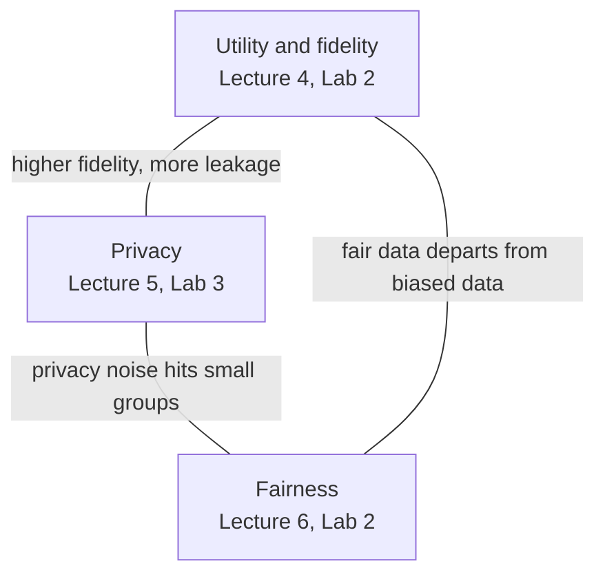

**Week 1** · 2 hours · Background for all learning outcomes; prepares [LO3](../../01-about/#learning-outcomes)

## Slides



## Overview

This lecture sets out why researchers turn to synthetic data and what synthetic data can and cannot do for them. We start from the limits on access to real data. These include the General Data Protection Regulation (GDPR), the European Health Data Space (EHDS) Regulation, the AI Act and Swedish ethical review, as well as data-sharing agreements and commercial interests. We then define synthetic data, trace its origins in statistical disclosure control and survey its main uses.

The second half asks whether synthetic data is anonymous. Law and the privacy literature answer this question in different ways, and the gap between them motivates the three properties that structure the course: utility, privacy and fairness. We close with a topic that has no lecture of its own, the energy use of training generative models, and with a roadmap of the course. The lecture gives background for all five learning outcomes and prepares LO3 in particular: you cannot assess the risk of releasing a synthetic dataset until you know which rules decide what counts as a risk.

## Learning goals

After this lecture, you should be able to:

1. State the GDPR definitions of personal data and pseudonymisation and the Recital 26 test for anonymous information, and apply them to a proposed release of synthetic data (prepares LO3).
2. Explain what the AI Act and the EHDS Regulation say about synthetic, anonymised and pseudonymised data, and name the questions they leave open (prepares LO3).
3. Distinguish fully from partially synthetic data, and match each main use of synthetic data to the property of the real data it must preserve (background for LO1 and LO2).
4. Argue from published attacks why synthetic data is not anonymous by construction, and describe the trade-offs between utility, privacy and fairness that you evaluate later in the course (LO2 and LO3).
5. Explain how CodeCarbon estimates energy use and emissions, where its estimates can go wrong, and how to report them so that comparisons between your models hold (supports LO4).

## Before the lecture

Read these before the session.

1. Jordon, J., et al. (2022). [Synthetic Data – what, why and how?](https://arxiv.org/abs/2205.03257) Read Sections 1 to 5. Look for the definition of synthetic data in Section 2 and for the separation of utility, fidelity and privacy in Section 5.
2. Stadler, T., Oprisanu, B., & Troncoso, C. (2022). [Synthetic Data – Anonymisation Groundhog Day](https://www.usenix.org/conference/usenixsecurity22/presentation/stadler). Read Sections 1, 3 and 7. Look for how the privacy gain is defined and which records stay exposed.
3. The GDPR, [Regulation (EU) 2016/679](https://eur-lex.europa.eu/eli/reg/2016/679/oj): Recital 26, Article 4(1) and (5), Article 9 and Article 89(1), about two pages in all. Look for the phrase "means reasonably likely to be used" and ask who the person using those means could be.
4. European Data Protection Board (2026). [Guidelines 02/2026 on Anonymisation](https://www.edpb.europa.eu/system/files_en?file=2026-09/edpb_guidelines_202602_anonymisation_v1_en_0.pdf). Look for how the guidelines judge whether data are anonymous, and what they say about synthetic data.

> [!TIP] Start your reflection now
> Before the lecture, write three or four sentences on what you believe synthetic data can and cannot do for your own research. Keep the note. In the [reflection report](../../06-project/#reflection-report) you compare it with your views at the end of the course (LO5).

## Lecture notes

### Why data access is hard

Most data about people is not freely available. Three kinds of limit stand in the way: legal limits from data protection law, institutional limits from ethical review and data-sharing agreements, and commercial limits from companies that hold data as an asset. Synthetic data is often proposed as a way past all three. This lecture examines when that proposal holds.

### The GDPR: personal, pseudonymised and anonymous data

The GDPR ([Regulation (EU) 2016/679](https://eur-lex.europa.eu/eli/reg/2016/679/oj)) applies to personal data, which Article 4(1) defines as "any information relating to an identified or identifiable natural person ('data subject')". A person is identifiable if they "can be identified, directly or indirectly", so a record without a name can still be personal data.

Processing, in Article 4(2), is "any operation or set of operations which is performed on personal data". The Article 29 Working Party, the EU advisory body on data protection under the former Directive 95/46/EC, treats anonymisation itself as "a further processing of personal data" ([Article 29 Working Party, 2014](https://ec.europa.eu/justice/article-29/documentation/opinion-recommendation/files/2014/wp216_en.pdf)). On the same reading, training a generator on personal data is processing. It needs a legal basis even if its output turns out to be anonymous.

Article 4(5) defines pseudonymisation as processing after which data "can no longer be attributed to a specific data subject without the use of additional information", provided that this information "is kept separately". Recital 26 states that such data "should be considered to be information on an identifiable natural person". Replacing names with codes does not take data out of the GDPR.

Recital 26 also sets the test for anonymity. The GDPR does not apply to "anonymous information", which includes data "rendered anonymous in such a manner that the data subject is not or no longer identifiable". Identifiability depends on "all the means reasonably likely to be used, such as singling out, either by the controller or by another person". These means are judged by "all objective factors", among them cost, time and "the available technology at the time of the processing and technological developments".

Three consequences follow for synthetic data. First, anonymity is a property of data in a context, not of a method: one synthetic dataset can be anonymous in one release and personal data in another. Second, the test looks forward, so an attack published after a release can change the verdict. Third, the word "synthetic" does not appear in the GDPR; a synthetic dataset faces the same test as any other.

Article 9(1) prohibits the processing of special categories of personal data, among them data "revealing racial or ethnic origin", genetic data, biometric data used to identify a person, "data concerning health" and data on a person's "sex life or sexual orientation". Article 9(2)(j) allows processing for research "in accordance with Article 89(1)", on the basis of Union or Member State law with safeguards. Article 89(1) adds: "Where those purposes can be fulfilled by further processing which does not permit or no longer permits the identification of data subjects, those purposes shall be fulfilled in that manner." The law thus pushes research on health data and protected attributes towards data that identifies no one, the gap synthetic data is meant to fill.

> [!NOTE] Is identifiability relative to the recipient?
> In *EDPS v SRB* (Case C-413/23 P, 4 September 2025), the Court of Justice held that pseudonymised data "must not be regarded as constituting, in all cases and for every person, personal data" (paragraph 86). Where third parties may have means to re-identify, the data remain personal (paragraph 85). The case concerned Regulation (EU) 2018/1725 for EU institutions, whose Recital 16, as quoted in the judgment, matches GDPR Recital 26 ([Court of Justice of the European Union, 2025](https://eur-lex.europa.eu/legal-content/EN/TXT/?uri=CELEX:62023CJ0413)). Applying the judgment to synthetic data is an interpretation, not a holding of the Court.

### Institutional and commercial limits

In Sweden, the Ethical Review Act ([Lag (2003:460) om etikprövning av forskning som avser människor](https://www.riksdagen.se/sv/dokument-och-lagar/dokument/svensk-forfattningssamling/lag-2003460-om-etikprovning-av-forskning-som_sfs-2003-460/)) covers research that processes sensitive personal data in the sense of GDPR Article 9(1), or personal data about criminal offences (section 3). Such research may be carried out only after approval in an ethical review (section 6). The Swedish Ethical Review Authority (Etikprövningsmyndigheten) decides on applications (section 24). Amended versions of sections 6 and 24 take effect on 1 July 2027.

Data holders add procedures of their own. [Raghunathan, Reiter and Rubin (2003)](https://www.scb.se/contentassets/ca21efb41fee47d293bbee5bf7be7fb3/multiple-imputation-for-statistical-disclosure-limitation.pdf) describe access to restricted survey microdata: a detailed proposal with a list of variables and a rationale, review by a committee, and access "only for the requested variables". Data-sharing agreements play a similar role between institutions, and companies may not share their data at all. [Jordon et al. (2022)](https://arxiv.org/abs/2205.03257) call the result a long series of "jumping through hoops". One of their use cases is a data controller that shares synthetic data with candidate partners to choose which one to work with.

### Health data and the European Health Data Space

The EHDS Regulation ([Regulation (EU) 2025/327](https://eur-lex.europa.eu/eli/reg/2025/327/oj)) of 11 February 2025 aims at "facilitating access to electronic health data" for primary use, that is, the provision of healthcare, and for secondary use (Articles 1(1) and 2). The purposes of secondary use include scientific research and the "training, testing and evaluation of algorithms" (Article 53(1)(e)). The Regulation applies from 26 March 2027, and its chapter on secondary use from 26 March 2029, with exceptions (Article 105).

Under Article 66(2), health data access bodies "shall provide electronic health data in an anonymised format, where the purpose of processing by the health data user can be achieved with such data". Pseudonymised data follow only if the user shows that anonymised data cannot serve the purpose (Article 66(3)). Recital 92 warns that even "state-of-the-art anonymisation techniques" leave a residual risk of re-identification, in particular for rare diseases affecting "not more than 5 in 10 000 persons in the Union". The Regulation does not mention synthetic data. Whether a synthetic dataset counts as "an anonymised format" is an open question, and the answer turns on the Recital 26 test.

### The AI Act: data governance and bias detection

The AI Act ([Regulation (EU) 2024/1689](https://eur-lex.europa.eu/eli/reg/2024/1689/oj)) requires that the data of high-risk AI systems undergo "examination in view of possible biases that are likely to affect the health and safety of persons, have a negative impact on fundamental rights or lead to discrimination prohibited under Union law" (Article 10(2)(f)), followed by "appropriate measures to detect, prevent and mitigate possible biases" (Article 10(2)(g)). Data sets "shall be relevant, sufficiently representative, and to the best extent possible, free of errors and complete in view of the intended purpose" (Article 10(3)).

Bias detection usually needs the protected attribute, often a special category under GDPR Article 9. The original Article 10(5) therefore let providers "exceptionally process special categories of personal data" for bias detection and correction, under six conditions. The first was that "the bias detection and correction cannot be effectively fulfilled by processing other data, including synthetic or anonymised data". The Digital Omnibus on AI ([Regulation (EU) 2026/1744](https://eur-lex.europa.eu/eli/reg/2026/1744/oj)) of 8 July 2026 deleted Article 10(5) and moved the provision, with this condition unchanged, to a new Article 4a. Article 4a(2) extends the exception to other AI systems and models and to deployers of high-risk systems. The high-risk requirements now apply from 2 December 2027 for Annex III systems and from 2 August 2028 for Annex I systems.

Article 59(1)(b) uses similar wording for regulatory sandboxes: personal data collected for other purposes may be used there only where the requirements "cannot effectively be fulfilled by processing anonymised, synthetic or other non-personal data". Article 50(2) uses the word in another sense: providers of systems "generating synthetic audio, image, video or text content" must mark the outputs as artificially generated.

Synthetic data must therefore fall short before special-category data may be used for bias detection. It can support bias detection only if it keeps the joint distribution of protected attributes, labels and other features, including for small groups. The text does not say how to show that synthetic data "cannot effectively" serve the purpose; that test is an open problem, and [Lecture 6](../lecture-6/) returns to it.

### What synthetic data is

[Jordon et al. (2022)](https://arxiv.org/abs/2205.03257) define synthetic data as "data that has been generated using a purpose-built mathematical model or algorithm, with the aim of solving a (set of) data science task(s)". In this course the model is learnt from real data. Let $D = (x_1, \dots, x_n)$ be a real dataset whose records come from an unknown distribution $P$. A training algorithm $\mathcal{A}$ fits a model $P_{\hat\theta} = \mathcal{A}(D)$, and you release $S = (\tilde{x}_1, \dots, \tilde{x}_m)$ sampled from $P_{\hat\theta}$, as in the formalisation of [Stadler et al. (2022)](https://www.usenix.org/conference/usenixsecurity22/presentation/stadler). The synthetic records depend on the real ones only through $\hat\theta$, which explains both why synthetic data can be useful (the model has learnt about $P$) and why it can leak (it has also learnt about each $x_i$).

The idea is older than deep learning. [Rubin (1993)](https://www.scb.se/contentassets/ca21efb41fee47d293bbee5bf7be7fb3/discussion-statistical-disclosure-limitation2.pdf) proposed "to release no actual microdata but only synthetic microdata, constructed using multiple imputation so that they can be validly analyzed using standard statistical software". In such fully synthetic data, every released record is drawn from a model. Raghunathan, Reiter and Rubin (2003) worked out how to analyse it. The data holder releases $M$ synthetic datasets; you compute a point estimate $q^{(l)}$ and its variance $v^{(l)}$ on each dataset $l$ and combine them:

$$
\bar{q}_M = \frac{1}{M}\sum_{l=1}^{M} q^{(l)}, \qquad
b_M = \frac{1}{M-1}\sum_{l=1}^{M}\left(q^{(l)} - \bar{q}_M\right)^2, \qquad
\bar{v}_M = \frac{1}{M}\sum_{l=1}^{M} v^{(l)}
$$

$$
T_M = \left(1 + \frac{1}{M}\right) b_M - \bar{v}_M
$$

Here $\bar{q}_M$ and $T_M$ serve as the approximate posterior mean and variance of the quantity of interest. The minus sign is intended: each synthetic sample is drawn from a synthetic population, so $b_M$ already contains the usual within-dataset variability, and $T_M$ can even be negative. The lesson carries over to deep generative models: one synthetic dataset analysed as if it were real understates uncertainty.

[Little (1993)](https://www.scb.se/contentassets/ca21efb41fee47d293bbee5bf7be7fb3/statistical-analysis-of-masked-data.pdf) set out a likelihood theory for data masked for confidentiality, with masking methods that include imputation and the "simulation of artificial records". Partially synthetic data keep the real records but replace some values. [Reiter (2003)](https://www150.statcan.gc.ca/n1/pub/12-001-x/2003002/article/6785-eng.pdf) describes data sets that comprise "the units originally surveyed, but some collected values, for example sensitive values at high risk of disclosure or values of key identifiers, are replaced with multiple imputations"; the US Federal Reserve Board used this approach for monetary values in the Survey of Consumer Finances. Write each record as $x = (x_{\mathrm{q}}, x_{\mathrm{s}})$. The release keeps every $x_{\mathrm{q}}$ and draws new $x_{\mathrm{s}}$ from a model of $P(x_{\mathrm{s}} \mid x_{\mathrm{q}})$, which is easier to fit than the full joint distribution. The kept values, however, tie each record to a real person, and Jordon et al. (2022) call the approach "trivially vulnerable to membership inference attacks".

### What synthetic data is used for

Each use asks the synthetic data to preserve a different property of the real data.

| Use | What the synthetic data must preserve | Example |
|---|---|---|
| Privacy-preserving release | The statistics that analysts will estimate | Synthetic data for a US Census Bureau application that maps commuting patterns ([Machanavajjhala et al., 2008](https://doi.org/10.1109/ICDE.2008.4497436)) |
| Sharing for model development | The ranking of methods: a model that wins on synthetic data should win on real data | Choosing a partner on synthetic data ([Jordon et al., 2022](https://arxiv.org/abs/2205.03257)) |
| Augmentation | The class-conditional distribution where real examples are scarce | GAN-generated liver lesion images ([Frid-Adar et al., 2018](https://doi.org/10.1016/j.neucom.2018.09.013)) |
| Testing and simulation | Valid values and structure, not necessarily the statistics | Synthea synthetic patient records ([Walonoski et al., 2018](https://doi.org/10.1093/jamia/ocx079)) |
| Fairness intervention | The task-relevant relations, with selected biased relations removed | FairGAN ([Xu et al., 2018](https://doi.org/10.1109/BigData.2018.8622525)), DECAF ([van Breugel et al., 2021](https://proceedings.neurips.cc/paper/2021/hash/ba9fab001f67381e56e410575874d967-Abstract.html)), Bt-GAN ([Ramachandranpillai et al., 2024](https://doi.org/10.1613/jair.1.15317)) |

On computed tomography images of 182 liver lesions, the classifier of Frid-Adar et al. (2018) reached 78.6% sensitivity and 88.4% specificity; adding GAN-generated lesions raised these to 85.7% and 92.4%. Synthea simulates the lifespans of synthetic patients with models of disease progression and care (Walonoski et al., 2018). For software testing, Jordon et al. (2022) note that synthetic data must be "semantically correct, but it need not necessarily be statistically correct". The fairness methods change what the generator learns: DECAF, for example, embeds a structural causal model so that biased causal edges can be removed when sampling, and Bt-GAN preserves subgroup densities in synthetic health records through score-based weighted sampling. Jordon et al. (2022) still recommend that any model to be deployed be evaluated, and if necessary fine-tuned, on real data.

### Is synthetic data anonymous?

The argument for anonymity is that synthetic records are artificial, so no direct link exists between a real and a synthetic record. Stadler et al. (2022) report that many studies accepted this argument and measured privacy with similarity tests between real and synthetic records.

The question matters because removing identifiers has failed before. [Narayanan and Shmatikov (2008)](https://doi.org/10.1109/SP.2008.33) linked records in the anonymised Netflix Prize ratings dataset to public profiles on the Internet Movie Database. [Rocher, Hendrickx and de Montjoye (2019)](https://doi.org/10.1038/s41467-019-10933-3) estimate that "99.98% of Americans would be correctly re-identified in any dataset using 15 demographic attributes". The Article 29 Working Party (2014) assesses anonymisation against three risks: singling out, linkability and inference, and states that "pseudonymisation is not a method of anonymisation".

Stadler et al. (2022) build privacy games on the linkability and inference risks. An adversary $\mathcal{A}$ tries to learn whether a target record $r_t$ was in the training data (linkability, modelled as membership inference) or the value of one of its attributes (inference). The privacy gain of publishing synthetic data $S$ in place of the raw data $R$ is the drop in the adversary's advantage:

$$
\mathrm{PG}(r_t) = \mathrm{Adv}_{\mathcal{A}}(R, r_t) - \mathrm{Adv}_{\mathcal{A}}(S, r_t)
$$

An anonymisation mechanism should give a high gain for every record, not only on average. Stadler et al. find that synthetic data from models without explicit privacy protection does not protect outlier records from linkage. Differentially private synthetic data protects them, but at a cost in utility, and you cannot predict which properties of the data survive. Two implementations of differentially private generators even violated their formal guarantees. Their conclusion is that synthetic data "does not provide a better tradeoff between privacy and utility than traditional anonymisation techniques".

Later attacks reach further. [Annamalai, Gadotti and Rocher (2024)](https://www.usenix.org/conference/usenixsecurity24/presentation/annamalai) build an attribute inference attack from linear reconstruction that is accurate on arbitrary records, not only outliers; releasing more synthetic records improves utility but makes the attack more effective. [Carlini et al. (2023)](https://www.usenix.org/conference/usenixsecurity23/presentation/carlini) show that image diffusion models memorise individual training images, and extract "over a thousand training examples".

The legal test and the technical evidence do not map onto each other: Recital 26 asks about means reasonably likely to be used, while the privacy literature measures an adversary's advantage under a stated threat model. No accepted rule converts a privacy gain, or the parameter $\varepsilon$ of differential privacy, into a Recital 26 verdict. The literature also disagrees on the overall answer: Stadler et al. (2022) quote claims that synthetic datasets "contain no personal data", while Jordon et al. (2022) state that "Synthetic data is not automatically private." In this course you treat the anonymity of a synthetic dataset as a claim to test against stated attacks, record by record. [Lecture 5](../lecture-5/) covers differential privacy and privacy attacks, and [Lab 3](../../04-labs/lab-3/) is the privacy evaluation lab.

### Utility, privacy and fairness

Jordon et al. (2022) name three properties of synthetic data. Utility is usefulness for a task, often measured by training on synthetic data and testing on real data. Fidelity is how well the synthetic data "statistically" matches the real data. Privacy is "the amount of information that it reveals about the real data used to produce it". This course groups fidelity with utility, as [Lecture 4](../lecture-4/) does, and adds fairness: whether models trained on the synthetic data treat groups defined by protected attributes differently. The three properties pull against each other.



"As a rule of thumb, when fidelity increases, the privacy of synthetic data decreases" (Jordon et al., 2022). Privacy and fairness conflict too. [Ganev, Oprisanu and De Cristofaro (2022)](https://proceedings.mlr.press/v162/ganev22a.html) train three differentially private generators and find that differential privacy can shrink the gap between majority and minority subgroups (a "Robin Hood" effect) or widen it (a "Matthew" effect). Either way, classifiers trained on the synthetic data lose accuracy disproportionately on underrepresented subgroups. Fairness and fidelity conflict as well: a fair synthetic dataset departs on purpose from a biased real distribution, and Jordon et al. (2022) call a full statistical match "even undesirable in the presence of biases". They name two open problems. A predictor that is fair on synthetic data may not be fair on real data, because the feature distribution shifts. And a definition of fair synthetic data that does not depend on a given predictor is still missing. [Lecture 6](../lecture-6/) takes these up.

### Energy use of training generative models

Training generative models costs energy. [Strubell, Ganesh and McCallum (2019)](https://aclanthology.org/P19-1355/) estimated 626,155 lbs of CO<sub>2</sub>-equivalent for training a Transformer (big) model with neural architecture search, against 126,000 lbs for an average car over its lifetime including fuel. [Patterson et al. (2021)](https://arxiv.org/abs/2104.10350) dispute the search estimate. The search used a small proxy task. They therefore argue that the energy estimate was 18.7 times too high for an average organisation, and the emissions estimate 88 times too high for an energy-efficient organisation such as Google. The dispute shows that estimates depend on assumptions about hardware, data centre and grid, and that measuring during the run beats estimating afterwards.

[Lacoste et al. (2019)](https://arxiv.org/abs/1910.09700) name the main factors: the server's location and energy grid, the length of training and the hardware. [Henderson et al. (2020)](https://jmlr.org/papers/v21/20-312.html) argue for systematic reporting and provide a framework that tracks energy and carbon in real time. At deployment, "multi-purpose, generative architectures are orders of magnitude more expensive than task-specific systems" ([Luccioni, Jernite and Strubell, 2024](https://doi.org/10.1145/3630106.3658542)).

CodeCarbon estimates emissions as energy times the carbon intensity of the electricity ([CodeCarbon, 2026](https://docs.codecarbon.io/latest/explanation/methodology/)):

$$
\text{emissions} = E \times C, \qquad E = \sum_{k} P_k \, \Delta t \cdot \mathrm{PUE}
$$

Here $P_k$ is the power drawn by CPU, GPU and RAM in sampling interval $k$, $\Delta t$ is the interval (15 seconds by default), PUE is an optional multiplier for data-centre overhead (1.0 by default) and $C$ is in grams of CO<sub>2</sub>-equivalent per kilowatt-hour.

- **CPU.** CodeCarbon reads hardware energy counters where it can, for example Intel RAPL on Linux and the Energy Meter Interface on Windows 11. Otherwise it scales the thermal design power (TDP) of the CPU model by load: in the default machine mode, $\mathrm{TDP} \times (0.1 + 0.9\,u^3)$ for load $u \in [0, 1]$.
- **GPU.** NVIDIA GPUs are read through NVML; without a supported library, GPU energy is not counted.
- **RAM.** No counter is available, so power is modelled from an estimated number of memory modules, at 5 W for each of the first four on x86 machines.
- **Carbon intensity.** CodeCarbon tries in turn a value you set, the cloud region, a live value from Electricity Maps, regional data (including the Swedish bidding zones SE1 to SE4), the country value, and finally a world average of 475 gCO<sub>2</sub>eq/kWh.

The documentation is open about error ([CodeCarbon, 2026](https://docs.codecarbon.io/latest/explanation/accuracy/)). On four profiled CPUs, the TDP-based estimate "deviated from RAPL by roughly −60% to +190%", and the world-average carbon intensity can be wrong "by close to an order of magnitude". The output file does not record which method produced a number. The documentation therefore advises you to compare within one machine, not across machines.

> [!IMPORTANT] Logging energy in the labs
> Log every training run in the labs and the project. A container on Windows or macOS runs inside a Linux virtual machine, so CodeCarbon may not reach the hardware counters and may fall back to the TDP estimate. The start-up log names the CPU tracking method; record it. A minimal set-up, which the lab instructions refine:
>
> ```python
> from codecarbon import OfflineEmissionsTracker
>
> tracker = OfflineEmissionsTracker(country_iso_code="SWE", project_name="lab1-ctgan", output_dir="emissions")
> tracker.start()
> model.fit(train_data)            # the training run you measure
> emissions_kg = tracker.stop()    # kg CO2eq; details in emissions/emissions.csv
> ```
>
> For each run, report energy in kWh, emissions, duration and the CPU tracking method. Compare models only on the same machine with the same set-up, and report energy next to emissions, since energy does not depend on the assumed grid.

### Course roadmap

| Week | Session | Focus |
|:----:|---|---|
| 1 | Lecture 1 | Data access, regulation, the three properties |
| 2 | [Lecture 2: VAEs and GANs](../lecture-2/) | Training objectives and their output (LO1) |
| 3 | [Lecture 3: Diffusion models, transformers and LLMs](../lecture-3/) | Newer model families (LO1) |
| 4 | [Paper seminar 1](../../05-paper-seminars/#paper-seminar-1-generative-model-families), [Lab 1](../../04-labs/lab-1/) | Failure modes of CTGAN, TVAE, TimeGAN and TransFusion (LO1) |
| 5 | [Lecture 4](../lecture-4/) | Fidelity and utility (LO2) |
| 6 | [Lecture 5](../lecture-5/) | Differential privacy and attacks (LO2, LO3) |
| 7 | [Lecture 6](../lecture-6/), [Lab 2](../../04-labs/lab-2/) | Fairness; utility and fairness evaluation (LO2, LO3) |
| 8 | [Guest lecture](../guest-lecture/), [Lab 3](../../04-labs/lab-3/) | Synthetic data in healthcare; privacy evaluation (LO2, LO3) |
| 9 | [Paper seminar 2](../../05-paper-seminars/#paper-seminar-2-privacy-and-fairness) | Privacy and fairness papers |
| 10 | [Project presentations](../../06-project/#presentation) | Your own domain problem (LO4, LO5) |

## Discussion questions

1. Recital 26 counts the means "reasonably likely to be used ... either by the controller or by another person". For a synthetic dataset, who is that other person? Compare a release to one research partner under contract with a public release, and say how *EDPS v SRB* bears on each case.

   
Ask who holds auxiliary data about the people in the training set, which published attacks apply (Stadler et al., 2022; Annamalai et al., 2024), and whether a contract counts as a technical and organisational measure. Keep in mind that the judgment concerns pseudonymised data, not synthetic data.


2. Article 4a(1)(a) of the AI Act allows special-category data for bias detection only if the task "cannot be effectively fulfilled by processing other data, including synthetic or anonymised data". Propose a procedure a provider could follow to show that synthetic data falls short. What must it measure for small groups?

   
Think about whether bias estimates on synthetic data agree with those on real data, group by group, and about the subgroup distortions that differential privacy can cause (Ganev et al., 2022). The procedure itself needs access to the real special-category data, which raises a question of its own.


3. Stadler et al. (2022) define the privacy gain per target record. Why does a per-record measure matter more than an average over records? Relate your answer to outliers, to members of small groups and to the findings of Ganev et al. (2022).

4. Under Article 66(2) of the EHDS Regulation, health data access bodies provide data "in an anonymised format" where this serves the purpose. Should a synthetic dataset from a differentially private generator count? What evidence should the body ask for, and who should carry the burden of showing it?

5. Fully synthetic data needs its own combining rules (Raghunathan et al., 2003), yet most machine learning papers train once on a single synthetic dataset. What do you lose by ignoring the extra variance, and when does the loss change a research conclusion?

6. You train two generators in the course container on your laptop, and CodeCarbon reports that it used the CPU-load estimate. Which comparisons can you defend with these numbers, and which can you not? How would you report them in your project?

## Further reading

- Drechsler, J. (2011). *[Synthetic Datasets for Statistical Disclosure Control: Theory and Implementation](https://doi.org/10.1007/978-1-4614-0326-5)*. Springer. A book-length treatment of fully and partially synthetic data from the statistical side.
- Raghunathan, T. E., Reiter, J. P., & Rubin, D. B. (2003). [Multiple Imputation for Statistical Disclosure Limitation](https://www.scb.se/contentassets/ca21efb41fee47d293bbee5bf7be7fb3/multiple-imputation-for-statistical-disclosure-limitation.pdf). Read it in full for the derivation of the combining rules and the simulations on the 1994 US Consumer Expenditure Survey.
- Article 29 Data Protection Working Party (2014). [Opinion 05/2014 on Anonymisation Techniques](https://ec.europa.eu/justice/article-29/documentation/opinion-recommendation/files/2014/wp216_en.pdf). Read the assessment of each technique against singling out, linkability and inference.
- Rocher, L., Hendrickx, J. M., & de Montjoye, Y.-A. (2019). [Estimating the success of re-identifications in incomplete datasets using generative models](https://doi.org/10.1038/s41467-019-10933-3). A copula-based model that estimates the chance that a specific person is correctly re-identified, even in a heavily incomplete dataset.
- Annamalai, M. S. M. S., Gadotti, A., & Rocher, L. (2024). [A Linear Reconstruction Approach for Attribute Inference Attacks against Synthetic Data](https://www.usenix.org/conference/usenixsecurity24/presentation/annamalai). An attack that targets arbitrary records, with results for several generator families.
- Ganev, G., Oprisanu, B., & De Cristofaro, E. (2022). [Robin Hood and Matthew Effects: Differential Privacy Has Disparate Impact on Synthetic Data](https://proceedings.mlr.press/v162/ganev22a.html). How differential privacy changes subgroup sizes in synthetic data, and what that does to downstream accuracy.
- Henderson, P., et al. (2020). [Towards the Systematic Reporting of the Energy and Carbon Footprints of Machine Learning](https://jmlr.org/papers/v21/20-312.html). A framework and a set of practices for reporting energy use and carbon emissions.
- Patterson, D., et al. (2021). [Carbon Emissions and Large Neural Network Training](https://arxiv.org/abs/2104.10350). Energy and emissions figures for several large language models, and the re-estimate of the neural architecture search case.

## References

- Annamalai, M. S. M. S., Gadotti, A., & Rocher, L. (2024). A Linear Reconstruction Approach for Attribute Inference Attacks against Synthetic Data. In *33rd USENIX Security Symposium (USENIX Security 24)*, 2351–2368. [usenix.org](https://www.usenix.org/conference/usenixsecurity24/presentation/annamalai)
- Article 29 Data Protection Working Party. (2014). *Opinion 05/2014 on Anonymisation Techniques* (WP216), adopted on 10 April 2014. [ec.europa.eu](https://ec.europa.eu/justice/article-29/documentation/opinion-recommendation/files/2014/wp216_en.pdf)
- Carlini, N., Hayes, J., Nasr, M., Jagielski, M., Sehwag, V., Tramèr, F., Balle, B., Ippolito, D., & Wallace, E. (2023). Extracting Training Data from Diffusion Models. In *32nd USENIX Security Symposium (USENIX Security 23)*, 5253–5270. [usenix.org](https://www.usenix.org/conference/usenixsecurity23/presentation/carlini)
- CodeCarbon. (2026). *Methodology* and *Accuracy and validation*. CodeCarbon documentation, accessed 10 November 2026. [Methodology](https://docs.codecarbon.io/latest/explanation/methodology/) · [Accuracy](https://docs.codecarbon.io/latest/explanation/accuracy/)
- Court of Justice of the European Union. (2025). Judgment of 4 September 2025, *European Data Protection Supervisor v Single Resolution Board*, Case C-413/23 P. [EUR-Lex](https://eur-lex.europa.eu/legal-content/EN/TXT/?uri=CELEX:62023CJ0413)
- Drechsler, J. (2011). *Synthetic Datasets for Statistical Disclosure Control: Theory and Implementation*. Lecture Notes in Statistics, vol. 201. Springer. [doi:10.1007/978-1-4614-0326-5](https://doi.org/10.1007/978-1-4614-0326-5)
- Frid-Adar, M., Diamant, I., Klang, E., Amitai, M., Goldberger, J., & Greenspan, H. (2018). GAN-based synthetic medical image augmentation for increased CNN performance in liver lesion classification. *Neurocomputing*, 321, 321–331. [doi:10.1016/j.neucom.2018.09.013](https://doi.org/10.1016/j.neucom.2018.09.013)
- Ganev, G., Oprisanu, B., & De Cristofaro, E. (2022). Robin Hood and Matthew Effects: Differential Privacy Has Disparate Impact on Synthetic Data. In *Proceedings of the 39th International Conference on Machine Learning*, PMLR 162, 6944–6959. [proceedings.mlr.press](https://proceedings.mlr.press/v162/ganev22a.html)
- Henderson, P., Hu, J., Romoff, J., Brunskill, E., Jurafsky, D., & Pineau, J. (2020). Towards the Systematic Reporting of the Energy and Carbon Footprints of Machine Learning. *Journal of Machine Learning Research*, 21(248), 1–43. [jmlr.org](https://jmlr.org/papers/v21/20-312.html)
- Jordon, J., Szpruch, L., Houssiau, F., Bottarelli, M., Cherubin, G., Maple, C., Cohen, S. N., & Weller, A. (2022). Synthetic Data – what, why and how? arXiv:2205.03257. [arXiv](https://arxiv.org/abs/2205.03257)
- Lacoste, A., Luccioni, A., Schmidt, V., & Dandres, T. (2019). Quantifying the Carbon Emissions of Machine Learning. arXiv:1910.09700. [arXiv](https://arxiv.org/abs/1910.09700)
- Lag (2003:460) om etikprövning av forskning som avser människor [Swedish Ethical Review Act]. Svensk författningssamling. [riksdagen.se](https://www.riksdagen.se/sv/dokument-och-lagar/dokument/svensk-forfattningssamling/lag-2003460-om-etikprovning-av-forskning-som_sfs-2003-460/)
- Little, R. J. A. (1993). Statistical Analysis of Masked Data. *Journal of Official Statistics*, 9(2), 407–426. [scb.se](https://www.scb.se/contentassets/ca21efb41fee47d293bbee5bf7be7fb3/statistical-analysis-of-masked-data.pdf)
- Luccioni, S., Jernite, Y., & Strubell, E. (2024). Power Hungry Processing: Watts Driving the Cost of AI Deployment? In *Proceedings of the 2024 ACM Conference on Fairness, Accountability, and Transparency (FAccT '24)*, 85–99. [doi:10.1145/3630106.3658542](https://doi.org/10.1145/3630106.3658542)
- Machanavajjhala, A., Kifer, D., Abowd, J., Gehrke, J., & Vilhuber, L. (2008). Privacy: Theory meets Practice on the Map. In *2008 IEEE 24th International Conference on Data Engineering*, 277–286. [doi:10.1109/ICDE.2008.4497436](https://doi.org/10.1109/ICDE.2008.4497436)
- Narayanan, A., & Shmatikov, V. (2008). Robust De-anonymization of Large Sparse Datasets. In *2008 IEEE Symposium on Security and Privacy*, 111–125. [doi:10.1109/SP.2008.33](https://doi.org/10.1109/SP.2008.33)
- Patterson, D., Gonzalez, J., Le, Q., Liang, C., Munguia, L.-M., Rothchild, D., So, D., Texier, M., & Dean, J. (2021). Carbon Emissions and Large Neural Network Training. arXiv:2104.10350. [arXiv](https://arxiv.org/abs/2104.10350)
- Raghunathan, T. E., Reiter, J. P., & Rubin, D. B. (2003). Multiple Imputation for Statistical Disclosure Limitation. *Journal of Official Statistics*, 19(1), 1–16. [scb.se](https://www.scb.se/contentassets/ca21efb41fee47d293bbee5bf7be7fb3/multiple-imputation-for-statistical-disclosure-limitation.pdf)
- Ramachandranpillai, R., Sikder, M. F., Bergström, D., & Heintz, F. (2024). Bt-GAN: Generating Fair Synthetic Healthdata via Bias-transforming Generative Adversarial Networks. *Journal of Artificial Intelligence Research*, 79, 1313–1341. [doi:10.1613/jair.1.15317](https://doi.org/10.1613/jair.1.15317)
- Regulation (EU) 2016/679 of the European Parliament and of the Council of 27 April 2016 (General Data Protection Regulation). *Official Journal of the European Union*, L 119, 4.5.2016. [EUR-Lex](https://eur-lex.europa.eu/eli/reg/2016/679/oj)
- Regulation (EU) 2024/1689 of the European Parliament and of the Council of 13 June 2024 (Artificial Intelligence Act). *Official Journal of the European Union*, L series, 12.7.2024. [EUR-Lex](https://eur-lex.europa.eu/eli/reg/2024/1689/oj)
- Regulation (EU) 2025/327 of the European Parliament and of the Council of 11 February 2025 on the European Health Data Space. *Official Journal of the European Union*, L series, 5.3.2025. [EUR-Lex](https://eur-lex.europa.eu/eli/reg/2025/327/oj)
- Regulation (EU) 2026/1744 of the European Parliament and of the Council of 8 July 2026 (Digital Omnibus on AI). *Official Journal of the European Union*, L series, 24.7.2026. [EUR-Lex](https://eur-lex.europa.eu/eli/reg/2026/1744/oj)
- Reiter, J. P. (2003). Inference for Partially Synthetic, Public Use Microdata Sets. *Survey Methodology*, 29(2), 181–188. [statcan.gc.ca](https://www150.statcan.gc.ca/n1/pub/12-001-x/2003002/article/6785-eng.pdf)
- Rocher, L., Hendrickx, J. M., & de Montjoye, Y.-A. (2019). Estimating the success of re-identifications in incomplete datasets using generative models. *Nature Communications*, 10, 3069. [doi:10.1038/s41467-019-10933-3](https://doi.org/10.1038/s41467-019-10933-3)
- Rubin, D. B. (1993). Discussion: Statistical Disclosure Limitation. *Journal of Official Statistics*, 9(2), 461–468. [scb.se](https://www.scb.se/contentassets/ca21efb41fee47d293bbee5bf7be7fb3/discussion-statistical-disclosure-limitation2.pdf)
- Stadler, T., Oprisanu, B., & Troncoso, C. (2022). Synthetic Data – Anonymisation Groundhog Day. In *31st USENIX Security Symposium (USENIX Security 22)*, 1451–1468. [usenix.org](https://www.usenix.org/conference/usenixsecurity22/presentation/stadler)
- Strubell, E., Ganesh, A., & McCallum, A. (2019). Energy and Policy Considerations for Deep Learning in NLP. In *Proceedings of the 57th Annual Meeting of the Association for Computational Linguistics*, 3645–3650. [doi:10.18653/v1/P19-1355](https://doi.org/10.18653/v1/P19-1355)
- van Breugel, B., Kyono, T., Berrevoets, J., & van der Schaar, M. (2021). DECAF: Generating Fair Synthetic Data Using Causally-Aware Generative Networks. In *Advances in Neural Information Processing Systems 34*. [proceedings.neurips.cc](https://proceedings.neurips.cc/paper/2021/hash/ba9fab001f67381e56e410575874d967-Abstract.html)
- Walonoski, J., Kramer, M., Nichols, J., Quina, A., Moesel, C., Hall, D., Duffett, C., Dube, K., Gallagher, T., & McLachlan, S. (2018). Synthea: An approach, method, and software mechanism for generating synthetic patients and the synthetic electronic health care record. *Journal of the American Medical Informatics Association*, 25(3), 230–238. [doi:10.1093/jamia/ocx079](https://doi.org/10.1093/jamia/ocx079)
- Xu, D., Yuan, S., Zhang, L., & Wu, X. (2018). FairGAN: Fairness-aware Generative Adversarial Networks. In *2018 IEEE International Conference on Big Data*, 570–575. [doi:10.1109/BigData.2018.8622525](https://doi.org/10.1109/BigData.2018.8622525)
