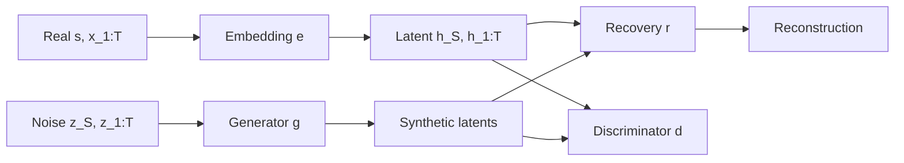

**Week 2** · 2 hours · Learning outcome [LO1](../../01-about/#learning-outcomes)

## Slides



## Overview

This lecture covers variational autoencoders (VAEs) and generative adversarial networks (GANs), the two families behind the tabular and time-series generators you train in Lab 1. For each family you derive the training objective, see which divergence it minimises when the networks have unlimited capacity, and follow what that implies for the records the model produces. The lecture then applies both families to the two data types of this course: tabular data, through CTGAN and TVAE, and time series, through RCGAN and TimeGAN.

The thread through the lecture is learning outcome LO1. A training objective decides which errors a model pays for and which it tolerates. Maximum likelihood pays heavily for missing any part of the data and little for implausible samples; the GAN objectives in common use tend to do the reverse. For synthetic data this decides whether rare subgroups survive and how closely the model copies its training records. Lecture 3 continues with diffusion and transformer-based models, and Lectures 4, 5 and 6 return to evaluation, privacy and fairness.

## Learning goals

After this lecture you should be able to:

1. Derive the evidence lower bound (ELBO) and the reparameterisation trick, and explain what the gap between the bound and the log-likelihood means for a trained VAE (LO1).
2. Derive the optimal discriminator and the Jensen–Shannon result of the original GAN, and state which quantity the non-saturating, f-divergence and Wasserstein variants minimise instead (LO1).
3. Explain each design choice in CTGAN, TVAE and TimeGAN as an answer to a specific property of tabular or time-series data (LO1, and in preparation for LO4).
4. Predict from a model's objective whether it tends to cover or drop rare modes, and whether it gives a per-record likelihood. Relate these predictions to the privacy and fairness risks of a release (LO1, LO3).
5. Identify where the literature disagrees about why VAE samples blur and why GANs collapse, and say what evidence each side offers (LO1).

## Before the lecture

Read these four papers. The note after each one says what to look for.

- Kingma, D. P., & Welling, M. (2014). Auto-Encoding Variational Bayes. *International Conference on Learning Representations (ICLR 2014)*. [arXiv:1312.6114](https://arxiv.org/abs/1312.6114). Read Sections 2 and 3: see how equations (1) to (3) split the log-likelihood, and why the reparameterisation in Section 2.4 makes the bound differentiable in the encoder parameters.
- Goodfellow, I. J., Pouget-Abadie, J., Mirza, M., Xu, B., Warde-Farley, D., Ozair, S., Courville, A., & Bengio, Y. (2014). Generative Adversarial Nets. *Advances in Neural Information Processing Systems*, 27. [Proceedings](https://proceedings.neurips.cc/paper_files/paper/2014/hash/f033ed80deb0234979a61f95710dbe25-Abstract.html) · [arXiv:1406.2661](https://arxiv.org/abs/1406.2661) (the arXiv version is titled "Generative Adversarial Networks"). Work through Proposition 1 and Theorem 1, then note the remark at the end of Section 4.2 that the proofs do not apply to the networks you actually train.
- Xu, L., Skoularidou, M., Cuesta-Infante, A., & Veeramachaneni, K. (2019). Modeling Tabular data using Conditional GAN. *Advances in Neural Information Processing Systems*, 32. [Proceedings](https://proceedings.neurips.cc/paper_files/paper/2019/hash/254ed7d2de3b23ab10936522dd547b78-Abstract.html) · [arXiv:1907.00503](https://arxiv.org/abs/1907.00503). Match each challenge listed in Section 3 to the component of CTGAN in Section 4 that addresses it.
- Yoon, J., Jarrett, D., & van der Schaar, M. (2019). Time-series Generative Adversarial Networks. *Advances in Neural Information Processing Systems*, 32. [Proceedings](https://proceedings.neurips.cc/paper_files/paper/2019/hash/c9efe5f26cd17ba6216bbe2a7d26d490-Abstract.html). Compare the global objective (1) with the local objective (2) in Section 3, and find which loss in Section 4.3 implements each.

## Lecture notes

### 1. Latent variable models and maximum likelihood

You observe records $x^{(1)}, \dots, x^{(N)}$, drawn independently from an unknown distribution $p_{\text{data}}$. A latent variable model explains each record through an unobserved variable $z$. First it draws $z$ from a prior $p(z)$, then it draws $x$ from a decoder $p_\theta(x \mid z)$, a neural network with parameters $\theta$. The model's distribution over records is the marginal

$$
p_\theta(x) = \int p_\theta(x \mid z)\, p(z)\, dz.
$$

Maximum likelihood chooses $\theta$ to maximise $\frac{1}{N}\sum_i \log p_\theta(x^{(i)})$. With infinite data this is the same as minimising the forward Kullback–Leibler (KL) divergence

$$
\mathrm{KL}(p_{\text{data}} \Vert p_\theta) = \mathbb{E}_{x \sim p_{\text{data}}}[\log p_{\text{data}}(x)] - \mathbb{E}_{x \sim p_{\text{data}}}[\log p_\theta(x)],
$$

because the first term does not depend on $\theta$ ([Goodfellow, 2016](https://arxiv.org/abs/1701.00160)). Keep the direction of this divergence in mind; Section 6 shows that it decides which errors the model tolerates.

With a neural decoder the integral has no closed form, so you can neither evaluate nor differentiate $\log p_\theta(x)$. The posterior $p_\theta(z \mid x) = p_\theta(x \mid z)\,p(z)/p_\theta(x)$ is intractable for the same reason, which rules out the expectation-maximisation (EM) algorithm ([Kingma and Welling, 2014](https://arxiv.org/abs/1312.6114)). The two families answer this problem in opposite ways. A VAE keeps the likelihood and maximises a lower bound on it. A GAN drops the likelihood and trains the generator by comparing its samples with real records.

### 2. Variational autoencoders

**Amortised inference.** A VAE adds an encoder $q_\phi(z \mid x)$: a second network that maps a record to a distribution over latent codes and approximates the true posterior $p_\theta(z \mid x)$. Classical variational inference fits separate variational parameters for every record. The encoder instead shares one set of parameters $\phi$ across all records, which is called amortised inference. Amortisation avoids a separate optimisation for each record, but it adds error. [Cremer et al. (2018)](https://proceedings.mlr.press/v80/cremer18a.html) split the gap between $\log p_\theta(x)$ and the bound into two parts. The approximation gap comes from the restricted family of $q$; the amortisation gap comes from the encoder not finding the best member of that family for each record. On their datasets the amortisation gap was often the larger part.

**The evidence lower bound.** For any encoder, the log-likelihood of a record splits into two terms ([Kingma and Welling, 2014](https://arxiv.org/abs/1312.6114)). Because $\log p_\theta(x)$ does not depend on $z$ and $p_\theta(x) = p_\theta(x, z)/p_\theta(z \mid x)$,

$$
\begin{aligned}
\log p_\theta(x) &= \mathbb{E}_{q_\phi(z \mid x)}\left[\log \frac{p_\theta(x, z)}{p_\theta(z \mid x)}\right] \\
&= \underbrace{\mathbb{E}_{q_\phi(z \mid x)}\left[\log \frac{p_\theta(x, z)}{q_\phi(z \mid x)}\right]}_{\mathcal{L}(\theta, \phi;\, x)} + \mathrm{KL}\big(q_\phi(z \mid x) \Vert p_\theta(z \mid x)\big).
\end{aligned}
$$

The KL term is non-negative, so $\mathcal{L}$ is a lower bound on $\log p_\theta(x)$. Writing $p_\theta(x, z) = p_\theta(x \mid z)\,p(z)$ gives the form you optimise:

$$
\mathcal{L}(\theta, \phi; x) = \mathbb{E}_{q_\phi(z \mid x)}[\log p_\theta(x \mid z)] - \mathrm{KL}\big(q_\phi(z \mid x) \Vert p(z)\big).
$$

The first term rewards reconstruction; the second keeps each encoded distribution close to the prior. Maximising $\mathcal{L}$ over $\phi$ tightens the bound. Maximising it over $\theta$ raises the bound in two ways: by raising the likelihood, or by making the true posterior easier for $q_\phi$ to match. Cremer et al. (2018) found evidence of the second effect, in which the decoder accommodates the chosen approximation.

**The reparameterisation trick.** The gradient with respect to $\phi$ is the hard part, because $\phi$ defines the distribution of the expectation. Kingma and Welling (2014) note that the usual Monte Carlo estimator of this gradient, which uses $\nabla_\phi \log q_\phi(z \mid x)$, has too much variance to be practical. They, and independently [Rezende et al. (2014)](https://proceedings.mlr.press/v32/rezende14.html), write the latent sample as a differentiable function of parameter-free noise. For a Gaussian encoder with diagonal covariance,

$$
z = \mu_\phi(x) + \sigma_\phi(x) \odot \epsilon, \qquad \epsilon \sim \mathcal{N}(0, I),
$$

so the expectation is over $\epsilon$, and gradients flow through $\mu_\phi$ and $\sigma_\phi$. With the prior $p(z) = \mathcal{N}(0, I)$ and $J$ latent dimensions, the KL term has a closed form (Kingma and Welling, 2014, equation 10):

$$
-\mathrm{KL}\big(q_\phi(z \mid x) \Vert p(z)\big) = \frac{1}{2}\sum_{j=1}^{J}\left(1 + \log \sigma_j^2 - \mu_j^2 - \sigma_j^2\right).
$$

The trick needs a distribution that you can reparameterise. Categorical variables cannot be written this way, which led [Jang et al. (2017)](https://arxiv.org/abs/1611.01144) to the Gumbel-softmax relaxation; CTGAN uses this relaxation for its discrete outputs (Section 4). For a longer treatment of VAEs, see [Kingma and Welling (2019)](https://doi.org/10.1561/2200000056).

**Averaging and blur.** Take a Gaussian decoder with fixed variance, $p_\theta(x \mid z) = \mathcal{N}(x; \mu_\theta(z), \sigma^2 I)$. Then $\log p_\theta(x \mid z) = -\lVert x - \mu_\theta(z)\rVert^2/(2\sigma^2) + \text{const}$, so the reconstruction term is a squared error. The squared error is minimised by the conditional mean. If several records receive overlapping codes, the decoder mean is their average. In images the average of several plausible outputs looks blurred, as [Goodfellow (2016)](https://arxiv.org/abs/1701.00160) illustrates for squared-error prediction. In a table, the average of two modes of a continuous column falls between them, where the real data has little mass. Multiplying $\mathcal{L}$ by $2\sigma^2$ shows that $\sigma^2$ also acts as a weight on the KL term.

The explanation of blur is disputed. [Zhao et al. (2017)](https://arxiv.org/abs/1702.08658) argue that blurry samples appear when conditions on the objective are not met, and they obtain sharp samples with a pixel-wise reconstruction loss. Goodfellow (2016) adds that GANs trained to approximate maximum likelihood still produce sharp samples, so the direction of the KL divergence alone does not explain the difference between the two families.

**Posterior collapse.** If the decoder can model $x$ without using $z$, the optimiser can set $q_\phi(z \mid x) = p(z)$ for some or all latent dimensions. The KL term then becomes zero and the decoder ignores the code. [Bowman et al. (2016)](https://aclanthology.org/K16-1002/) observed this with a recurrent (LSTM) decoder for sentences: with a straightforward implementation, most of their training runs drove the KL term to zero. They proposed KL annealing and word dropout as remedies. [Lucas et al. (2019)](https://proceedings.neurips.cc/paper_files/paper/2019/hash/7e3315fe390974fcf25e44a9445bd821-Abstract.html) analyse linear VAEs and prove that the ELBO adds no spurious local maxima to the log marginal likelihood. In their account, collapse can come from local maxima of the log marginal likelihood itself, and the observation noise $\sigma^2$ affects when it occurs. How far this explanation carries to deep non-linear decoders is still open.

**β-VAE.** [Higgins et al. (2017)](https://openreview.net/forum?id=Sy2fzU9gl) weight the KL term by a factor $\beta$:

$$
\mathcal{L}_\beta(\theta, \phi; x) = \mathbb{E}_{q_\phi(z \mid x)}[\log p_\theta(x \mid z)] - \beta\,\mathrm{KL}\big(q_\phi(z \mid x) \Vert p(z)\big).
$$

With $\beta > 1$ they obtain more disentangled latent factors at the cost of reconstruction fidelity. Since the KL term is non-negative, $\mathcal{L}_\beta \le \mathcal{L} \le \log p_\theta(x)$ whenever $\beta \ge 1$, so the objective remains a lower bound. For $\beta < 1$ it is no longer guaranteed to be one.

### 3. Generative adversarial networks

**The game.** A generator $G$ maps noise $z \sim p_z$ to a record $G(z)$, which defines a distribution $p_g$ only implicitly: you can sample from $p_g$ but not evaluate its density. A discriminator $D$ outputs the probability that its input is real. [Goodfellow et al. (2014)](https://proceedings.neurips.cc/paper_files/paper/2014/hash/f033ed80deb0234979a61f95710dbe25-Abstract.html) train both networks on the value function

$$
\min_G \max_D V(D, G) = \mathbb{E}_{x \sim p_{\text{data}}}[\log D(x)] + \mathbb{E}_{z \sim p_z}[\log(1 - D(G(z)))].
$$

**The optimal discriminator.** For a fixed generator, write the value function as an integral over $x$:

$$
V(G, D) = \int \Big(p_{\text{data}}(x)\log D(x) + p_g(x)\log\big(1 - D(x)\big)\Big)\,dx.
$$

For $a, b > 0$, the function $y \mapsto a\log y + b\log(1 - y)$ reaches its maximum on $[0, 1]$ at $y = a/(a+b)$. Maximising pointwise gives

$$
D^*_G(x) = \frac{p_{\text{data}}(x)}{p_{\text{data}}(x) + p_g(x)}.
$$

Substituting $D^*_G$ back gives the generator's criterion

$$
C(G) = -\log 4 + 2\cdot\mathrm{JSD}(p_{\text{data}} \Vert p_g),
\qquad
\mathrm{JSD}(P \Vert Q) = \tfrac{1}{2}\mathrm{KL}\big(P \Vert M\big) + \tfrac{1}{2}\mathrm{KL}\big(Q \Vert M\big),\quad M = \tfrac{1}{2}(P + Q).
$$

The Jensen–Shannon divergence is zero only when the two distributions are equal, so the global minimum $C = -\log 4$ is reached only at $p_g = p_{\text{data}}$. The result holds in the space of densities with an optimal discriminator. Goodfellow et al. (2014) state that the proofs do not apply when you optimise the parameters of a fixed network. In practice you alternate $k$ discriminator steps with one generator step; the original paper used $k = 1$.

**The non-saturating loss.** Early in training the discriminator rejects generated samples with high confidence, and $\log(1 - D(G(z)))$ saturates. Goodfellow et al. (2014) therefore train the generator to maximise $\log D(G(z))$ instead, which has the same fixed point and stronger gradients early on. The change alters the quantity being minimised. [Arjovsky and Bottou (2017)](https://arxiv.org/abs/1701.04862) prove that, with the discriminator optimal for the current parameters $\theta$,

$$
\mathbb{E}_{z}\big[-\nabla_\theta \log D^*(g_\theta(z))\big] = \nabla_\theta\big[\mathrm{KL}(p_{g_\theta} \Vert p_{\text{data}}) - 2\,\mathrm{JSD}(p_{g_\theta} \Vert p_{\text{data}})\big].
$$

The KL term is the reverse KL divergence. It pays a high cost for samples where the data has little mass and a low cost for regions of the data the generator never covers.

**Training problems.** Goodfellow et al. (2014) already warn against the "Helvetica scenario", in which the generator maps many values of $z$ to the same output; this is now called mode collapse. Complete collapse is rare, but partial collapse is common (Goodfellow, 2016). Arjovsky and Bottou (2017) also study what happens when $p_{\text{data}}$ and $p_g$ have disjoint supports, or lie on low-dimensional manifolds that do not align exactly. A discriminator with accuracy 1 then exists, and the gradient of the original generator loss vanishes as the discriminator approaches it. [Mescheder et al. (2018)](https://proceedings.mlr.press/v80/mescheder18a.html) show that unregularised GAN training can fail to converge when the distributions lack densities, and that zero-centred gradient penalties restore local convergence. In a large study, [Lucic et al. (2018)](https://proceedings.neurips.cc/paper_files/paper/2018/hash/e46de7e1bcaaced9a54f1e9d0d2f800d-Abstract.html) found that most GAN variants reach similar scores with enough tuning, and that none consistently beats the non-saturating GAN.

> [!WARNING] The cause of mode collapse is disputed
> Arjovsky and Bottou (2017) attribute mode dropping to the reverse-KL term in the non-saturating loss. Goodfellow (2016) argues against a divergence explanation: GANs trained to approximate maximum likelihood also collapse, and GANs often use fewer modes than the Jensen–Shannon divergence would prefer. He points instead to the training procedure: simultaneous gradient descent can behave like the maximin game, in which the generator maps every $z$ to the single point the discriminator rates most real.

**f-GAN.** [Nowozin et al. (2016)](https://proceedings.neurips.cc/paper_files/paper/2016/hash/cedebb6e872f539bef8c3f919874e9d7-Abstract.html) generalise the GAN objective to any f-divergence $D_f(P \Vert Q) = \int q(x)\, f\big(p(x)/q(x)\big)\,dx$. Here $f$ is convex and lower-semicontinuous, with $f(1) = 0$. Using the convex conjugate $f^*(t) = \sup_u \{ut - f(u)\}$, they obtain a variational lower bound and train the generator $Q_\theta$ and a variational function $T_\omega$ on the saddle-point objective

$$
F(\theta, \omega) = \mathbb{E}_{x \sim P}[T_\omega(x)] - \mathbb{E}_{x \sim Q_\theta}\big[f^*(T_\omega(x))\big].
$$

The choice of $f$ selects the divergence, including the forward and reverse KL. The original GAN corresponds to $2\,\mathrm{JSD} - \log 4$. In their image experiments, three divergences produced equally realistic samples. They note that the learned distributions differ only when the generator is not rich enough.

**Wasserstein GAN.** [Arjovsky et al. (2017)](https://proceedings.mlr.press/v70/arjovsky17a.html) replace the divergence with the Earth-Mover (Wasserstein-1) distance

$$
W(P_r, P_g) = \inf_{\gamma \in \Pi(P_r, P_g)} \mathbb{E}_{(x, y) \sim \gamma}\big[\lVert x - y \rVert\big] = \sup_{\lVert f \rVert_L \le 1} \mathbb{E}_{x \sim P_r}[f(x)] - \mathbb{E}_{x \sim P_g}[f(x)],
$$

where $\Pi(P_r, P_g)$ is the set of couplings with the two marginals and the second form is the Kantorovich–Rubinstein duality. Their Example 1 shows why this helps. Take two parallel line segments a distance $\theta$ apart: $W = \lvert\theta\rvert$, whereas the Jensen–Shannon divergence equals $\log 2$ for every $\theta \neq 0$ and gives no gradient. The critic $f$ must be Lipschitz; the original WGAN enforces this by clipping the critic's weights to a small box after each update.

**WGAN-GP.** [Gulrajani et al. (2017)](https://proceedings.neurips.cc/paper_files/paper/2017/hash/892c3b1c6dccd52936e27cbd0ff683d6-Abstract.html) show that weight clipping can bias the critic towards overly simple functions and, without careful tuning of the clipping threshold, cause exploding or vanishing gradients. They replace it with a penalty on the critic's gradient norm:

$$
L = \mathbb{E}_{\tilde{x} \sim P_g}[D(\tilde{x})] - \mathbb{E}_{x \sim P_r}[D(x)] + \lambda\,\mathbb{E}_{\hat{x} \sim P_{\hat{x}}}\Big[\big(\lVert \nabla_{\hat{x}} D(\hat{x}) \rVert_2 - 1\big)^2\Big],
$$

where $\hat{x}$ is sampled uniformly on straight lines between real and generated points, and $\lambda = 10$ in all their experiments. The penalty is computed per input, so they remove batch normalisation from the critic. Mescheder et al. (2018) show that neither WGAN nor WGAN-GP always converges with a finite number of critic updates per generator update.

**Conditional GANs.** [Mirza and Osindero (2014)](https://arxiv.org/abs/1411.1784) feed extra information $y$, such as a class label, to both networks. The game then uses $D(x \mid y)$ and $G(z \mid y)$. For synthetic data, conditioning lets you request records with a given label or category. CTGAN builds its training scheme on this idea.

### 4. Tabular data: CTGAN and TVAE

[Xu et al. (2019)](https://proceedings.neurips.cc/paper_files/paper/2019/hash/254ed7d2de3b23ab10936522dd547b78-Abstract.html) list the properties of tables that break an image GAN:

- **Mixed types.** The generator must output continuous and discrete columns at once, yet a GAN needs gradients through its outputs and cannot emit discrete values directly (Goodfellow et al., 2014).
- **Non-Gaussian and multimodal columns.** In their 8 real datasets, 57 of 123 continuous columns have more than one mode. Min-max normalisation to $[-1, 1]$ with a tanh output leads to vanishing gradients on such columns.
- **Sparse one-hot vectors.** A real category is a one-hot vector, whereas the generator outputs a softmax distribution, so a trivial discriminator can tell them apart by sparsity alone.
- **Imbalanced categories.** In the same datasets, 636 of 1048 categorical columns have a major category in more than 90% of rows. Missing a minor category changes the distribution so little that the discriminator struggles to detect it.

**Mode-specific normalisation.** For each continuous column $C_i$, CTGAN fits a variational Gaussian mixture, derived in [Bishop (2006, Section 10.2)](https://www.microsoft.com/en-us/research/publication/pattern-recognition-machine-learning/). The mixture estimates the number of modes $m_i$ as well as their weights $\mu_k$, means $\eta_k$ and standard deviations $\phi_k$. For a value $c_{i,j}$ it computes the mode densities $\rho_k = \mu_k\,\mathcal{N}(c_{i,j}; \eta_k, \phi_k)$, samples one mode $k$ in proportion to them, and represents the value as a one-hot mode indicator $\beta_{i,j}$ and a scalar

$$
\alpha_{i,j} = \frac{c_{i,j} - \eta_k}{4\phi_k}.
$$

A row becomes the concatenation of all $(\alpha, \beta)$ pairs and the one-hot vectors of the discrete columns.

**Conditional generator and training-by-sampling.** Sampling training rows uniformly under-represents minor categories, while resampling them changes the distribution the generator learns. CTGAN avoids both. In each step it picks one discrete column $D_{i^*}$ uniformly at random, picks a category $k^*$ with probability proportional to the logarithm of its frequency, and encodes the condition as a one-hot vector $\mathit{cond}$. The generator receives $z$ and $\mathit{cond}$; a cross-entropy term in the generator loss forces the generated value of $D_{i^*}$ to match $k^*$. The critic sees real rows drawn with $D_{i^*} = k^*$. If the generator learns each conditional correctly, the joint distribution follows from

$$
P(\text{row}) = \sum_{k \in D_{i^*}} P_G(\text{row} \mid D_{i^*} = k)\, P(D_{i^*} = k).
$$

**Architecture and loss.** The generator has two fully connected hidden layers with batch normalisation and ReLU. It outputs $\alpha$ through tanh, and $\beta$ and the discrete columns through Gumbel-softmax with temperature 0.2. The critic uses the PacGAN framework of [Lin et al. (2018)](https://proceedings.neurips.cc/paper_files/paper/2018/hash/288cc0ff022877bd3df94bc9360b9c5d-Abstract.html) with 10 samples per pac: it judges 10 rows jointly, which penalises a generator with low diversity. CTGAN trains with the WGAN-GP loss and Adam at a learning rate of $2 \times 10^{-4}$.

**TVAE.** Xu et al. (2019) also adapt the VAE to tables with the same preprocessing. The decoder outputs a mean $\bar{\alpha}_{i,j}$ through tanh and models $\hat{\alpha}_{i,j} \sim \mathcal{N}(\bar{\alpha}_{i,j}, \delta_i)$ with a learned $\delta_i$; it models $\hat{\beta}$ and the discrete columns with softmax outputs. The encoder is a standard Gaussian encoder, and the model trains on the ELBO. Because the mode indicator is categorical, a single decoder mean never has to sit between two modes of a column.

**Results.** On the real classification datasets of Xu et al. (2019, Table 2), classifiers trained on synthetic data reached an average F1 of 0.519 with TVAE and 0.469 with CTGAN, against 0.743 with the real training data. Their ablation reports the absolute change in classification performance on the real datasets, excluding MNIST: removing training-by-sampling gave −17.8%, removing the conditional vector as well gave −36.5%, and replacing mode-specific normalisation with min-max normalisation gave −25.7%. Xu et al. still argue for GANs: because the generator never accesses real data, CTGAN is in their view easier to make differentially private than TVAE. Section 6 qualifies this argument.

### 5. Time series: RCGAN and TimeGAN

A time-series record has static features $s$ and a sequence $x_{1:T}$. Its temporal dynamics are the conditionals $p(x_t \mid s, x_{1:t-1})$. A generator can match the marginal of each time step and still get these conditionals wrong.

**RCGAN.** [Esteban et al. (2017)](https://arxiv.org/abs/1706.02633) use LSTM networks as generator and discriminator and condition both on auxiliary information, without feeding the generator's previous output back as input. They evaluate with "train on synthetic, test on real" (TSTR), which Lecture 4 covers, and they discuss the privacy of the synthetic data, including differentially private training of the RCGAN.

**TimeGAN.** Yoon et al. (2019) start from two objectives. The global objective matches the joint distribution, $\min_{\hat{p}} D\big(p(S, X_{1:T}) \Vert \hat{p}(S, X_{1:T})\big)$, which under an optimal discriminator takes the form of the Jensen–Shannon divergence. The local objective matches each stepwise conditional, $\min_{\hat{p}} D\big(p(X_t \mid S, X_{1:t-1}) \Vert \hat{p}(X_t \mid S, X_{1:t-1})\big)$, which maximum likelihood turns into a KL divergence. Four networks combine the two.

The embedding network maps features to latent codes, $h_S = e_S(s)$ and $h_t = e_X(h_S, h_{t-1}, x_t)$, and the recovery network maps them back, $\tilde{s} = r_S(h_S)$ and $\tilde{x}_t = r_X(h_t)$. The generator works in the latent space, $\hat{h}_S = g_S(z_S)$ and $\hat{h}_t = g_X(\hat{h}_S, \hat{h}_{t-1}, z_t)$, with Gaussian $z_S$ and a Wiener process for $z_t$. The discriminator classifies latent sequences. Three losses tie them together:

$$
\begin{aligned}
\mathcal{L}_R &= \mathbb{E}_{s, x_{1:T} \sim p}\Big[\lVert s - \tilde{s} \rVert_2 + \textstyle\sum_t \lVert x_t - \tilde{x}_t \rVert_2\Big], \\
\mathcal{L}_U &= \mathbb{E}_{s, x_{1:T} \sim p}\Big[\log y_S + \textstyle\sum_t \log y_t\Big] + \mathbb{E}_{s, x_{1:T} \sim \hat{p}}\Big[\log(1 - \hat{y}_S) + \textstyle\sum_t \log(1 - \hat{y}_t)\Big], \\
\mathcal{L}_S &= \mathbb{E}_{s, x_{1:T} \sim p}\Big[\textstyle\sum_t \lVert h_t - g_X(h_S, h_{t-1}, z_t) \rVert_2\Big].
\end{aligned}
$$

$\mathcal{L}_R$ is the reconstruction loss. $\mathcal{L}_U$ is the adversarial loss on sequences that the generator produces from its own previous outputs. $\mathcal{L}_S$ is a supervised loss: the generator receives the real latent history $h_{t-1}$ and must predict the next real latent $h_t$. The embedding and recovery networks minimise $\lambda\mathcal{L}_S + \mathcal{L}_R$; the generator and discriminator play $\min_{g}\big(\eta\mathcal{L}_S + \max_{d}\mathcal{L}_U\big)$. Yoon et al. (2019) set $\lambda = 1$ and $\eta = 10$ and report that TimeGAN is not sensitive to either. In their ablation, the supervised loss, the embedding networks and the joint training all improve the results, and the supervised loss matters most on the dataset with high temporal correlation (stock prices). TimeGAN gives no privacy guarantee; Yoon et al. (2019) name differential privacy as future work.

### 6. How the objective shapes the synthetic data

**Mode covering and mode seeking.** Look at the integrand of each KL direction. In $\mathrm{KL}(p_{\text{data}} \Vert p_\theta)$, a region where $p_{\text{data}} > 0$ but $p_\theta \to 0$ costs without bound, while mass where there is no data costs almost nothing. The reverse divergence $\mathrm{KL}(p_\theta \Vert p_{\text{data}})$ swaps the two costs (Arjovsky and Bottou, 2017). [Bishop (2006, Section 10.1.2)](https://www.microsoft.com/en-us/research/publication/pattern-recognition-machine-learning/) calls the forward direction zero-avoiding and the reverse direction zero-forcing. When the model family is too simple, the forward direction spreads mass over all modes, including the space between them, and the reverse direction picks one mode. [Theis et al. (2016)](https://arxiv.org/abs/1511.01844) show the same contrast by fitting a single Gaussian to a mixture. The KL fit covers the data and puts much mass in non-data regions; the Jensen–Shannon fit captures one mode well and ignores the rest.

| Model | Quantity minimised in theory | Per-record likelihood | Behaviour on rare modes |
|---|---|---|---|
| VAE | Lower bound on the forward KL objective (maximum likelihood) | A lower bound, the ELBO | Must assign mass to every training record |
| GAN, minimax | $2\,\mathrm{JSD} - \log 4$ | None | JSD lies between the two KL directions |
| GAN, non-saturating | Gradient of $\mathrm{KL}(p_g \Vert p_{\text{data}}) - 2\,\mathrm{JSD}$ | None | Low cost for dropping a mode |
| WGAN, WGAN-GP | Wasserstein-1 distance | None | No mode collapse in the WGAN experiments; no general guarantee |
| TimeGAN | Adversarial loss on latent sequences plus a stepwise supervised loss | None | Inherits the adversarial behaviour |

The table describes tendencies under the assumptions of the theory (unlimited capacity, optimal discriminator), not guarantees for a trained model. The disagreement in Section 3 shows that the optimiser can matter as much as the divergence.

**Quality and diversity.** A mode-seeking model trades coverage for plausible samples; a mode-covering model trades plausibility for coverage. [Sajjadi et al. (2018)](https://proceedings.neurips.cc/paper_files/paper/2018/hash/f7696a9b362ac5a51c3dc8f098b73923-Abstract.html) define precision and recall for distributions to separate these two failures, and [Alaa et al. (2022)](https://proceedings.mlr.press/v162/alaa22a.html) add a third axis, authenticity, which measures how much a model copies its training data. Lecture 4 covers these metrics, and the labs use the sample-level metrics of Alaa et al. (2022).

**Likelihood and memorisation.** A per-record likelihood lets you compare training and held-out records. [van den Burg and Williams (2021)](https://proceedings.neurips.cc/paper_files/paper/2021/hash/eae15aabaa768ae4a5993a8a4f4fa6e4-Abstract.html) define a memorisation score as the change in a record's log-likelihood when the record is left out of training. They find memorisation in VAEs in sparsely populated regions of the input space, and the most memorised records are not always outliers. A high likelihood does not rule out copying either: Theis et al. (2016) show that a mixture that reproduces training examples 99% of the time loses at most $\log 100 \approx 4.61$ nats of log-likelihood. GANs give no likelihood, and Goodfellow et al. (2014) suggest that the generator's indirect access to the data may be a statistical advantage. That indirect access is not a privacy guarantee: [Hayes et al. (2019)](https://doi.org/10.2478/popets-2019-0008) mount membership inference attacks against GANs. Lecture 5 develops these attacks and the defences.

**Rare subgroups and fairness.** Suppose a subgroup defined by a protected attribute forms a small mode of the data. A mode-seeking objective can drop it at little cost, and Xu et al. (2019) observe that a missing minor category is hard for the discriminator to detect. A likelihood-based model must keep mass on the subgroup, but in a sparse region it may do so by memorising its few records, which turns a fairness concern into a privacy concern. CTGAN's training-by-sampling shows rare categories to the generator more often than their frequency; whether this raises the memorisation risk for those rows is a question you can test in Lab 3. A classifier trained on synthetic data in which a subgroup is missing or distorted may perform differently on that subgroup in real data. Lecture 6 covers how to measure this.

### 7. Open problems

- **Why GANs collapse.** The divergence explanation (Arjovsky and Bottou, 2017) and the optimisation explanation (Goodfellow, 2016) are both supported by some evidence, and neither is settled.
- **Theory for mixed data.** Xu et al. (2019) name a theoretical justification for GANs on mixed discrete and continuous data as future work.
- **Memorisation without a likelihood.** van den Burg and Williams (2021) study explicit density models because they are easier to analyse than implicit models such as GANs; a comparable per-record measure for GANs remains open.
- **Objective or tuning.** Lucic et al. (2018) conclude that improvements can come from computational budget and tuning rather than from algorithmic changes, so your own comparisons need equal tuning budgets.
- **Evaluation.** Log-likelihood, Parzen window estimates and sample quality are largely independent in high dimensions (Theis et al., 2016), so no single number tells you whether synthetic data is fit for its purpose.

## Discussion questions

1. A table contains a binary protected attribute whose minority value appears in a small fraction of rows. You train a TVAE and a CTGAN without its conditional vector on it. Using the KL directions and the results of Xu et al. (2019), predict how each model treats the minority rows, and then say what the conditional vector changes.


TVAE maximises a bound on the likelihood, so it must keep mass on every training row, including the minority ones. It may blur them into neighbouring majority rows, or, if they sit in a sparse region, memorise them. A GAN without conditioning faces a low cost for dropping a small mode, and Xu et al. (2019) note that a missing minor category barely changes the distribution the discriminator sees. Their ablation shows the size of the effect on their benchmark: removing both training-by-sampling and the conditional vector changed performance by −36.5%. The conditional vector, sampled by log-frequency, forces the generator to produce the minority category in a share of steps larger than its frequency, and the cross-entropy term penalises it when it does not.


2. The β-VAE objective stays a lower bound on $\log p_\theta(x)$ for $\beta \ge 1$ but not for $\beta < 1$. Prove this. Then argue which direction of $\beta$ you would expect to reduce memorisation, and what it would cost in utility.


Use $\mathrm{KL} \ge 0$. For the second part, think of the KL term as a limit on how much information about each record the code can carry, and consider what happens to the reconstruction of a rare record when that limit tightens. Treat your answer as a hypothesis to test with the memorisation score of van den Burg and Williams (2021), not as a result.


3. Xu et al. (2019) argue that CTGAN is easier to make differentially private than TVAE because the generator never accesses real data. Assess this argument. Which network must be protected, and why does indirect access alone not protect anyone?


Trace which network touches real records in each model: the discriminator in CTGAN, the encoder in TVAE, and every parameter update that depends on them. Then recall the membership inference attacks of Hayes et al. (2019). Lecture 5 introduces the post-processing property of differential privacy, which is the formal version of the argument.


4. TimeGAN's supervised loss $\mathcal{L}_S$ compares the next real latent with a generated one that uses a single noise sample. What does this loss reward when the true conditional $p(h_t \mid h_S, h_{1:t-1})$ is multimodal? How does the adversarial loss $\mathcal{L}_U$ counteract it, and how would you check in Lab 1 which effect dominates?

5. Theis et al. (2016) show that a model can copy training records 99% of the time at a cost of at most 4.61 nats. Design an evaluation that detects copying for a VAE and for a GAN. Which parts of your design need a likelihood?

6. Goodfellow (2016) and Arjovsky and Bottou (2017) disagree about the cause of mode collapse. Propose an experiment on a small tabular dataset that could tell the two explanations apart.


Hold the divergence fixed and change the optimisation, and the reverse. For example, compare the minimax and non-saturating losses at several numbers of discriminator steps per generator step, and count how many categories of an imbalanced column survive. Keep the tuning budget equal across conditions; Lucic et al. (2018) show why this matters.


## Further reading

- Kingma and Welling (2019), *An Introduction to Variational Autoencoders*: a longer treatment of VAEs and their extensions by the original authors.
- Goodfellow (2016), *NIPS 2016 Tutorial: Generative Adversarial Networks*: Section 3.2.5 on the role of the divergence and Section 5.1.1 on mode collapse.
- Bishop (2006), *Pattern Recognition and Machine Learning*, Chapter 10: variational inference, the asymmetry of the KL divergence (Section 10.1.2) and the variational mixture of Gaussians that CTGAN uses (Section 10.2).
- Arjovsky and Bottou (2017), *Towards Principled Methods for Training Generative Adversarial Networks*: why GAN training is unstable and what the non-saturating loss minimises.
- Theis et al. (2016), *A note on the evaluation of generative models*: why likelihood and sample quality can disagree.
- Mescheder et al. (2018), *Which Training Methods for GANs do actually Converge?*: convergence of GAN, WGAN and gradient-penalty training.
- Lucic et al. (2018), *Are GANs Created Equal? A Large-Scale Study*: how much of the difference between GAN variants survives equal tuning.
- van den Burg and Williams (2021), *On Memorization in Probabilistic Deep Generative Models*: a per-record memorisation score and where memorisation occurs.

## References

- Alaa, A., van Breugel, B., Saveliev, E. S., & van der Schaar, M. (2022). How Faithful is your Synthetic Data? Sample-level Metrics for Evaluating and Auditing Generative Models. *Proceedings of the 39th International Conference on Machine Learning*, PMLR 162, 290–306. [PMLR](https://proceedings.mlr.press/v162/alaa22a.html)
- Arjovsky, M., & Bottou, L. (2017). Towards Principled Methods for Training Generative Adversarial Networks. *International Conference on Learning Representations (ICLR 2017)*. [arXiv:1701.04862](https://arxiv.org/abs/1701.04862)
- Arjovsky, M., Chintala, S., & Bottou, L. (2017). Wasserstein Generative Adversarial Networks. *Proceedings of the 34th International Conference on Machine Learning*, PMLR 70, 214–223. [PMLR](https://proceedings.mlr.press/v70/arjovsky17a.html)
- Bishop, C. M. (2006). *Pattern Recognition and Machine Learning*. Springer. [Book page](https://www.microsoft.com/en-us/research/publication/pattern-recognition-machine-learning/)
- Bowman, S. R., Vilnis, L., Vinyals, O., Dai, A., Jozefowicz, R., & Bengio, S. (2016). Generating Sentences from a Continuous Space. *Proceedings of the 20th SIGNLL Conference on Computational Natural Language Learning*, 10–21. [ACL Anthology](https://aclanthology.org/K16-1002/)
- Cremer, C., Li, X., & Duvenaud, D. (2018). Inference Suboptimality in Variational Autoencoders. *Proceedings of the 35th International Conference on Machine Learning*, PMLR 80, 1078–1086. [PMLR](https://proceedings.mlr.press/v80/cremer18a.html)
- Esteban, C., Hyland, S. L., & Rätsch, G. (2017). Real-valued (Medical) Time Series Generation with Recurrent Conditional GANs. [arXiv:1706.02633](https://arxiv.org/abs/1706.02633)
- Goodfellow, I. (2016). NIPS 2016 Tutorial: Generative Adversarial Networks. [arXiv:1701.00160](https://arxiv.org/abs/1701.00160)
- Goodfellow, I. J., Pouget-Abadie, J., Mirza, M., Xu, B., Warde-Farley, D., Ozair, S., Courville, A., & Bengio, Y. (2014). Generative Adversarial Nets. *Advances in Neural Information Processing Systems*, 27. [Proceedings](https://proceedings.neurips.cc/paper_files/paper/2014/hash/f033ed80deb0234979a61f95710dbe25-Abstract.html) · [arXiv:1406.2661](https://arxiv.org/abs/1406.2661)
- Gulrajani, I., Ahmed, F., Arjovsky, M., Dumoulin, V., & Courville, A. (2017). Improved Training of Wasserstein GANs. *Advances in Neural Information Processing Systems*, 30. [Proceedings](https://proceedings.neurips.cc/paper_files/paper/2017/hash/892c3b1c6dccd52936e27cbd0ff683d6-Abstract.html)
- Hayes, J., Melis, L., Danezis, G., & De Cristofaro, E. (2019). LOGAN: Membership Inference Attacks Against Generative Models. *Proceedings on Privacy Enhancing Technologies*, 2019(1), 133–152. [doi:10.2478/popets-2019-0008](https://doi.org/10.2478/popets-2019-0008)
- Higgins, I., Matthey, L., Pal, A., Burgess, C., Glorot, X., Botvinick, M., Mohamed, S., & Lerchner, A. (2017). beta-VAE: Learning Basic Visual Concepts with a Constrained Variational Framework. *International Conference on Learning Representations (ICLR 2017)*. [OpenReview](https://openreview.net/forum?id=Sy2fzU9gl)
- Jang, E., Gu, S., & Poole, B. (2017). Categorical Reparameterization with Gumbel-Softmax. *International Conference on Learning Representations (ICLR 2017)*. [arXiv:1611.01144](https://arxiv.org/abs/1611.01144)
- Kingma, D. P., & Welling, M. (2014). Auto-Encoding Variational Bayes. *International Conference on Learning Representations (ICLR 2014)*. [arXiv:1312.6114](https://arxiv.org/abs/1312.6114)
- Kingma, D. P., & Welling, M. (2019). An Introduction to Variational Autoencoders. *Foundations and Trends in Machine Learning*, 12(4), 307–392. [doi:10.1561/2200000056](https://doi.org/10.1561/2200000056) · [arXiv:1906.02691](https://arxiv.org/abs/1906.02691)
- Lin, Z., Khetan, A., Fanti, G., & Oh, S. (2018). PacGAN: The power of two samples in generative adversarial networks. *Advances in Neural Information Processing Systems*, 31. [Proceedings](https://proceedings.neurips.cc/paper_files/paper/2018/hash/288cc0ff022877bd3df94bc9360b9c5d-Abstract.html)
- Lucas, J., Tucker, G., Grosse, R., & Norouzi, M. (2019). Don't Blame the ELBO! A Linear VAE Perspective on Posterior Collapse. *Advances in Neural Information Processing Systems*, 32. [Proceedings](https://proceedings.neurips.cc/paper_files/paper/2019/hash/7e3315fe390974fcf25e44a9445bd821-Abstract.html)
- Lucic, M., Kurach, K., Michalski, M., Gelly, S., & Bousquet, O. (2018). Are GANs Created Equal? A Large-Scale Study. *Advances in Neural Information Processing Systems*, 31. [Proceedings](https://proceedings.neurips.cc/paper_files/paper/2018/hash/e46de7e1bcaaced9a54f1e9d0d2f800d-Abstract.html)
- Mescheder, L., Geiger, A., & Nowozin, S. (2018). Which Training Methods for GANs do actually Converge? *Proceedings of the 35th International Conference on Machine Learning*, PMLR 80, 3481–3490. [PMLR](https://proceedings.mlr.press/v80/mescheder18a.html)
- Mirza, M., & Osindero, S. (2014). Conditional Generative Adversarial Nets. [arXiv:1411.1784](https://arxiv.org/abs/1411.1784)
- Nowozin, S., Cseke, B., & Tomioka, R. (2016). f-GAN: Training Generative Neural Samplers using Variational Divergence Minimization. *Advances in Neural Information Processing Systems*, 29. [Proceedings](https://proceedings.neurips.cc/paper_files/paper/2016/hash/cedebb6e872f539bef8c3f919874e9d7-Abstract.html)
- Rezende, D. J., Mohamed, S., & Wierstra, D. (2014). Stochastic Backpropagation and Approximate Inference in Deep Generative Models. *Proceedings of the 31st International Conference on Machine Learning*, PMLR 32(2), 1278–1286. [PMLR](https://proceedings.mlr.press/v32/rezende14.html)
- Sajjadi, M. S. M., Bachem, O., Lucic, M., Bousquet, O., & Gelly, S. (2018). Assessing Generative Models via Precision and Recall. *Advances in Neural Information Processing Systems*, 31. [Proceedings](https://proceedings.neurips.cc/paper_files/paper/2018/hash/f7696a9b362ac5a51c3dc8f098b73923-Abstract.html)
- Theis, L., van den Oord, A., & Bethge, M. (2016). A note on the evaluation of generative models. *International Conference on Learning Representations (ICLR 2016)*. [arXiv:1511.01844](https://arxiv.org/abs/1511.01844)
- van den Burg, G., & Williams, C. (2021). On Memorization in Probabilistic Deep Generative Models. *Advances in Neural Information Processing Systems*, 34, 27916–27928. [Proceedings](https://proceedings.neurips.cc/paper_files/paper/2021/hash/eae15aabaa768ae4a5993a8a4f4fa6e4-Abstract.html)
- Xu, L., Skoularidou, M., Cuesta-Infante, A., & Veeramachaneni, K. (2019). Modeling Tabular data using Conditional GAN. *Advances in Neural Information Processing Systems*, 32. [Proceedings](https://proceedings.neurips.cc/paper_files/paper/2019/hash/254ed7d2de3b23ab10936522dd547b78-Abstract.html) · [arXiv:1907.00503](https://arxiv.org/abs/1907.00503)
- Yoon, J., Jarrett, D., & van der Schaar, M. (2019). Time-series Generative Adversarial Networks. *Advances in Neural Information Processing Systems*, 32. [Proceedings](https://proceedings.neurips.cc/paper_files/paper/2019/hash/c9efe5f26cd17ba6216bbe2a7d26d490-Abstract.html)
- Zhao, S., Song, J., & Ermon, S. (2017). Towards Deeper Understanding of Variational Autoencoding Models. [arXiv:1702.08658](https://arxiv.org/abs/1702.08658)

You train CTGAN, TVAE and TimeGAN in [Lab 1](../../04-labs/lab-1/) in week 4.
