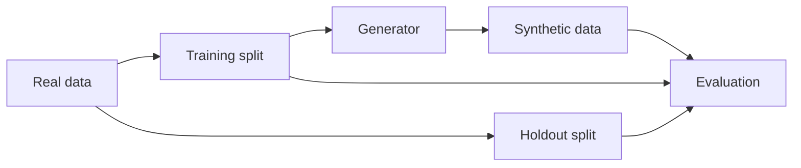

**2 hours** · Learning outcome [ILO2](../../01-about/#learning-outcomes)

## Slides



## Overview

A generative model returns a dataset, not a judgement of its quality. This lecture covers how you judge that dataset against the real data it imitates, on two of the four criteria of the course. *Fidelity* asks whether the synthetic data follow the distribution of the real data. *Utility* asks whether the synthetic data support the task you need them for. Privacy and fairness use some of the same tools, but [Lecture 5](../lecture-5/) and [Lecture 6](../lecture-6/) treat them in full.

The lecture moves from simple to structured metrics: statistics of single columns, comparisons of pairs of columns and of whole distributions, classifier-based tests, sample-level precision and recall, Fréchet distances and task-based utility. For each metric you see its formal definition, what it measures and what it cannot detect. The lecture ends with the pitfalls that make published numbers hard to compare, and with a reporting checklist that you use in [Lab 2](../../04-labs/lab-2/) and in your [project](../../06-project/).

## Learning goals

After this lecture you should be able to:

1. Define the univariate, pairwise and distribution-level fidelity metrics of this lecture, and construct for each one a synthetic dataset that scores well but is wrong ([ILO2](../../01-about/#learning-outcomes)).
2. Define precision, recall, density, coverage, $\alpha$-precision, $\beta$-recall and authenticity, and explain how they depend on the embedding and, where used, on the neighbourhood size $k$ ([ILO2](../../01-about/#learning-outcomes)).
3. Relate failures that follow from a model's training objective, such as mode collapse, to the metrics that detect them ([ILO1](../../01-about/#learning-outcomes)).
4. Design a utility evaluation with TSTR, TRTS and ranking agreement around a real holdout set ([ILO2](../../01-about/#learning-outcomes)).
5. Choose and report a set of metrics for your own project data, with reference values and uncertainty ([ILO4](../../01-about/#learning-outcomes)).

## Before the lecture

Read these two papers before the lecture.

- Alaa, A., van Breugel, B., Saveliev, E. S., & van der Schaar, M. (2022). How Faithful is your Synthetic Data? Sample-level Metrics for Evaluating and Auditing Generative Models. *Proceedings of the 39th International Conference on Machine Learning*, PMLR 162, 290–306. [PMLR](https://proceedings.mlr.press/v162/alaa22a.html) · [arXiv:2102.08921](https://arxiv.org/abs/2102.08921). Read Sections 3 and 4, and look for the definition of the $\alpha$-support, why standard precision and recall are the special case $\alpha = \beta = 1$, and why the authenticity score needs the training data.
- Sikder, M. F., Ramachandranpillai, R., de Leng, D., & Heintz, F. (2024). FairX: A comprehensive benchmarking tool for model analysis using fairness, utility, and explainability. *Proceedings of the 2nd Workshop on Fairness and Bias in AI (AEQUITAS 2024), co-located with ECAI 2024*, CEUR Workshop Proceedings, Vol. 3808. [PDF](https://ceur-ws.org/Vol-3808/paper16.pdf) · [arXiv:2406.14281](https://arxiv.org/abs/2406.14281) · [Code](https://github.com/fahim-sikder/FairX) · [Publication page](/publications/fairx/). Read the description of the evaluation module, and look for which utility and synthetic-data metrics the tool computes and which classifier it uses for utility.

## Lecture notes

### What to evaluate and why {#what-to-evaluate}

Throughout this lecture, $\mathcal{D}_{\text{train}}$ holds the $n$ real records that the generator sees, $\mathcal{D}_{\text{hold}}$ holds real records that it never sees, and $\mathcal{D}_{\text{syn}}$ holds the $m$ synthetic records it returns. We write $P_r$ for the distribution of the real data and $P_g$ for the distribution of the generator.

Fidelity asks how close $P_g$ is to $P_r$. [Alaa et al. (2022)](https://proceedings.mlr.press/v162/alaa22a.html) split this question into three parts: *fidelity* in the narrow sense (synthetic records look like real ones), *diversity* (the synthetic data cover the variability of the real data) and *generalisation* (the model creates new records instead of copying training records). Utility asks whether the synthetic data serve a downstream task, for example training a classifier that then works on real data.

These properties do not imply each other. [Theis et al. (2016)](https://arxiv.org/abs/1511.01844) show that average log-likelihood, Parzen window estimates and the visual quality of samples are largely independent of each other for high-dimensional data, and conclude that generative models need to be evaluated for the application they are meant for. Decide what the synthetic data are for before you choose metrics.

The holdout is the test set for utility, and its distance to the training data is the reference value for every fidelity metric (see [Pitfalls](#pitfalls)).

### Univariate fidelity {#univariate}

Univariate metrics compare one column at a time. For a numerical column with empirical cumulative distribution functions $\hat F_r$ and $\hat F_g$, the two-sample Kolmogorov-Smirnov (KS) statistic is the largest gap between them ([SciPy, n.d.-a](https://docs.scipy.org/doc/scipy/reference/generated/scipy.stats.ks_2samp.html)):

$$
D_{\text{KS}} = \sup_x \, \lvert \hat F_r(x) - \hat F_g(x) \rvert .
$$

For a categorical column with category frequencies $R_\omega$ and $S_\omega$ over the categories $\Omega$, the total variation distance (TVD) is

$$
\delta(R, S) = \frac{1}{2} \sum_{\omega \in \Omega} \lvert R_\omega - S_\omega \rvert ,
$$

which equals the largest difference in probability that the two distributions give to any set of categories. Both statistics lie in $[0, 1]$. SDMetrics reports them as similarity scores, $1 - D_{\text{KS}}$ (KSComplement) and $1 - \delta$ (TVComplement), so that 1 is best ([DataCebo, n.d.](https://docs.sdv.dev/sdmetrics/data-metrics/quality)).

KS records how much probability mass is misplaced, not how far it moves. Move a fraction $\epsilon$ of the mass of a column far into the tail, and $D_{\text{KS}}$ changes by at most $\epsilon$, however far the mass moves. The first Wasserstein distance accounts for distance:

$$
W_1(P, Q) = \inf_{\gamma \in \Gamma(P, Q)} \mathbb{E}_{(X, Y) \sim \gamma} \lvert X - Y \rvert = \int_{-\infty}^{\infty} \lvert F_P(x) - F_Q(x) \rvert \, dx ,
$$

where $\Gamma(P, Q)$ is the set of joint distributions with marginals $P$ and $Q$. The second form holds for one-dimensional distributions ([SciPy, n.d.-b](https://docs.scipy.org/doc/scipy/reference/generated/scipy.stats.wasserstein_distance.html)). $W_1$ is in the units of the column, so standardise columns before you average it over them. With large samples a KS test flags differences too small to matter, so report the statistic, not only its p-value.

Every univariate metric shares one limitation. Shuffle each column of the training data independently: every marginal is preserved exactly, so KS, TVD and $W_1$ are all zero, while every relation between columns is destroyed.

> [!TIP] The column-shuffle baseline
> Compute every metric for the column-shuffled training data. A generator that does not beat this table on the pairwise and multivariate metrics has not learned the dependence structure. Never release the shuffled table: every value in it is real.

### Pairwise and multivariate structure {#multivariate}

The next level compares pairs of columns. For numerical columns $A$ and $B$, compare the correlation $R_{A,B}$ in the real data with $S_{A,B}$ in the synthetic data; SDMetrics reports $1 - \lvert S_{A,B} - R_{A,B} \rvert / 2$ with the Pearson or Spearman coefficient. For categorical columns, compare the normalised contingency tables with the TVD:

$$
\text{ContingencySimilarity}(A, B) = 1 - \frac{1}{2} \sum_{a} \sum_{b} \lvert S_{a,b} - R_{a,b} \rvert ,
$$

where $a$ and $b$ range over the categories of $A$ and $B$. A numerical column in such a pair is first discretised into bins (10 by default). The SDMetrics Quality Report averages the per-column scores into *Column Shapes* and the pairwise scores into *Column Pair Trends* ([DataCebo, n.d.](https://docs.sdv.dev/sdmetrics/data-metrics/quality)). From version 0.27.0, the report discards pairs whose real association is weak (a Pearson correlation between $-0.5$ and $0.5$, or a Cramér association of at most 0.3), so scores from different versions are not comparable.

Pairwise metrics miss higher-order structure. Two datasets can agree on every two-way table and differ in three-way interactions, and a correlation coefficient captures only linear (Pearson) or monotone (Spearman) association. [Platzer and Reutterer (2021)](https://doi.org/10.3389/fdata.2021.679939) therefore average the TVD over all $k$-way marginals of discretised data for $k = 1, 2, 3$; on a dataset with 15 attributes that means 15, 105 and 455 tables.

### Distribution-level tests: MMD, classifiers and pMSE {#distribution-level}

The maximum mean discrepancy (MMD) compares two distributions through a class $\mathcal{F}$ of functions ([Gretton et al., 2012](https://jmlr.org/papers/v13/gretton12a.html)):

$$
\mathrm{MMD}[\mathcal{F}, p, q] = \sup_{f \in \mathcal{F}} \left( \mathbb{E}_{x \sim p}[f(x)] - \mathbb{E}_{y \sim q}[f(y)] \right).
$$

When $\mathcal{F}$ is the unit ball of a reproducing kernel Hilbert space with kernel $k$,

$$
\mathrm{MMD}^2[\mathcal{F}, p, q] = \mathbb{E}_{x, x'}[k(x, x')] - 2\, \mathbb{E}_{x, y}[k(x, y)] + \mathbb{E}_{y, y'}[k(y, y')],
$$

where $x'$ and $y'$ are independent copies of $x$ and $y$. For a characteristic kernel, such as the Gaussian or Laplace kernel on $\mathbb{R}^d$, the MMD is zero only if $p = q$. The unbiased estimator costs $O((m + n)^2)$ time and can be negative. MMD belongs to the family of integral probability metrics: functions of bounded variation 1 give the Kolmogorov distance, and 1-Lipschitz functions give the Wasserstein distance (Gretton et al., 2012, Section 7). The kernel and its bandwidth decide which differences the MMD can see, so report both.

A *classifier two-sample test* (C2ST) learns the comparison instead of fixing it in advance ([Lopez-Paz & Oquab, 2017](https://arxiv.org/abs/1610.06545)). Label real records 0 and synthetic records 1, split the pooled data into a training and a test part, train a classifier $f$ that estimates $p(l = 1 \mid z)$, and report its test accuracy:

$$
\hat t = \frac{1}{n_{\text{te}}} \sum_{(z_i, l_i) \in \mathcal{D}_{\text{te}}} \mathbb{I}\left[ \mathbb{I}\left( f(z_i) > \tfrac{1}{2} \right) = l_i \right].
$$

Under $H_0\colon P = Q$, $n_{\text{te}} \hat t$ follows a $\mathrm{Binomial}(n_{\text{te}}, \tfrac{1}{2})$ distribution, so for large $n_{\text{te}}$ the statistic is approximately $\mathcal{N}(\tfrac{1}{2}, \tfrac{1}{4 n_{\text{te}}})$. Accuracy is easy to interpret, and the classifier's scores show which records and features give the synthetic data away. The test is only as strong as the classifier, and it reacts to any systematic artefact: Lopez-Paz and Oquab report that on raw pixels all tests separated real images from DCGAN samples almost perfectly, whatever their visual quality, because of checkerboard-like artefacts. SDMetrics offers this test as LogisticDetection and SVCDetection (beta metrics, scored from the AUC), and its documentation warns that a score of 1 can also mean copied rows ([DataCebo, n.d.](https://docs.sdv.dev/sdmetrics/data-metrics/metrics-in-beta/detection-single-table)).

The *propensity score mean squared error* (pMSE) of [Snoke et al. (2018)](https://doi.org/10.1111/rssa.12358) is a classifier test with a different statistic. Stack the $n_1$ real and $n_2$ synthetic records, with $N = n_1 + n_2$, fit a model that predicts the indicator of being synthetic, and compute

$$
\text{pMSE} = \frac{1}{N} \sum_{i=1}^{N} (\hat p_i - c)^2, \qquad c = \frac{n_2}{N},
$$

where $\hat p_i$ is the estimated propensity score of record $i$. If the synthetic data come from the correct generative model and the propensity model is a logistic regression with $k$ parameters (here $k$ counts parameters), the null pMSE is a multiple of a $\chi^2_{k-1}$ variable with

$$
\mathbb{E}[\text{pMSE}] = \frac{(k - 1)(1 - c)^2 c}{N},
$$

which is $(k - 1)/(8N)$ when $n_1 = n_2$. Snoke et al. standardise the observed value in two ways: the *pMSE ratio*, observed over null expectation, which is about 1 under correct synthesis, and the *standardised pMSE*. They expect the ratio to be the more useful of the two, because the standardised value is over-sensitive to small differences. For CART propensity models they estimate the null by permutation. The R package synthpop implements these measures.

### Sample-level metrics: precision, recall, density and coverage {#sample-level}

A single distance mixes two failures: synthetic samples that look unrealistic, and real modes that the generator never produces. [Sajjadi et al. (2018)](https://proceedings.neurips.cc/paper/2018/hash/f7696a9b362ac5a51c3dc8f098b73923-Abstract.html) separate them. A distribution $Q$ has precision $\alpha$ at recall $\beta$ with respect to $P$ if there are distributions $\mu$, $\nu_P$ and $\nu_Q$ such that

$$
P = \beta \mu + (1 - \beta) \nu_P \quad \text{and} \quad Q = \alpha \mu + (1 - \alpha) \nu_Q .
$$

Here $\mu$ is the shared part, $\nu_P$ is the part of $P$ that $Q$ misses and $\nu_Q$ is the part of $Q$ that does not resemble $P$. On a finite state space the attainable pairs form a curve with $\alpha(\lambda) = \sum_\omega \min(\lambda P(\omega), Q(\omega))$ and $\beta(\lambda) = \sum_\omega \min(P(\omega), Q(\omega)/\lambda)$ for $\lambda > 0$. In practice they compare histograms over 20 $k$-means clusters of Inception embeddings, and summarise recall by $F_8$ and precision by $F_{1/8}$. On Fashion-MNIST, VAEs showed lower precision, higher recall, or both, compared with GANs, which matches the common view of the two model families from [Lecture 2](../lecture-2/): VAEs often produce samples of lower quality but are less prone to mode collapse.

> [!NOTE] Notation
> In Sajjadi et al., $\alpha$ and $\beta$ are precision and recall values. In Alaa et al. below, $\alpha$ and $\beta$ are probability masses that define the typical part of a distribution.

[Kynkäänniemi et al. (2019)](https://proceedings.neurips.cc/paper/2019/hash/0234c510bc6d908b28c70ff313743079-Abstract.html) replace the histograms with $k$-nearest-neighbour balls. For a set of feature vectors $\Phi$, let $f(\phi, \Phi) = 1$ if $\lVert \phi - \phi' \rVert_2 \le \lVert \phi' - \mathrm{NN}_k(\phi', \Phi) \rVert_2$ for at least one $\phi' \in \Phi$, and 0 otherwise, where $\mathrm{NN}_k(\phi', \Phi)$ is the $k$-th nearest neighbour of $\phi'$ in $\Phi$. Then

$$
\text{precision} = \frac{1}{\lvert \Phi_g \rvert} \sum_{\phi_g \in \Phi_g} f(\phi_g, \Phi_r), \qquad \text{recall} = \frac{1}{\lvert \Phi_r \rvert} \sum_{\phi_r \in \Phi_r} f(\phi_r, \Phi_g).
$$

They use VGG-16 features, $k = 3$ and 50,000 samples. [Naeem et al. (2020)](https://proceedings.mlr.press/v119/naeem20a.html) show that these estimates are not robust to outliers, since one real outlier enlarges the estimated real manifold and fake samples near it raise precision, and that they fail to detect a match between two identical distributions. Their *density* and *coverage* use balls around the $N$ real samples $X_i$ only, with $M$ synthetic samples $Y_j$:

$$
\begin{aligned}
\text{density} &= \frac{1}{kM} \sum_{j=1}^{M} \sum_{i=1}^{N} \mathbb{1}\left[ Y_j \in B(X_i, \mathrm{NND}_k(X_i)) \right], \\
\text{coverage} &= \frac{1}{N} \sum_{i=1}^{N} \mathbb{1}\left[ \exists\, j : Y_j \in B(X_i, \mathrm{NND}_k(X_i)) \right].
\end{aligned}
$$

Density counts how many real neighbourhoods contain each synthetic sample, so it rewards samples in dense real regions; it has expectation 1 for identical distributions and can exceed 1. Coverage is the fraction of real neighbourhoods that contain at least one synthetic sample, and lies in $[0, 1]$. Its expectation for identical distributions does not depend on the type or dimension of the data, which lets Naeem et al. choose $k = 5$ and $N = M = 10{,}000$, for an expected coverage of about 0.969.

All four quantities depend on the feature space. For images, pre-trained networks provide one. For tabular data there is no standard embedding, and the scaling and encoding of columns decide which records count as neighbours.

### α-precision, β-recall and authenticity {#alpha-precision}

Alaa et al. (2022) refine precision and recall with minimum volume sets. For a distribution $\mathbb{P}$ with support $\mathcal{S}$, the $\alpha$-support is the smallest set that holds probability mass $\alpha$:

$$
\mathcal{S}^{\alpha} = \arg\min_{s \subseteq \mathcal{S}} V(s) \quad \text{subject to} \quad \mathbb{P}(s) = \alpha ,
$$

where $V$ is volume (Lebesgue measure). The $\alpha$-support holds the most densely packed mass, so it contains the typical samples and leaves out the outliers. With embedded real and synthetic samples $\widetilde{X}_r$ and $\widetilde{X}_g$, $\alpha$-precision is the probability that a synthetic sample lies in the $\alpha$-support of the real distribution, and $\beta$-recall the probability that a real sample lies in the $\beta$-support of the synthetic distribution:

$$
P_\alpha = \mathbb{P}\left(\widetilde{X}_g \in \mathcal{S}_r^{\alpha}\right), \qquad R_\beta = \mathbb{P}\left(\widetilde{X}_r \in \mathcal{S}_g^{\beta}\right), \qquad \alpha, \beta \in [0, 1].
$$

Standard precision and recall are $P_1$ and $R_1$. Theorem 1 of the paper states that $P_\alpha = \alpha$ and $R_\beta = \beta$ for all $\alpha$ and $\beta$ if and only if $P_g = P_r$, so matching supports is not enough. The deviation from this diagonal gives single-number summaries:

$$
\Delta P_\alpha = \int_0^1 \lvert P_\alpha - \alpha \rvert \, d\alpha, \qquad IP_\alpha = 1 - 2\, \Delta P_\alpha ,
$$

and likewise $IR_\beta = 1 - 2\, \Delta R_\beta$. Both lie in $[0, 1]$, and $IP_\alpha = IR_\beta = 1$ only if $P_g = P_r$. The curves expose failures that $P_1$ and $R_1$ hide. A model with mode collapse can reach $P_1 = 1$ but has a concave $P_\alpha$ curve. A model that over-represents rare samples can reach $P_1 = R_1 = 1$ and still have poor curves.

*Authenticity* addresses generalisation. Alaa et al. model the generator as a mixture

$$
P_g = A \cdot P_g' + (1 - A) \cdot \delta_{g, \epsilon} ,
$$

in which the model creates a new sample from $P_g'$ with probability $A$, or copies a training record and adds noise of small variance $\epsilon^2$ with probability $1 - A$. To estimate $A$, let $i^*$ be the training record closest to synthetic sample $j$, at distance $d_{g,j}$, and let $d_{r,i^*}$ be the distance from $i^*$ to its nearest other training record. Sample $j$ counts as unauthentic if $d_{g,j} \le d_{r,i^*}$, that is, if it is closer to $i^*$ than any other training record is; the authenticity score is the fraction of authentic samples. The test needs the data the generator was trained on, and Alaa et al. use the same original data for training the generative models and for evaluating all metrics. Authenticity is a check for copying, not a privacy guarantee; [Lecture 5](../lecture-5/) covers distance-based privacy metrics and membership inference.

To estimate $P_\alpha$, Alaa et al. train the embedding as a one-class network (Deep SVDD) that maps the real data into a hypersphere around a centre $c_r$. The $\alpha$-support of the real data is then the ball $B(c_r, \hat r_\alpha)$, where $\hat r_\alpha$ is the $\alpha$-quantile of the distances $\lVert \widetilde{X}_{r,i} - c_r \rVert$. For $R_\beta$ they keep the synthetic samples inside the $\beta$-quantile ball around the synthetic mean, and check for each real sample whether the closest of them lies within that real sample's $k$-nearest-neighbour radius. The scores therefore depend on the embedding, on $k$ and on how the integral over $\alpha$ is approximated. The FairX implementation used in Lab 2 adapts the synthcity code: it fits the one-class embedding on the real data, evaluates 30 values of $\alpha$, and truncates the larger dataset so that both have the same size ([FairX repository](https://github.com/fahim-sikder/FairX)).

### Fréchet distances {#frechet}

The Fréchet Inception Distance (FID) of [Heusel et al. (2017)](https://proceedings.neurips.cc/paper/2017/hash/8a1d694707eb0fefe65871369074926d-Abstract.html) fits a Gaussian to the features of real images and another to the features of generated images, and computes the Fréchet (Wasserstein-2) distance between the two Gaussians:

$$
d^2\big((m, C), (m_w, C_w)\big) = \lVert m - m_w \rVert_2^2 + \mathrm{Tr}\left( C + C_w - 2 (C C_w)^{1/2} \right),
$$

where $(m, C)$ and $(m_w, C_w)$ are the mean and covariance of the last pooling layer of Inception-v3 for generated and real images. Heusel et al. used 50,000 generated images. FID uses only the first two moments, and it mixes fidelity and diversity in one number.

Three caveats matter. First, the FID estimator is biased: [Bińkowski et al. (2018)](https://arxiv.org/abs/1801.01401) observe strong bias for sample sizes up to 10,000 when they compare the CIFAR-10 training and test sets. They propose the Kernel Inception Distance (KID), the squared MMD between Inception features with a cubic polynomial kernel, whose estimator is unbiased. Second, [Chong and Forsyth (2020)](https://openaccess.thecvf.com/content_CVPR_2020/html/Chong_Effectively_Unbiased_FID_and_Inception_Score_and_Where_to_Find_CVPR_2020_paper.html) show that the bias depends on the generator, so a fixed number of samples does not make comparisons fair; they extrapolate to an infinite sample size instead. Third, the features come from an ImageNet classifier: [Stein et al. (2023)](https://proceedings.neurips.cc/paper_files/paper/2023/hash/0bc795afae289ed465a65a3b4b1f4eb7-Abstract-Conference.html) find that no existing metric correlates strongly with human judgements of realism, and name over-reliance on Inception-v3 as one cause.

Time series have no Inception network. [Jeha et al. (2022)](https://arxiv.org/abs/2108.00981) define *Context-FID* by replacing Inception-v3 with the unsupervised time-series encoder of [Franceschi et al. (2019)](https://proceedings.neurips.cc/paper/2019/hash/53c6de78244e9f528eb3e1cda69699bb-Abstract.html), trained separately for each dataset. Real and synthetic windows from the same time range are encoded, and the FID is computed on the embeddings. On their benchmarks, Context-FID correlated with downstream forecasting error (NRMSE) with a Pearson coefficient of 0.71 and a Spearman coefficient of 0.67, averaged over datasets. Context-FID values are comparable only under the same encoder, so check which encoder a paper used.

### Utility {#utility}

Utility measures whether a model trained on synthetic data works on real data. [Esteban et al. (2017)](https://arxiv.org/abs/1706.02633) define *train on synthetic, test on real* (TSTR): train a model on the synthetic data and evaluate it on held-out real records. The reverse, *train on real, test on synthetic* (TRTS), evaluates a model trained on real data on synthetic data. Esteban et al. note that TRTS does not degrade when the generator suffers mode collapse, and therefore consider TSTR the more informative of the two. Report TSTR next to the real baseline, which we call TRTR (train on $\mathcal{D}_{\text{train}}$, test on $\mathcal{D}_{\text{hold}}$), with the same model class and hyperparameters:

$$
\Delta_{\text{TSTR}} = \mathrm{m}\big(A(\mathcal{D}_{\text{train}}), \mathcal{D}_{\text{hold}}\big) - \mathrm{m}\big(A(\mathcal{D}_{\text{syn}}), \mathcal{D}_{\text{hold}}\big),
$$

where $A$ is a learning algorithm and $\mathrm{m}$ a performance measure. Use several model classes, because one model tests the synthetic data only through the features that this model relies on.

When synthetic data serve to compare methods, for example in a data challenge, what matters is whether they rank methods in the same order as real data. [Jordon et al. (2018)](https://arxiv.org/abs/1806.11345) define the *synthetic ranking agreement* for $k$ algorithms, with $R_i$ the performance of algorithm $i$ trained and tested on real data and $S_i$ its performance trained and tested on synthetic data:

$$
\text{SRA}(G) = \frac{1}{k(k - 1)} \sum_{i=1}^{k} \sum_{j \neq i} \mathbb{I}\left[ (R_i - R_j)(S_i - S_j) > 0 \right].
$$

SRA is the empirical probability that a comparison on synthetic data agrees with the same comparison on real data. It depends on the chosen algorithms (Jordon et al. use 12), many variants of one method bias it, and it can be high even when the synthetic distribution differs from the real one.

For time series, [Yoon et al. (2019)](https://proceedings.neurips.cc/paper/2019/hash/c9efe5f26cd17ba6216bbe2a7d26d490-Abstract.html) introduce two scores. The *discriminative score* trains a post-hoc recurrent classifier to separate real from synthetic sequences. The *predictive score* trains a next-step prediction model on synthetic sequences and reports its mean absolute error on real sequences, which is TSTR for forecasting. The paper describes both post-hoc models as 2-layer LSTMs and the discriminative score as the classification error on held-out data. The first author's public implementation ([TimeGAN repository](https://github.com/jsyoon0823/TimeGAN)) uses GRU networks, returns $\lvert \text{accuracy} - 0.5 \rvert$, which is 0 for indistinguishable data, and predicts only the last feature one step ahead from the other features. State which version you use.

[van Breugel et al. (2023)](https://proceedings.mlr.press/v202/van-breugel23a.html) show that treating one synthetic dataset as if it were real leads to downstream models and analyses that generalise poorly to real data. Their Deep Generative Ensemble, an ensemble of generative models, helps most for minority classes and low-density regions.

### Tools {#tools}

The table lists what the documentation of each tool states; check the version you install.

| Tool | Fidelity and detection | Utility |
|---|---|---|
| SDMetrics ([DataCebo, n.d.](https://docs.sdv.dev/sdmetrics)) | KSComplement, TVComplement, CorrelationSimilarity, ContingencySimilarity (Quality Report); LogisticDetection, SVCDetection (beta) | ML efficacy (beta): train on synthetic, test on real; F1 score for binary classification |
| synthcity ([Qian et al., 2023a](https://arxiv.org/abs/2301.07573)) | KS test, chi-squared test, inverse KL divergence, MMD, Jensen-Shannon distance, Wasserstein distance, PRDC, α-precision, FID, Kaplan-Meier distance; detection with XGBoost, MLP, GMM and linear models | `performance.xgb`, `performance.linear`, `performance.mlp` (real and synthetic training data, evaluated on test data); `performance.feat_rank_distance` |
| FairX ([Sikder et al., 2024](https://ceur-ws.org/Vol-3808/paper16.pdf)) | `SyntheticEvaluation`: α-precision, β-recall, authenticity; t-SNE and PCA plots | `DataUtilsMetrics`: XGBoost classifier; accuracy, AUROC, F1, precision, recall |

Two details matter in the lab. First, score directions differ: an SDMetrics detection score of 1 means the classifier cannot separate the data, while a synthcity detection score of 0 means the same. Second, FairX's `DataUtilsMetrics` trains on the training part of the split you pass and tests on its test part, so it computes TSTR only if you pass synthetic training data and a real test split. FairX comes from the examiner's group and also provides the fairness metrics of Lecture 6. A peer-reviewed paper on the synthcity benchmarking framework is [Qian et al. (2023b)](https://proceedings.neurips.cc/paper_files/paper/2023/hash/09723c9f291f6056fd1885081859c186-Abstract-Datasets_and_Benchmarks.html).

### Pitfalls {#pitfalls}

**Metrics disagree.** In the COVID-19 experiment of Alaa et al. (2022), a predictive model trained on data from the generator with the best $P_1$ reached an AUC-ROC of 0.55 on real data, against 0.79 for the generator with the best $IP_\alpha$. The SDMetrics documentation states that statistical quality and the value of the data for a task "may or may not correlate". Choose metrics for the intended use, then report all of them, including those that look bad.

**Tuning on the reported metric.** If you select hyperparameters by a metric and report the same metric on the same data, the number measures your selection. Esteban et al. (2017) chose among saved synthetic datasets by TSTR on only 3 of their 7 tasks, and reported all 7. Select on a real validation split, and use the holdout once.

**Small samples.** The FID estimator is biased at realistic sample sizes. The C2ST statistic has variance $1/(4 n_{\text{te}})$ under the null. Density, coverage and $k$-NN precision depend on $N$, $M$ and $k$. For $d \ge 3$ dimensions, the empirical Wasserstein distance converges to the true one at rate $n^{-1/d}$ ([Ramdas et al., 2015](https://arxiv.org/abs/1509.02237)). Compare generators at equal sample sizes, repeat over several generator seeds and evaluation resamples, and report the spread.

> [!WARNING] Leakage
> Fit scalers, encoders and bin edges on the training split only; Platzer and Reutterer (2021) compute bins on the training data and reuse them for the synthetic and holdout data. Keep holdout records away from the generator, including during hyperparameter search. If the generator has seen the TSTR test set, copying looks like utility.

**No reference value.** A metric value means little until you know what fresh real data would score. Platzer and Reutterer (2021) compare the synthetic data $S$ and the holdout $H$ with the training data $T$:

$$
\text{ratio}_k = \frac{F_k(T, S)}{F_k(T, H)},
$$

where $F_k$ is the mean TVD over all $k$-way marginals. A ratio near 1 means that $S$ is as close to $T$ as fresh real data are; a ratio below 1 means that $S$ is closer to $T$ than fresh data would be, a sign that it carries record-specific information. Lopez-Paz and Oquab (2017) give the same advice for two-sample tests: a generator that does not overfit gives similar statistics against the training and the test set.

### Reporting checklist {#checklist}

Use this checklist in papers and in your project report.

1. **Data.** Source, $n$ and $m$, the training, validation and holdout splits, and where preprocessing was fitted.
2. **Generator.** Model, training budget, number of seeds, and energy use logged with CodeCarbon.
3. **Fidelity.** At least one marginal, one pairwise, one distribution-level and one sample-level metric, with their settings: $k$, kernel and bandwidth, bins, embedding and software version.
4. **Utility.** TRTR next to TSTR (and TRTS if relevant), for several downstream model classes with the same hyperparameters; ranking agreement if the data will be used to compare methods.
5. **Reference values.** Each metric for holdout against training data, and for the column-shuffle baseline.
6. **Uncertainty.** Mean and spread over generator seeds and evaluation resamples.
7. **Beyond this lecture.** Privacy (Lecture 5) and fairness (Lecture 6) results, and code for every number.

## Discussion questions

**Question 1: Marginals against detection.** Your synthetic table has near-perfect KSComplement and TVComplement on every column, and TSTR within the seed-to-seed spread of TRTR. A gradient-boosted classifier still separates real from synthetic records well above chance. Give three explanations, and the analysis that would tell them apart.


One explanation is dependence structure that the downstream model does not use, for example interactions between columns that are irrelevant to the target; check pairwise and three-way tables. A second is an artefact, such as rounding, impossible category combinations or values outside the real range; inspect the classifier's feature importances and the records it classifies most confidently. A third is a weak reference; compute the same test between training and holdout data, and compare the accuracy with the null distribution for your test-set size.


**Question 2: Is authenticity a privacy metric?** Alaa et al. define authenticity with respect to the training data. What does an authenticity score of 1 tell you about privacy, and what does it not tell you?


A score of 1 says that, in the chosen embedding, every synthetic sample is farther from its nearest training record than that record is from its own nearest training neighbour. It says nothing about what an attacker can infer by other means, it depends on the embedding and its distance, and it is not a formal guarantee such as differential privacy. Lecture 5 treats these questions.


**Question 3: When can TSTR exceed TRTR?** Under what conditions could a model trained on synthetic data outperform the same model trained on the real training split, on the same real holdout? Is that evidence that the synthetic data are better than the real data?


Consider the number of synthetic records, rebalanced classes, and smoothing by the generator, which can act as regularisation. Before you accept any of these, rule out leakage: did the generator, or its hyperparameter search, see the holdout? Check whether the effect survives several seeds and model classes.


**Question 4: Choosing an embedding.** Every sample-level metric and every Fréchet distance depends on an embedding. For the data in your own project, which embedding would you use, and how would you check that distances in it mean what you need?


Heusel et al. checked FID against images with increasing levels of noise, blur and other disturbances. You can do the same with perturbations that matter in your domain. Also check that the holdout against training data gives near-ideal values, and that a known failure, such as dropping a mode, lowers recall or coverage.


**Question 5: Tuning and reporting.** A paper selects the best of many generator configurations by $IP_\alpha$ and reports $IP_\alpha$ on the same data. What bias does this introduce, and what protocol avoids it?


The maximum over many noisy estimates is biased upwards, so the reported value overstates what a new evaluation would give. Select on a real validation split, report on the holdout once, and report a second metric that was not used for selection.


**Question 6: Small real datasets, an open problem.** In a clinical study with a few hundred patients, the holdout is small. Which metrics in this lecture become unreliable first, and what would you report instead of a single number?


Start from the sample-size results in this lecture: the bias of FID, the variance of the classifier test, and the dependence of density and coverage on $N$, $M$ and $k$. Consider resampling the split several times and reporting intervals, and ask whether a holdout of this size can still serve as a reference. The literature has no settled answer.


## Further reading

- Jordon, J., Szpruch, L., Houssiau, F., Bottarelli, M., Cherubin, G., Maple, C., Cohen, S. N., & Weller, A. (2022). Synthetic Data: what, why and how? Report commissioned by the Royal Society. [arXiv:2205.03257](https://arxiv.org/abs/2205.03257). Section 6.2 reviews how to evaluate the utility and fidelity of synthetic datasets.
- Platzer, M., & Reutterer, T. (2021). Holdout-Based Empirical Assessment of Mixed-Type Synthetic Data. *Frontiers in Big Data*, 4, 679939. [doi:10.3389/fdata.2021.679939](https://doi.org/10.3389/fdata.2021.679939). The holdout reference applied to fidelity and privacy.
- Theis, L., van den Oord, A., & Bethge, M. (2016). A note on the evaluation of generative models. *International Conference on Learning Representations*. [arXiv:1511.01844](https://arxiv.org/abs/1511.01844). Why good performance on one criterion does not imply good performance on another.
- Stein, G., et al. (2023). Exposing flaws of generative model evaluation metrics and their unfair treatment of diffusion models. *Advances in Neural Information Processing Systems*, 36. [NeurIPS](https://proceedings.neurips.cc/paper_files/paper/2023/hash/0bc795afae289ed465a65a3b4b1f4eb7-Abstract-Conference.html). A human study of 17 metrics and their feature extractors.
- van Breugel, B., Qian, Z., & van der Schaar, M. (2023). Synthetic Data, Real Errors: How (Not) to Publish and Use Synthetic Data. *Proceedings of the 40th International Conference on Machine Learning*, PMLR 202, 34793–34808. [PMLR](https://proceedings.mlr.press/v202/van-breugel23a.html). What goes wrong when one synthetic dataset stands in for the real data.
- Chong, M. J., & Forsyth, D. (2020). Effectively Unbiased FID and Inception Score and Where to Find Them. *IEEE/CVF Conference on Computer Vision and Pattern Recognition*, 6070–6079. [CVF](https://openaccess.thecvf.com/content_CVPR_2020/html/Chong_Effectively_Unbiased_FID_and_Inception_Score_and_Where_to_Find_CVPR_2020_paper.html). The sample-size bias of FID and how to remove it.
- Qian, Z., Davis, R., & van der Schaar, M. (2023b). Synthcity: a benchmark framework for diverse use cases of tabular synthetic data. *Advances in Neural Information Processing Systems*, 36, Datasets and Benchmarks Track. [NeurIPS](https://proceedings.neurips.cc/paper_files/paper/2023/hash/09723c9f291f6056fd1885081859c186-Abstract-Datasets_and_Benchmarks.html). A benchmark of generators across use cases.

## References

- Alaa, A., van Breugel, B., Saveliev, E. S., & van der Schaar, M. (2022). How Faithful is your Synthetic Data? Sample-level Metrics for Evaluating and Auditing Generative Models. *Proceedings of the 39th International Conference on Machine Learning*, PMLR 162, 290–306. [PMLR](https://proceedings.mlr.press/v162/alaa22a.html)
- Bińkowski, M., Sutherland, D. J., Arbel, M., & Gretton, A. (2018). Demystifying MMD GANs. *International Conference on Learning Representations*. [arXiv:1801.01401](https://arxiv.org/abs/1801.01401)
- Chong, M. J., & Forsyth, D. (2020). Effectively Unbiased FID and Inception Score and Where to Find Them. *IEEE/CVF Conference on Computer Vision and Pattern Recognition*, 6070–6079. [CVF](https://openaccess.thecvf.com/content_CVPR_2020/html/Chong_Effectively_Unbiased_FID_and_Inception_Score_and_Where_to_Find_CVPR_2020_paper.html)
- DataCebo. (n.d.). *SDMetrics documentation*. Retrieved 10 November 2026. [docs.sdv.dev/sdmetrics](https://docs.sdv.dev/sdmetrics)
- Esteban, C., Hyland, S. L., & Rätsch, G. (2017). Real-valued (Medical) Time Series Generation with Recurrent Conditional GANs. [arXiv:1706.02633](https://arxiv.org/abs/1706.02633)
- Franceschi, J.-Y., Dieuleveut, A., & Jaggi, M. (2019). Unsupervised Scalable Representation Learning for Multivariate Time Series. *Advances in Neural Information Processing Systems*, 32. [NeurIPS](https://proceedings.neurips.cc/paper/2019/hash/53c6de78244e9f528eb3e1cda69699bb-Abstract.html)
- Gretton, A., Borgwardt, K. M., Rasch, M. J., Schölkopf, B., & Smola, A. (2012). A Kernel Two-Sample Test. *Journal of Machine Learning Research*, 13(25), 723–773. [JMLR](https://jmlr.org/papers/v13/gretton12a.html)
- Heusel, M., Ramsauer, H., Unterthiner, T., Nessler, B., & Hochreiter, S. (2017). GANs Trained by a Two Time-Scale Update Rule Converge to a Local Nash Equilibrium. *Advances in Neural Information Processing Systems*, 30. [NeurIPS](https://proceedings.neurips.cc/paper/2017/hash/8a1d694707eb0fefe65871369074926d-Abstract.html)
- Jeha, P., Bohlke-Schneider, M., Mercado, P., Kapoor, S., Nirwan, R. S., Flunkert, V., Gasthaus, J., & Januschowski, T. (2022). PSA-GAN: Progressive Self Attention GANs for Synthetic Time Series. *International Conference on Learning Representations*. [arXiv:2108.00981](https://arxiv.org/abs/2108.00981)
- Jordon, J., Szpruch, L., Houssiau, F., Bottarelli, M., Cherubin, G., Maple, C., Cohen, S. N., & Weller, A. (2022). Synthetic Data: what, why and how? [arXiv:2205.03257](https://arxiv.org/abs/2205.03257)
- Jordon, J., Yoon, J., & van der Schaar, M. (2018). Measuring the quality of Synthetic data for use in competitions. *KDD Workshop on Machine Learning for Medicine and Healthcare*. [arXiv:1806.11345](https://arxiv.org/abs/1806.11345)
- Kynkäänniemi, T., Karras, T., Laine, S., Lehtinen, J., & Aila, T. (2019). Improved Precision and Recall Metric for Assessing Generative Models. *Advances in Neural Information Processing Systems*, 32. [NeurIPS](https://proceedings.neurips.cc/paper/2019/hash/0234c510bc6d908b28c70ff313743079-Abstract.html)
- Lopez-Paz, D., & Oquab, M. (2017). Revisiting Classifier Two-Sample Tests. *International Conference on Learning Representations*. [arXiv:1610.06545](https://arxiv.org/abs/1610.06545)
- Naeem, M. F., Oh, S. J., Uh, Y., Choi, Y., & Yoo, J. (2020). Reliable Fidelity and Diversity Metrics for Generative Models. *Proceedings of the 37th International Conference on Machine Learning*, PMLR 119, 7176–7185. [PMLR](https://proceedings.mlr.press/v119/naeem20a.html)
- Platzer, M., & Reutterer, T. (2021). Holdout-Based Empirical Assessment of Mixed-Type Synthetic Data. *Frontiers in Big Data*, 4, 679939. [doi:10.3389/fdata.2021.679939](https://doi.org/10.3389/fdata.2021.679939)
- Qian, Z., Cebere, B.-C., & van der Schaar, M. (2023a). Synthcity: facilitating innovative use cases of synthetic data in different data modalities. [arXiv:2301.07573](https://arxiv.org/abs/2301.07573) · [Code](https://github.com/vanderschaarlab/synthcity)
- Qian, Z., Davis, R., & van der Schaar, M. (2023b). Synthcity: a benchmark framework for diverse use cases of tabular synthetic data. *Advances in Neural Information Processing Systems*, 36, Datasets and Benchmarks Track. [NeurIPS](https://proceedings.neurips.cc/paper_files/paper/2023/hash/09723c9f291f6056fd1885081859c186-Abstract-Datasets_and_Benchmarks.html)
- Ramdas, A., García Trillos, N., & Cuturi, M. (2015). On Wasserstein Two Sample Testing and Related Families of Nonparametric Tests. [arXiv:1509.02237](https://arxiv.org/abs/1509.02237)
- Sajjadi, M. S. M., Bachem, O., Lucic, M., Bousquet, O., & Gelly, S. (2018). Assessing Generative Models via Precision and Recall. *Advances in Neural Information Processing Systems*, 31. [NeurIPS](https://proceedings.neurips.cc/paper/2018/hash/f7696a9b362ac5a51c3dc8f098b73923-Abstract.html)
- SciPy. (n.d.-a). *scipy.stats.ks_2samp*. SciPy documentation. Retrieved 10 November 2026. [docs.scipy.org](https://docs.scipy.org/doc/scipy/reference/generated/scipy.stats.ks_2samp.html)
- SciPy. (n.d.-b). *scipy.stats.wasserstein_distance*. SciPy documentation. Retrieved 10 November 2026. [docs.scipy.org](https://docs.scipy.org/doc/scipy/reference/generated/scipy.stats.wasserstein_distance.html)
- Sikder, M. F., Ramachandranpillai, R., de Leng, D., & Heintz, F. (2024). FairX: A comprehensive benchmarking tool for model analysis using fairness, utility, and explainability. *Proceedings of the 2nd Workshop on Fairness and Bias in AI (AEQUITAS 2024), co-located with ECAI 2024*, CEUR Workshop Proceedings, Vol. 3808. [PDF](https://ceur-ws.org/Vol-3808/paper16.pdf) · [arXiv:2406.14281](https://arxiv.org/abs/2406.14281) · [Code](https://github.com/fahim-sikder/FairX)
- Snoke, J., Raab, G. M., Nowok, B., Dibben, C., & Slavković, A. (2018). General and specific utility measures for synthetic data. *Journal of the Royal Statistical Society Series A: Statistics in Society*, 181(3), 663–688. [doi:10.1111/rssa.12358](https://doi.org/10.1111/rssa.12358)
- Stein, G., Cresswell, J. C., Hosseinzadeh, R., Sui, Y., Ross, B. L., Villecroze, V., Liu, Z., Caterini, A. L., Taylor, J. E. T., & Loaiza-Ganem, G. (2023). Exposing flaws of generative model evaluation metrics and their unfair treatment of diffusion models. *Advances in Neural Information Processing Systems*, 36. [NeurIPS](https://proceedings.neurips.cc/paper_files/paper/2023/hash/0bc795afae289ed465a65a3b4b1f4eb7-Abstract-Conference.html)
- Theis, L., van den Oord, A., & Bethge, M. (2016). A note on the evaluation of generative models. *International Conference on Learning Representations*. [arXiv:1511.01844](https://arxiv.org/abs/1511.01844)
- van Breugel, B., Qian, Z., & van der Schaar, M. (2023). Synthetic Data, Real Errors: How (Not) to Publish and Use Synthetic Data. *Proceedings of the 40th International Conference on Machine Learning*, PMLR 202, 34793–34808. [PMLR](https://proceedings.mlr.press/v202/van-breugel23a.html)
- Yoon, J., Jarrett, D., & van der Schaar, M. (2019). Time-series Generative Adversarial Networks. *Advances in Neural Information Processing Systems*, 32. [NeurIPS](https://proceedings.neurips.cc/paper/2019/hash/c9efe5f26cd17ba6216bbe2a7d26d490-Abstract.html) · [Code](https://github.com/jsyoon0823/TimeGAN)

[Lab 2: Utility and privacy evaluation](../../04-labs/lab-2/), after [Lecture 5](../lecture-5/), puts these metrics into practice.
