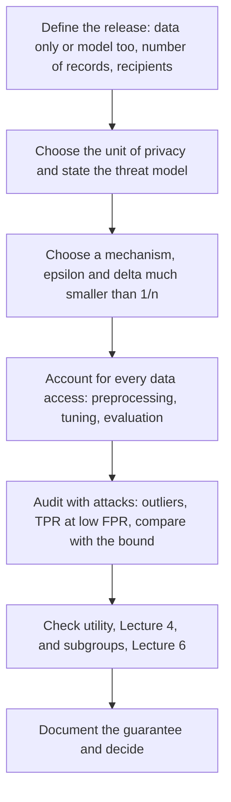

**Week 6** · 2 hours · Learning outcomes [LO2 and LO3](../../01-about/#learning-outcomes)

## Slides



## Overview

Lecture 4 asked whether synthetic data is faithful to the real data and useful for a task. This lecture asks what the synthetic data reveals about the people in the training data, and how you can bound or measure that leakage. We start from the failure of de-identification, define differential privacy (DP) and its main tools, and follow how DP enters a generative model through DP-SGD, PATE-GAN and marginal-based mechanisms. We then change sides and study the attacks: membership inference, attribute inference, and the similarity heuristics that are often used in place of a guarantee.

The two halves meet in the release decision. A DP guarantee is an upper bound on what any attacker can learn; a successful attack is a lower bound on what one attacker did learn. To assess the privacy risk of releasing a synthetic dataset (LO3) you need both, and both mean something only under a threat model that you state explicitly.

## Learning goals

After this lecture you should be able to:

1. State the definition of $(\varepsilon, \delta)$-differential privacy, including the neighbouring relation and the unit of privacy, and interpret $\varepsilon$ as a bound on an attacker's true and false positive rates (LO3).
2. Explain how DP-SGD, PATE-GAN and marginal-based mechanisms such as MST and AIM make a generator differentially private, and where each loses utility or breaks its guarantee in practice (LO2, LO3).
3. Specify a threat model for a synthetic data release and choose membership and attribute inference attacks to audit it, reporting the true positive rate at a low false positive rate (LO2).
4. Explain why similarity-based metrics such as distance to closest record give no privacy guarantee (LO2, LO3).
5. Draft a privacy risk assessment for a release, covering the unit of privacy, $\varepsilon$ and $\delta$, the scope of the privacy accounting, audit results and documentation (LO3).

## Before the lecture

Read these three works. The note after each one says what to look for.

- Dwork, C., & Roth, A. (2014). The Algorithmic Foundations of Differential Privacy. *Foundations and Trends in Theoretical Computer Science*, 9(3–4), 211–407. [doi:10.1561/0400000042](https://doi.org/10.1561/0400000042). Read Chapters 1 and 2, above all Sections 2.3.1 to 2.3.3 on what DP promises, what it does not promise and the granularity of privacy. Then read Section 3.3 on the Laplace mechanism, Section 3.5 on composition (including 3.5.3 on Laplace versus Gaussian noise) and Appendix A on the Gaussian mechanism. Look for why the definition quantifies over all neighbouring databases, and why $\delta$ must be much smaller than $1/n$.
- Jordon, J., Yoon, J., & van der Schaar, M. (2019). PATE-GAN: Generating Synthetic Data with Differential Privacy Guarantees. *International Conference on Learning Representations (ICLR 2019)*. [OpenReview](https://openreview.net/forum?id=S1zk9iRqF7). Find out which networks read real data, which network the generator learns from, and why the post-processing property then makes the generator private.
- Zhang, Z., Wang, T., Li, N., Honorio, J., Backes, M., He, S., Chen, J., & Zhang, Y. (2021). PrivSyn: Differentially Private Data Synthesis. *30th USENIX Security Symposium*, 929–946. [USENIX](https://www.usenix.org/conference/usenixsecurity21/presentation/zhang-zhikun). Look for how PrivSyn chooses which marginals to measure under a fixed privacy budget, and how it generates records that agree with the noisy marginals.

> [!TIP] A companion to PATE-GAN
> After the original paper, skim the summary of Ganev, Annamalai and De Cristofaro ([2025](https://arxiv.org/abs/2406.13985)). They re-ran six public PATE-GAN implementations and show how far code can drift from a paper's guarantee.

## Lecture notes

### 1. Why de-identification fails

Removing names and identifiers does not anonymise a dataset. Sweeney reports, from her earlier study of 1990 US census data, that 87% of the US population (216 of 248 million people) was likely unique on 5-digit ZIP code, gender and date of birth ([Sweeney, 2002](https://doi.org/10.1142/S0218488502001648)). She linked hospital data on about 135,000 Massachusetts state employees and their families, released as anonymous, to the Cambridge voter list, and singled out the record of the governor of the time. Her response, k-anonymity, requires each released record to be indistinguishable from at least $k-1$ others on a set of quasi-identifiers; the same paper shows that linking several k-anonymous releases breaks the protection.

High-dimensional data make linkage easier. In the Netflix Prize data, 8 movie ratings (2 of which may be wrong) with dates known to within 14 days identify 99% of subscriber records ([Narayanan and Shmatikov, 2008](https://doi.org/10.1109/SP.2008.33)). With a copula-based generative model, Rocher, Hendrickx and de Montjoye estimate that 99.98% of Americans would be correctly re-identified in any dataset with 15 demographic attributes ([Rocher et al., 2019](https://doi.org/10.1038/s41467-019-10933-3)).

Privacy is therefore not a property you can check by inspecting the released data; it depends on what the attacker already knows. Synthetic data inherits the problem, because the generator was fitted to real people. Stadler, Oprisanu and Troncoso measure privacy gain, which is 1 when the synthetic data gives an attacker no advantage and 0 when it helps as much as the raw data. Randomly chosen records had a gain close to 1, while one outlier in a hospital dataset had a gain below 0.005 under CTGAN ([Stadler et al., 2022](https://www.usenix.org/conference/usenixsecurity22/presentation/stadler)). We need a property of the generating process that holds for every record: differential privacy.

### 2. Differential privacy

A mechanism $M$ is a randomised algorithm that maps a dataset $D$ to an output: a count, a trained model or a synthetic dataset. Two datasets are neighbouring, written $D \simeq D'$, if one is obtained from the other by adding or removing one record. Dwork and Roth ([2014](https://doi.org/10.1561/0400000042)) write datasets as histograms $x, y$ with $\lVert x - y \rVert_1 \le 1$, which is the same relation.

> [!IMPORTANT] Definition: differential privacy ([Dwork and Roth, 2014](https://doi.org/10.1561/0400000042), Definition 2.4)
> A randomised mechanism $M$ is $(\varepsilon, \delta)$-differentially private if for all neighbouring $D \simeq D'$ and all sets of outputs $S$,
> $$\Pr[M(D) \in S] \le e^{\varepsilon} \Pr[M(D') \in S] + \delta,$$
> where the probability is over the coins of $M$ only. With $\delta = 0$ the mechanism is $\varepsilon$-differentially private.

The definition is due to Dwork, McSherry, Nissim and Smith ([Dwork et al., 2006](https://doi.org/10.1007/11681878_14)). It holds for every neighbouring pair, so it covers the record most at risk and an attacker who knows every other record; no auxiliary information can break it. Dwork and Roth warn that $\delta$ of order $1/n$ permits publishing the complete records of a few people, so choose $\delta \ll 1/n$.

**Unit of privacy.** "One record" must be the entity you protect. With one row per hospital visit, visit-level DP protects a visit, not a patient with 40 visits; Dwork and Roth (Section 2.3.3) call this the granularity of privacy. By group privacy (Theorem 2.2), an $\varepsilon$-DP mechanism is $k\varepsilon$-DP for groups of $k$ records. Since replacing a record is one removal plus one addition, a pure $\varepsilon$ guarantee under add-or-remove gives $2\varepsilon$ under replace-one, so compare $\varepsilon$ values only under the same relation.

**Reading $\varepsilon$ as a hypothesis test.** An attacker who sees the output tests $H_0$: the data are $D$, against $H_1$: the data are $D'$, which contains the target. Kairouz, Oh and Viswanath show that $M$ is $(\varepsilon, \delta)$-DP if and only if, for all neighbouring pairs, every test satisfies

$$
P_{\mathrm{FA}} + e^{\varepsilon} P_{\mathrm{MD}} \ge 1 - \delta, \qquad e^{\varepsilon} P_{\mathrm{FA}} + P_{\mathrm{MD}} \ge 1 - \delta,
$$

where $P_{\mathrm{FA}}$ is the false alarm and $P_{\mathrm{MD}}$ the missed detection probability ([Kairouz et al., 2015](https://proceedings.mlr.press/v37/kairouz15.html), Theorem 2.1). With $\mathrm{FPR} = P_{\mathrm{FA}}$ and $\mathrm{TPR} = 1 - P_{\mathrm{MD}}$, the second inequality reads $\mathrm{TPR} \le e^{\varepsilon}\,\mathrm{FPR} + \delta$. For pure DP, Bayes' rule gives an equivalent reading: the attacker's posterior odds are at most $e^{\varepsilon}$ times the prior odds. The table evaluates these bounds with $\delta = 0$.

| $\varepsilon$ | $e^{\varepsilon}$ | Largest posterior from a prior of 0.5 | Largest $\mathrm{TPR} - \mathrm{FPR}$ | TPR bound at FPR = 0.001 |
|---|---|---|---|---|
| 0.1 | 1.11 | 0.525 | 0.050 | 0.0011 |
| 1 | 2.72 | 0.731 | 0.462 | 0.0027 |
| 3 | 20.1 | 0.953 | 0.905 | 0.020 |
| 8 | 2981 | 0.9997 | 0.9993 | no constraint |

The table's bounds describe the strongest possible attacker, not known attacks. Dwork and Roth (Section 2.3.3) note that failing to be DP at a large $\varepsilon$ can mean anything from a meaningless breach to full disclosure. The guarantee is also limited in scope (Section 2.3.2): if the data show that an attribute predicts a disease, applying that finding to you is not a violation, even if your record was in the data.

### 3. Mechanisms, post-processing and composition

The $\ell_1$-sensitivity of a function $f$ is $\Delta_1 f = \max_{D \simeq D'} \lVert f(D) - f(D') \rVert_1$, and $\Delta_2 f$ uses the $\ell_2$ norm instead. Sensitivity is a worst case over all neighbouring pairs, not over your dataset.

- **Laplace mechanism** ([Dwork and Roth, 2014](https://doi.org/10.1561/0400000042), Theorem 3.6). Releasing $f(D) + (Y_1, \dots, Y_k)$ with independent $Y_i \sim \mathrm{Lap}(\Delta_1 f / \varepsilon)$ is $\varepsilon$-DP. A count has $\Delta_1 f = 1$; at $\varepsilon = 0.5$ the noise has scale 2 and standard deviation 2.83, for any dataset size.
- **Gaussian mechanism** (Theorem A.1). For $\varepsilon \in (0, 1)$, releasing $f(D) + \mathcal{N}(0, \sigma^2 I)$ with $\sigma \ge c\,\Delta_2 f / \varepsilon$ and $c^2 > 2 \ln(1.25/\delta)$ is $(\varepsilon, \delta)$-DP. With $\Delta_2 f = 1$, $\varepsilon = 0.5$ and $\delta = 10^{-5}$ this requires $\sigma > 9.69$. Scaling with $\ell_2$ sensitivity, which can be up to $\sqrt{d}$ times smaller than $\ell_1$ sensitivity for $d$-dimensional outputs, suits gradients.
- **Post-processing** (Proposition 2.1). Any function of a DP output, randomised or not, is DP with the same parameters, provided it does not read the private data again.
- **Basic composition** (Theorem 3.16). Releasing the outputs of $k$ mechanisms with parameters $(\varepsilon_i, \delta_i)$ is $(\sum_i \varepsilon_i, \sum_i \delta_i)$-DP.
- **Advanced composition** (Theorem 3.20). The $k$-fold adaptive composition of $(\varepsilon, \delta)$-DP mechanisms is $(\varepsilon', k\delta + \delta')$-DP for $\varepsilon' = \sqrt{2k \ln(1/\delta')}\,\varepsilon + k\varepsilon(e^{\varepsilon} - 1)$. For $k = 1000$, $\varepsilon = 0.01$ and $\delta' = 10^{-5}$, basic composition gives 10 and advanced composition gives 1.62.

**Rényi DP.** Iterative training composes thousands of Gaussian steps, and tracking $(\varepsilon, \delta)$ pairs step by step is loose. Mironov ([2017](https://doi.org/10.1109/CSF.2017.11)) defines $(\alpha, \varepsilon)$-Rényi DP by requiring, for all neighbouring datasets,

$$
D_\alpha\big(M(D) \,\|\, M(D')\big) = \frac{1}{\alpha - 1} \log \mathbb{E}_{x \sim M(D')}\left[ \left( \frac{\Pr[M(D) = x]}{\Pr[M(D') = x]} \right)^{\alpha} \right] \le \varepsilon .
$$

The Gaussian mechanism with sensitivity 1 is $(\alpha, \alpha/2\sigma^2)$-RDP (Corollary 3), and composition adds the $\varepsilon$ values at each order $\alpha$ (Proposition 1). To report a standard guarantee, convert: $(\alpha, \varepsilon)$-RDP implies $(\varepsilon + \log(1/\delta)/(\alpha - 1), \delta)$-DP for any $\delta \in (0, 1)$ (Proposition 3). For 100 Gaussian steps with $\sigma = 10$ and $\delta = 10^{-5}$, minimising over $\alpha$ gives $\varepsilon \approx 5.3$ at $\alpha \approx 5.8$.

### 4. DP-SGD

A neural network has no useful bound on the sensitivity of its final weights, so DP-SGD bounds the influence of each example at every step ([Abadi et al., 2016](https://doi.org/10.1145/2976749.2978318), Algorithm 1). Each example joins the lot with probability $q = L/N$; the algorithm clips each per-example gradient to norm $C$ and adds Gaussian noise to the sum:

$$
\bar g(x_i) = \frac{g(x_i)}{\max\left(1, \lVert g(x_i) \rVert_2 / C\right)}, \qquad \tilde g = \frac{1}{L} \Big( \sum_{i \in \text{lot}} \bar g(x_i) + \mathcal{N}(0, \sigma^2 C^2 I) \Big).
$$

Clipping makes each step a Gaussian mechanism with $\ell_2$ sensitivity $C$, and sampling amplifies the guarantee. The moments accountant tracks bounds on the log moments of the privacy loss, which add up over steps; Rényi DP turns the same idea into a definition. In the example of Abadi et al., $q = 0.01$, $\sigma = 4$, $\delta = 10^{-5}$ and $T = 10{,}000$ steps give $\varepsilon \approx 1.26$, against $\varepsilon \approx 9.34$ from the strong composition theorem. The guarantee covers the whole sequence of noisy gradients, so the final model and anything sampled from it are covered by post-processing.

**Opacus.** Opacus is a PyTorch library for DP training that computes per-sample gradients in batches ([Yousefpour et al., 2021](https://arxiv.org/abs/2109.12298)). Its `PrivacyEngine` wraps a model, optimiser and data loader with `make_private` (you set `noise_multiplier` and `max_grad_norm`) or `make_private_with_epsilon` (you set `target_epsilon`, `target_delta` and `epochs`), and `get_epsilon(delta)` reports the budget spent. The current documentation offers the accountants `"rdp"`, `"gdp"` and `"prv"` (the default) and enables Poisson sampling by default, as the accountant assumes it ([Opacus documentation](https://opacus.ai/api/privacy_engine.html)). In a GAN only the discriminator reads real data, so only its optimiser needs to be private.

> [!WARNING] What the accountant does not see
> The $\varepsilon$ that Opacus reports covers one training run. Hyperparameter tuning on the same data, statistics computed from the data for preprocessing, and evaluation on the training data consume privacy that the accountant does not count. Ponomareva et al. ask authors to state which data accesses a guarantee covers ([Ponomareva et al., 2023](https://doi.org/10.1613/jair.1.14649), Section 5.3.3).

### 5. Differentially private generative models

In each of three routes, the generator inherits the guarantee by post-processing.

| Route | Example | Where noise enters |
|---|---|---|
| Noisy training | DPGAN | Discriminator gradients |
| Teacher ensemble | PATE-GAN | Votes of teacher discriminators |
| Marginals | PrivBayes, MST, AIM | Low-dimensional marginals |

**DPGAN.** Xie et al. train a Wasserstein GAN, add Gaussian noise to the discriminator's gradients and bound those gradients through weight clipping; they evaluate on MNIST and MIMIC-III ([Xie et al., 2018](https://arxiv.org/abs/1802.06739)).

**PATE and PATE-GAN.** In PATE, teachers trained on disjoint partitions of the private data label public data for a student through a noisy plurality vote, $\arg\max_j \{ n_j(x) + \mathrm{Lap}(1/\gamma) \}$, where $n_j(x)$ counts the teachers that vote for class $j$ ([Papernot et al., 2017](https://arxiv.org/abs/1610.05755)). A record affects only one teacher, so it can change at most one vote. PATE-GAN trains one teacher discriminator per partition to separate real from generated records ([Jordon et al., 2019](https://openreview.net/forum?id=S1zk9iRqF7)). A student discriminator sees only generated records, labelled by the noisy teacher vote, and the generator trains against the student; no public data is needed. Ganev, Annamalai and De Cristofaro audited six public implementations: none reproduced the original utility, all leaked more than intended, and together they contained 19 privacy violations and 5 other bugs ([Ganev et al., 2025](https://arxiv.org/abs/2406.13985)).

**Select, measure, generate.** Marginal-based mechanisms select low-dimensional marginals (counts over a few attributes), measure them with noise, and generate records from a model consistent with the noisy measurements. A marginal has $\ell_2$ sensitivity 1 under add-or-remove, because one record changes one cell by one ([McKenna et al., 2021](https://doi.org/10.29012/jpc.778)).

- PrivBayes learns a Bayesian network privately, using a low-sensitivity surrogate for mutual information, adds noise to the marginals it needs and samples from the model ([Zhang et al., 2017](https://doi.org/10.1145/3134428)).
- MST measures all one-way marginals, picks attribute pairs that form a maximum spanning tree with a private Kruskal's algorithm based on the exponential mechanism, measures them with the Gaussian mechanism and fits Private-PGM ([McKenna et al., 2021](https://doi.org/10.29012/jpc.778)). Its variant NIST-MST won the 2018 NIST synthetic data contest.
- AIM selects marginals iteratively with the exponential mechanism, weights candidates by their relevance to a user-supplied workload, anneals the per-round budget and bounds the error of each query ([McKenna et al., 2022](https://doi.org/10.14778/3551793.3551817)).

**Evidence on tabular benchmarks.** In the benchmark of Tao et al., MST had the best average rank across all metrics (1.56). GAN-based methods, including DPGAN, DP-CTGAN and PATE-GAN, often failed to preserve one-way marginals, and classifiers trained on their output were generally no more accurate than predicting the majority class ([Tao et al., 2021](https://arxiv.org/abs/2112.09238)). On its own benchmark, AIM reduced error over the next best mechanism by a factor of 1.6 on average and up to 5.7 ([McKenna et al., 2022](https://doi.org/10.14778/3551793.3551817)). Three caveats apply. The metrics (low-order marginals, correlations, classification) are what marginal methods target. McKenna and Miklau co-authored the benchmark and designed MST and AIM, so an independent replication would add weight. And marginal methods assume a finite domain of discrete attributes, so numerical columns need private discretisation, and images or long time series do not fit the recipe directly.

**Implementations break guarantees.** Stadler et al. found that the public PrivBayes and PATE-GAN implementations derived attribute ranges and categories from the raw data. At $\varepsilon = 0.1$, two of five outlier targets had a privacy gain below 0.1, whereas the DP bound implies at least 0.89; with metadata supplied independently, the gain respected the bound for most targets ([Stadler et al., 2022](https://www.usenix.org/conference/usenixsecurity22/presentation/stadler)). Every access to the real data counts, including preprocessing.

### 6. Privacy attacks

**Threat models.** Attack results mean nothing without a threat model, which TAPAS describes along three dimensions ([Houssiau et al., 2022](https://arxiv.org/abs/2211.06550)). Knowledge of the data ranges from an auxiliary population sample to exact knowledge of every record except the target. Knowledge of the generator ranges from no-box through black-box, where the attacker can run the training algorithm on any data, to white-box, where the attacker also has the weights. The goal is membership or attribute inference for a target record. DP covers the strongest combination.

**Membership inference.** In the game of Yeom et al., the target comes either from the training set or from the population, and the attacker's advantage is $\mathrm{TPR} - \mathrm{FPR}$; for an $\varepsilon$-DP algorithm it is at most $e^{\varepsilon} - 1$ ([Yeom et al., 2018](https://doi.org/10.1109/CSF.2018.00027), Theorem 1). This exceeds 1 at $\varepsilon = 1$, so the hypothesis-testing bound of Section 2 is tighter. Shokri et al. introduced shadow models, trained on data with known membership, from which the attacker learns how members differ from non-members ([Shokri et al., 2017](https://doi.org/10.1109/SP.2017.41)). Carlini et al. argue that average accuracy and AUC hide attacks that are confident on a few records, and compare attacks by TPR at low FPR, for example 0.1% ([Carlini et al., 2022](https://doi.org/10.1109/SP46214.2022.9833649)).

**Attacks on generative models.** LOGAN uses the target GAN's discriminator, which scores training records higher when it overfits; its black-box variant trains a local GAN on generated samples ([Hayes et al., 2019](https://doi.org/10.2478/popets-2019-0008)). The Monte Carlo attack counts generated samples close to the target, and a reconstruction attack targets VAEs ([Hilprecht et al., 2019](https://doi.org/10.2478/popets-2019-0067)). GAN-Leaks orders settings from a full black-box generator to an accessible discriminator, scores a target by how well the generator reconstructs it and calibrates the score with a reference model; its attacks weaken as the training set grows ([Chen et al., 2020](https://doi.org/10.1145/3372297.3417238)).

**Attacks on released synthetic data.** When only the synthetic data $S$ is published, Stadler et al. train shadow models on features of $S$ such as histograms and correlations ([Stadler et al., 2022](https://www.usenix.org/conference/usenixsecurity22/presentation/stadler)). DOMIAS gives the attacker a reference sample Dref from the population and scores a record $x$ by the density ratio

$$
\frac{p_G(x)}{p_R(x)},
$$

with $p_G$ fitted to $S$ and $p_R$ fitted to Dref ([van Breugel et al., 2023](https://proceedings.mlr.press/v206/breugel23a.html)). A high ratio marks local overfitting. Uncommon records were the most exposed, and the attack grew stronger with the number of synthetic records. Van Breugel et al. stress that a failed attack does not certify privacy.

**Attribute inference.** Here the attacker knows part of a target record and infers a sensitive attribute. Its difficulty is the base rate: if the attribute correlates with others in the population, a classifier trained on $S$ guesses well even for people outside the training data. TAPAS randomises the target's sensitive value when training such an attack, and notes that whether inference from correlations is a privacy violation is contested ([Houssiau et al., 2022](https://arxiv.org/abs/2211.06550)). DP limits what is learned from your contribution, not what is learned about the population. Annamalai, Gadotti and Rocher adapt linear reconstruction attacks to synthetic data; their attack reaches arbitrary records, not only outliers, and the generators they evaluated could not consistently prevent it while keeping reasonable utility ([Annamalai et al., 2024a](https://www.usenix.org/conference/usenixsecurity24/presentation/annamalai)).

### 7. Similarity-based metrics are not guarantees

Ganev and De Cristofaro analyse three metrics used in practice ([Ganev and De Cristofaro, 2025](https://arxiv.org/abs/2312.05114)). Identical match share (IMS) passes if the share of synthetic records that copy a training record is no larger than for a holdout set. Distance to closest record (DCR) passes if the fifth percentile of training-to-synthetic distances is at least that of training-to-holdout distances. Nearest neighbour distance ratio (NNDR) divides the nearest distance by the second nearest.

The three tests have no theoretical guarantee and arbitrary thresholds. They treat privacy as binary, and they do not compare runs with and without a given record, so they describe one dataset rather than the generating process. They use a percentile, not the worst case, so a dataset can pass while it contains every training outlier. Because they read the training data deterministically, the metrics themselves leak. Their attack, ReconSyn, recovers 78% to 100% of the training outliers from black-box access to one fitted model plus the metric results, even when the model is trained with DP. TAPAS adds that a synthetic record close to the target indicates leakage only if it is more likely to appear when the target was in the training data ([Houssiau et al., 2022](https://arxiv.org/abs/2211.06550)).

> [!WARNING] Use DCR as a diagnostic, not as evidence of privacy
> DCR can flag exact or near copies. It cannot show that a release is private. Do not filter synthetic records by their distance to training records after DP training: the filter reads the private data and voids the guarantee. Lecture 4's sample-level metrics need the same care when they compare synthetic with training records.

### 8. Auditing: attacks as lower bounds

DP gives an upper bound on leakage. An attack in a distinguishing game gives a lower bound: if an attack reaches true and false positive rates TPR and FPR, the hypothesis-testing inequality implies $\varepsilon \ge \ln\big((\mathrm{TPR} - \delta)/\mathrm{FPR}\big)$. You estimate the two rates from repeated runs and report confidence intervals. If the lower bound exceeds the claimed $\varepsilon$, the implementation violates its guarantee.

For DP-SGD, Nasr et al. show that attacks by the strongest adversary give lower bounds that match the theoretical upper bound, while attacks under realistic restrictions are much weaker ([Nasr et al., 2021](https://doi.org/10.1109/SP40001.2021.00069)). For synthetic data, Annamalai, Ganev and De Cristofaro audited six DP generator implementations. Black-box membership attacks gave loose estimates; tight ones needed white-box attacks and worst-case datasets. The audit found known violations in 4 of the 6 implementations and a new one in a DPWGAN implementation ([Annamalai et al., 2024b](https://www.usenix.org/conference/usenixsecurity24/presentation/annamalai-theory)).

### 9. Assessing the risk of a release

The workflow below combines the two halves of the lecture into a release assessment (LO3).

**Choosing $\varepsilon$.** There is no agreed value. Ponomareva et al. propose three tiers for machine learning models ([Ponomareva et al., 2023](https://doi.org/10.1613/jair.1.14649), Section 5.2.1). Tier 1, $\varepsilon \le 1$, gives a strong formal guarantee. Tier 2, $\varepsilon \le 10$, is a "currently undocumented but still widely used goal". In Tier 3, $\varepsilon > 10$, the guarantee alone is not sufficient evidence of anonymisation, and measures such as empirical auditing may be needed. They note that Tiers 2 and 3 may be controversial in the DP community.

**What to publish.** Release the synthetic data rather than the model, since several attacks need model access. Release no more records than the task needs: DOMIAS and the linear reconstruction attack both grew stronger with the number of synthetic records ([van Breugel et al., 2023](https://proceedings.mlr.press/v206/breugel23a.html); [Annamalai et al., 2024a](https://www.usenix.org/conference/usenixsecurity24/presentation/annamalai)).

**What to document.** Following Ponomareva et al., state the DP setting, the unit of privacy, the data accesses covered, the exact output released, the accountant with its assumptions and the final $(\varepsilon, \delta)$, and publish the code.

### 10. Limitations and open problems

- **Choosing $\varepsilon$.** No principled map exists from $\varepsilon$ to harm; the tiers are conventions. How $\varepsilon$ relates to legal notions of anonymisation (Lecture 1) remains a question of interpretation.
- **Bounds and attacks disagree.** Worst-case bounds are tight for the strongest adversary, but realistic attacks are much weaker ([Nasr et al., 2021](https://doi.org/10.1109/SP40001.2021.00069)). Whether that gap justifies a large $\varepsilon$ is disputed, because an audit gives only a lower bound ([Ponomareva et al., 2023](https://doi.org/10.1613/jair.1.14649)).
- **Utility of DP deep generators.** They trail marginal methods on tabular benchmarks ([Tao et al., 2021](https://arxiv.org/abs/2112.09238)), and the PATE-GAN results did not reproduce ([Ganev et al., 2025](https://arxiv.org/abs/2406.13985)). For time series, the utility cost of DP training is open.
- **Correct implementations.** Data-dependent preprocessing, mismatched sampling assumptions and floating-point effects ([Dwork and Roth, 2014](https://doi.org/10.1561/0400000042), Remark 2.1) can void a guarantee silently.
- **Who pays for the noise.** DP synthetic data can shrink or inflate minority subgroups and lowers classification accuracy on them ([Ganev et al., 2022](https://proceedings.mlr.press/v162/ganev22a.html)); Lecture 6 takes this up.

## Discussion questions

1. A vendor reports that its synthetic data passes DCR, IMS and NNDR tests and is therefore anonymous. Describe a threat model and an attack under which this release still leaks membership, and say what evidence you would ask for instead.


Take a black-box attacker with an auxiliary sample of the population who targets an outlier. The tests compare percentiles, so a synthetic dataset can pass while it contains a copy of every training outlier; Ganev and De Cristofaro ([2025](https://arxiv.org/abs/2312.05114)) give such counter-examples. Their ReconSyn attack uses the metric results themselves to recover 78% to 100% of outliers. DOMIAS would score the outlier by $p_G(x)/p_R(x)$, which is high near an overfitted outlier. Ask for a DP guarantee with a stated unit of privacy and accounting scope, and for an audit that reports TPR at low FPR on outliers under a stated threat model.


2. Using the inequalities of Kairouz et al. ([2015](https://proceedings.mlr.press/v37/kairouz15.html)) with $\delta = 0$, derive the largest possible $\mathrm{TPR} - \mathrm{FPR}$ for an $\varepsilon$-DP mechanism. Compare it with the bound $e^{\varepsilon} - 1$ of Yeom et al. ([2018](https://doi.org/10.1109/CSF.2018.00027)) at $\varepsilon = 1$.


The two constraints are $\mathrm{TPR} \le e^{\varepsilon}\,\mathrm{FPR}$ and $1 - \mathrm{TPR} \ge e^{-\varepsilon}(1 - \mathrm{FPR})$. The difference $\mathrm{TPR} - \mathrm{FPR}$ is largest where both bind, at $\mathrm{FPR} = 1/(e^{\varepsilon} + 1)$, which gives $(e^{\varepsilon} - 1)/(e^{\varepsilon} + 1)$. At $\varepsilon = 1$ this is 0.462, whereas $e - 1 = 1.72$ places no constraint. Randomised response, which reports the true bit with probability $e^{\varepsilon}/(1 + e^{\varepsilon})$, attains the bound, so it cannot be improved.


3. You normalise each numerical column with the minimum and maximum of the training data, then train CTGAN's discriminator with DP-SGD in Opacus and report the $\varepsilon$ from `get_epsilon`. Is the released synthetic data $(\varepsilon, \delta)$-DP? If not, how would you fix it?


It is not. The minimum and maximum come from the private data outside the accountant, and they can reveal an outlier. The range shifts when the outlier is present, and samples from the generator can fall in the shifted range. Stadler et al. ([2022](https://www.usenix.org/conference/usenixsecurity22/presentation/stadler)) observed this failure in the public PrivBayes and PATE-GAN implementations. Take the bounds from public metadata or domain knowledge, or spend part of the budget on a DP estimate of them. Include that cost in the reported $\varepsilon$. Hyperparameter tuning on the same data needs the same treatment.


4. Tao et al. ([2021](https://arxiv.org/abs/2112.09238)) find that marginal-based mechanisms outperform GAN-based ones on tabular benchmarks. Which properties of the data, the metrics or the study design could change that conclusion for your own research data?


Consider numerical attributes that need private discretisation, and a domain too large for low-order marginals to describe. Consider sequential data such as the time series in this course, and utility measures that depend on high-order structure. Finally, consider the overlap between the benchmark's authors and the designers of MST and AIM.


5. A hospital wants to release synthetic electronic health records in which each patient has many visits. Which unit of privacy would you choose, how does it affect the sensitivity and the noise, and what would you write in the release documentation?


Visit-level DP protects one visit; by group privacy, a patient with $k$ visits receives only $k\varepsilon$ for pure DP. Patient-level DP needs the contribution of a whole patient to be bounded, for example by capping the number of visits per patient, which raises sensitivity or removes data. State the unit, the cap and its effect on rare patients in the documentation.


6. An audit of your DP generator at $\varepsilon = 8$ finds no attack with TPR above 0.2% at FPR 0.1%. Is this enough to release the data?


An audit gives a lower bound on leakage under one threat model; a stronger attack may appear later. At $\varepsilon = 8$ the formal bound does not constrain TPR at this FPR (see the table in Section 2), so the release rests on the audit alone. Consider the threat model used, whether the audit targeted outliers and worst-case datasets, Tier 3 in Ponomareva et al. ([2023](https://doi.org/10.1613/jair.1.14649)), and whether you can lower $\varepsilon$ or release fewer records.


## Further reading

- Ponomareva, N., et al. (2023). How to DP-fy ML: A Practical Guide to Machine Learning with Differential Privacy. *Journal of Artificial Intelligence Research*, 77, 1113–1201. [doi:10.1613/jair.1.14649](https://doi.org/10.1613/jair.1.14649). Practical guidance on accounting, tuning and reporting; read Section 5.
- Near, J., Darais, D., Lefkovitz, N., & Howarth, G. (2025). Guidelines for Evaluating Differential Privacy Guarantees. NIST Special Publication 800-226. [doi:10.6028/NIST.SP.800-226](https://doi.org/10.6028/NIST.SP.800-226). A practitioner's view of what to check in a DP system, including common privacy hazards.
- Kairouz, P., Oh, S., & Viswanath, P. (2015). The Composition Theorem for Differential Privacy. *Proceedings of the 32nd International Conference on Machine Learning*, PMLR 37, 1376–1385. [Proceedings](https://proceedings.mlr.press/v37/kairouz15.html). The hypothesis-testing view of DP and optimal composition.
- Carlini, N., Chien, S., Nasr, M., Song, S., Terzis, A., & Tramèr, F. (2022). Membership Inference Attacks From First Principles. *2022 IEEE Symposium on Security and Privacy*, 1897–1914. [doi:10.1109/SP46214.2022.9833649](https://doi.org/10.1109/SP46214.2022.9833649). How to evaluate membership attacks.
- Houssiau, F., et al. (2022). TAPAS: a Toolbox for Adversarial Privacy Auditing of Synthetic Data. SyntheticData4ML workshop at NeurIPS 2022. [arXiv:2211.06550](https://arxiv.org/abs/2211.06550). Threat models and attacks for synthetic data, with open-source code.
- Annamalai, M. S. M. S., Ganev, G., & De Cristofaro, E. (2024). "What do you want from theory alone?" Experimenting with Tight Auditing of Differentially Private Synthetic Data Generation. *33rd USENIX Security Symposium*, 4855–4871. [USENIX](https://www.usenix.org/conference/usenixsecurity24/presentation/annamalai-theory). Auditing DP generators in practice.
- Ganev, G., Annamalai, M. S. M. S., & De Cristofaro, E. (2025). The Elusive Pursuit of Reproducing PATE-GAN: Benchmarking, Auditing, Debugging. *Transactions on Machine Learning Research*. [arXiv:2406.13985](https://arxiv.org/abs/2406.13985). A case study of a DP generator in code.
- McKenna, R., Mullins, B., Sheldon, D., & Miklau, G. (2022). AIM: An Adaptive and Iterative Mechanism for Differentially Private Synthetic Data. *Proceedings of the VLDB Endowment*, 15(11), 2599–2612. [doi:10.14778/3551793.3551817](https://doi.org/10.14778/3551793.3551817). Section 3 surveys the design choices of marginal-based mechanisms.

## References

- Abadi, M., Chu, A., Goodfellow, I., McMahan, H. B., Mironov, I., Talwar, K., & Zhang, L. (2016). Deep Learning with Differential Privacy. *Proceedings of the 2016 ACM SIGSAC Conference on Computer and Communications Security*, 308–318. [doi:10.1145/2976749.2978318](https://doi.org/10.1145/2976749.2978318)
- Annamalai, M. S. M. S., Gadotti, A., & Rocher, L. (2024a). A Linear Reconstruction Approach for Attribute Inference Attacks against Synthetic Data. *33rd USENIX Security Symposium*, 2351–2368. [USENIX](https://www.usenix.org/conference/usenixsecurity24/presentation/annamalai)
- Annamalai, M. S. M. S., Ganev, G., & De Cristofaro, E. (2024b). "What do you want from theory alone?" Experimenting with Tight Auditing of Differentially Private Synthetic Data Generation. *33rd USENIX Security Symposium*, 4855–4871. [USENIX](https://www.usenix.org/conference/usenixsecurity24/presentation/annamalai-theory)
- Carlini, N., Chien, S., Nasr, M., Song, S., Terzis, A., & Tramèr, F. (2022). Membership Inference Attacks From First Principles. *2022 IEEE Symposium on Security and Privacy*, 1897–1914. [doi:10.1109/SP46214.2022.9833649](https://doi.org/10.1109/SP46214.2022.9833649)
- Chen, D., Yu, N., Zhang, Y., & Fritz, M. (2020). GAN-Leaks: A Taxonomy of Membership Inference Attacks against Generative Models. *Proceedings of the 2020 ACM SIGSAC Conference on Computer and Communications Security*, 343–362. [doi:10.1145/3372297.3417238](https://doi.org/10.1145/3372297.3417238)
- Dwork, C., McSherry, F., Nissim, K., & Smith, A. (2006). Calibrating Noise to Sensitivity in Private Data Analysis. *Theory of Cryptography (TCC 2006)*, Lecture Notes in Computer Science, 265–284. [doi:10.1007/11681878_14](https://doi.org/10.1007/11681878_14)
- Dwork, C., & Roth, A. (2014). The Algorithmic Foundations of Differential Privacy. *Foundations and Trends in Theoretical Computer Science*, 9(3–4), 211–407. [doi:10.1561/0400000042](https://doi.org/10.1561/0400000042)
- Ganev, G., Annamalai, M. S. M. S., & De Cristofaro, E. (2025). The Elusive Pursuit of Reproducing PATE-GAN: Benchmarking, Auditing, Debugging. *Transactions on Machine Learning Research*. [arXiv:2406.13985](https://arxiv.org/abs/2406.13985)
- Ganev, G., & De Cristofaro, E. (2025). The Inadequacy of Similarity-based Privacy Metrics: Privacy Attacks against "Truly Anonymous" Synthetic Datasets. *2025 IEEE Symposium on Security and Privacy*. [arXiv:2312.05114](https://arxiv.org/abs/2312.05114)
- Ganev, G., Oprisanu, B., & De Cristofaro, E. (2022). Robin Hood and Matthew Effects: Differential Privacy Has Disparate Impact on Synthetic Data. *Proceedings of the 39th International Conference on Machine Learning*, PMLR 162, 6944–6959. [Proceedings](https://proceedings.mlr.press/v162/ganev22a.html)
- Hayes, J., Melis, L., Danezis, G., & De Cristofaro, E. (2019). LOGAN: Membership Inference Attacks Against Generative Models. *Proceedings on Privacy Enhancing Technologies*, 2019(1), 133–152. [doi:10.2478/popets-2019-0008](https://doi.org/10.2478/popets-2019-0008)
- Hilprecht, B., Härterich, M., & Bernau, D. (2019). Monte Carlo and Reconstruction Membership Inference Attacks against Generative Models. *Proceedings on Privacy Enhancing Technologies*, 2019(4), 232–249. [doi:10.2478/popets-2019-0067](https://doi.org/10.2478/popets-2019-0067)
- Houssiau, F., Jordon, J., Cohen, S. N., Daniel, O., Elliott, A., Geddes, J., Mole, C., Rangel-Smith, C., & Szpruch, L. (2022). TAPAS: a Toolbox for Adversarial Privacy Auditing of Synthetic Data. SyntheticData4ML workshop at NeurIPS 2022. [arXiv:2211.06550](https://arxiv.org/abs/2211.06550)
- Jordon, J., Yoon, J., & van der Schaar, M. (2019). PATE-GAN: Generating Synthetic Data with Differential Privacy Guarantees. *International Conference on Learning Representations (ICLR 2019)*. [OpenReview](https://openreview.net/forum?id=S1zk9iRqF7)
- Kairouz, P., Oh, S., & Viswanath, P. (2015). The Composition Theorem for Differential Privacy. *Proceedings of the 32nd International Conference on Machine Learning*, PMLR 37, 1376–1385. [Proceedings](https://proceedings.mlr.press/v37/kairouz15.html)
- McKenna, R., Miklau, G., & Sheldon, D. (2021). Winning the NIST Contest: A scalable and general approach to differentially private synthetic data. *Journal of Privacy and Confidentiality*, 11(3). [doi:10.29012/jpc.778](https://doi.org/10.29012/jpc.778)
- McKenna, R., Mullins, B., Sheldon, D., & Miklau, G. (2022). AIM: An Adaptive and Iterative Mechanism for Differentially Private Synthetic Data. *Proceedings of the VLDB Endowment*, 15(11), 2599–2612. [doi:10.14778/3551793.3551817](https://doi.org/10.14778/3551793.3551817)
- Mironov, I. (2017). Rényi Differential Privacy. *2017 IEEE 30th Computer Security Foundations Symposium (CSF)*, 263–275. [doi:10.1109/CSF.2017.11](https://doi.org/10.1109/CSF.2017.11)
- Narayanan, A., & Shmatikov, V. (2008). Robust De-anonymization of Large Sparse Datasets. *2008 IEEE Symposium on Security and Privacy*, 111–125. [doi:10.1109/SP.2008.33](https://doi.org/10.1109/SP.2008.33)
- Nasr, M., Song, S., Thakurta, A., Papernot, N., & Carlini, N. (2021). Adversary Instantiation: Lower Bounds for Differentially Private Machine Learning. *2021 IEEE Symposium on Security and Privacy*, 866–882. [doi:10.1109/SP40001.2021.00069](https://doi.org/10.1109/SP40001.2021.00069)
- Opacus. PrivacyEngine API documentation. [opacus.ai](https://opacus.ai/api/privacy_engine.html) (accessed 10 November 2026)
- Papernot, N., Abadi, M., Erlingsson, Ú., Goodfellow, I., & Talwar, K. (2017). Semi-supervised Knowledge Transfer for Deep Learning from Private Training Data. *International Conference on Learning Representations (ICLR 2017)*. [arXiv:1610.05755](https://arxiv.org/abs/1610.05755)
- Ponomareva, N., Hazimeh, H., Kurakin, A., Xu, Z., Denison, C., McMahan, H. B., Vassilvitskii, S., Chien, S., & Thakurta, A. G. (2023). How to DP-fy ML: A Practical Guide to Machine Learning with Differential Privacy. *Journal of Artificial Intelligence Research*, 77, 1113–1201. [doi:10.1613/jair.1.14649](https://doi.org/10.1613/jair.1.14649)
- Rocher, L., Hendrickx, J. M., & de Montjoye, Y.-A. (2019). Estimating the success of re-identifications in incomplete datasets using generative models. *Nature Communications*, 10, 3069. [doi:10.1038/s41467-019-10933-3](https://doi.org/10.1038/s41467-019-10933-3)
- Shokri, R., Stronati, M., Song, C., & Shmatikov, V. (2017). Membership Inference Attacks Against Machine Learning Models. *2017 IEEE Symposium on Security and Privacy*, 3–18. [doi:10.1109/SP.2017.41](https://doi.org/10.1109/SP.2017.41)
- Stadler, T., Oprisanu, B., & Troncoso, C. (2022). Synthetic Data – Anonymisation Groundhog Day. *31st USENIX Security Symposium*, 1451–1468. [USENIX](https://www.usenix.org/conference/usenixsecurity22/presentation/stadler)
- Sweeney, L. (2002). k-anonymity: a model for protecting privacy. *International Journal of Uncertainty, Fuzziness and Knowledge-Based Systems*, 10(5), 557–570. [doi:10.1142/S0218488502001648](https://doi.org/10.1142/S0218488502001648)
- Tao, Y., McKenna, R., Hay, M., Machanavajjhala, A., & Miklau, G. (2021). Benchmarking Differentially Private Synthetic Data Generation Algorithms. [arXiv:2112.09238](https://arxiv.org/abs/2112.09238)
- van Breugel, B., Sun, H., Qian, Z., & van der Schaar, M. (2023). Membership Inference Attacks against Synthetic Data through Overfitting Detection. *Proceedings of the 26th International Conference on Artificial Intelligence and Statistics*, PMLR 206, 3493–3514. [Proceedings](https://proceedings.mlr.press/v206/breugel23a.html)
- Xie, L., Lin, K., Wang, S., Wang, F., & Zhou, J. (2018). Differentially Private Generative Adversarial Network. [arXiv:1802.06739](https://arxiv.org/abs/1802.06739)
- Yeom, S., Giacomelli, I., Fredrikson, M., & Jha, S. (2018). Privacy Risk in Machine Learning: Analyzing the Connection to Overfitting. *2018 IEEE 31st Computer Security Foundations Symposium (CSF)*, 268–282. [doi:10.1109/CSF.2018.00027](https://doi.org/10.1109/CSF.2018.00027)
- Yousefpour, A., Shilov, I., Sablayrolles, A., Testuggine, D., Prasad, K., Malek, M., Nguyen, J., Ghosh, S., Bharadwaj, A., Zhao, J., Cormode, G., & Mironov, I. (2021). Opacus: User-Friendly Differential Privacy Library in PyTorch. Privacy in Machine Learning (PriML) workshop, NeurIPS 2021. [arXiv:2109.12298](https://arxiv.org/abs/2109.12298)
- Zhang, J., Cormode, G., Procopiuc, C. M., Srivastava, D., & Xiao, X. (2017). PrivBayes: Private Data Release via Bayesian Networks. *ACM Transactions on Database Systems*, 42(4), Article 25. [doi:10.1145/3134428](https://doi.org/10.1145/3134428)

[Lab 3: Privacy evaluation](../../04-labs/lab-3/) in week 8 puts this lecture into practice.
