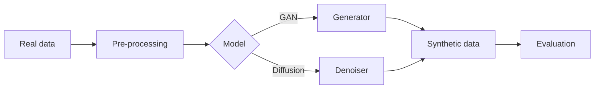
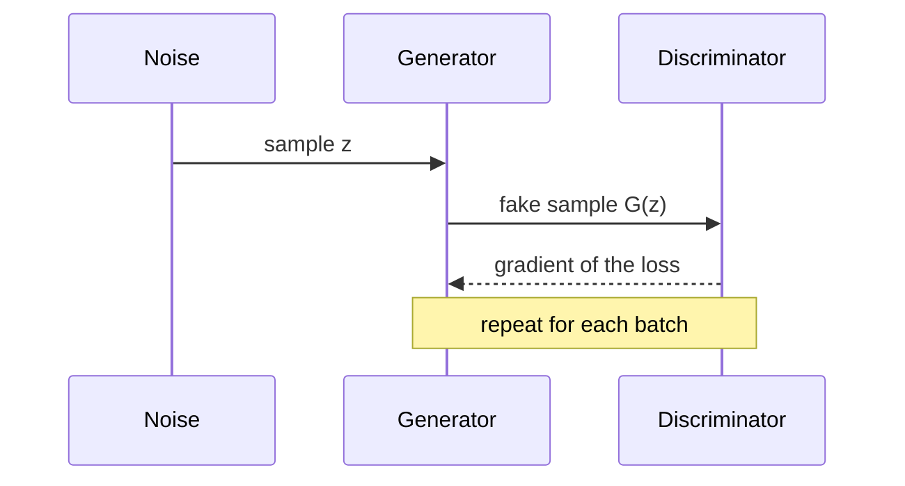
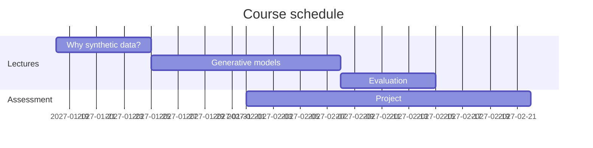
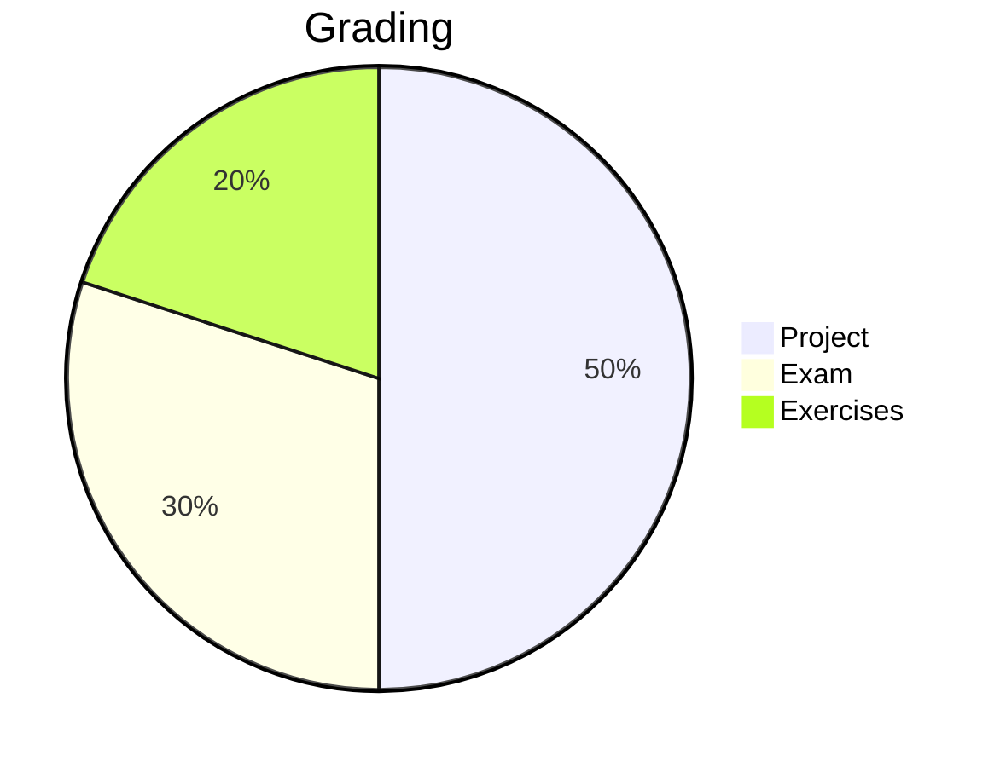

You can draw diagrams as text inside a lesson. The site renders Mermaid diagrams, Markmap mind maps and interactive Plotly charts, and loads each library only on pages that use it.

## Flowchart



````markdown

````

## Sequence diagram



````markdown

````

## Gantt chart

A Gantt chart can show the course schedule.



````markdown

````

## Pie chart



````markdown

````

## Mind map

A `markmap` block turns a Markdown outline into a mind map that you can pan, zoom, fold and unfold. The `height` option sets its height.

```markmap {height="380px"}
# Synthetic data
## Why
- Data sharing
- Augmentation
- Fairness
## How
- GANs
- Diffusion models
- VAEs
## Evaluation
- Fidelity
- Utility
- Privacy
```

````markdown
```markmap {height="380px"}
# Synthetic data
## Why
- Data sharing
- Augmentation
- Fairness
## How
- GANs
- Diffusion models
- VAEs
## Evaluation
- Fidelity
- Utility
- Privacy
```
````

## Interactive chart

The `chart` shortcode draws a Plotly chart from a JSON file in the page folder. Hover over the bars to see their values. The numbers are illustrative.



```markdown

```

The page folder holds `tstr-accuracy.json`, which follows the Plotly figure format:

```json
{
  "data": [
    { "type": "bar", "name": "Trained on real", "x": ["Logistic regression", "Random forest", "MLP"], "y": [0.85, 0.86, 0.85] },
    { "type": "bar", "name": "Trained on GAN data", "x": ["Logistic regression", "Random forest", "MLP"], "y": [0.80, 0.78, 0.79] }
  ],
  "layout": { "barmode": "group", "yaxis": { "title": { "text": "Accuracy on real test data" } } }
}
```
