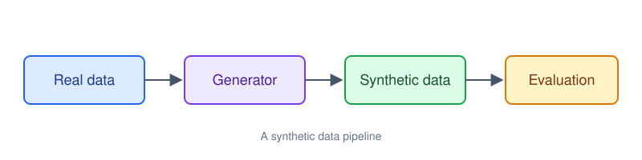

Put image, video and audio files in the lesson's own folder, next to its `index.md`. The site looks for a file there first, then in the shared library at `assets/media/`, and also accepts a full web address.

## Image with a caption

The text in quotes becomes the caption. Click the image to zoom.



```markdown

```

## Image from the shared media library

A file name that is not in the lesson folder is looked up in `assets/media/`. This image is `assets/media/stacked-peaks.svg`.


```markdown

```

## The figure shortcode

Hugo's built-in `figure` shortcode adds options that Markdown images lack, such as a width, a link and a separate title.



```markdown

```

## YouTube

Pass the video ID, which is the part of the address after `v=`. This is the video from the "Teach academic courses" post on your site.



```markdown

```

## Video file

The `video` shortcode plays an MP4 or WebM file. Add `controls="true"` to show the player controls; without them, the video plays on a silent loop. This sample clip is in the public domain (CC0) and comes from MDN.



```markdown


```

## Audio file

The `audio` shortcode plays an MP3 or MP4 audio file. This sample is also a CC0 clip from MDN.



```markdown

```

## Bilibili

The `bilibili` shortcode embeds a video from Bilibili by its BV identifier. We give only the syntax here, since this course has no Bilibili video.

```markdown

```
