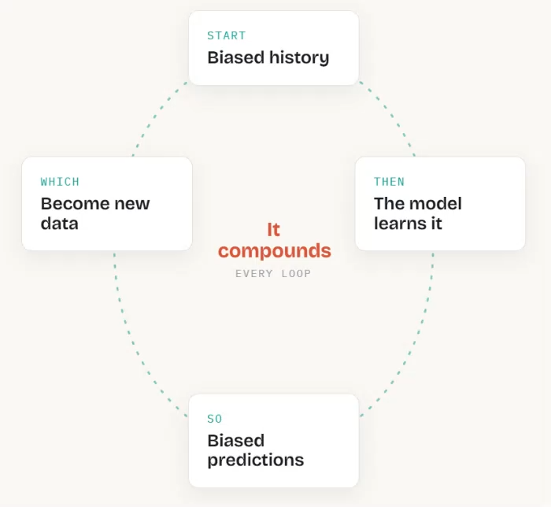

I gave an invited talk titled **"What Makes an Algorithm Fair? Bias, Fairness, Representation Learning and Synthetic Data"** at the **SweCSS Interdisciplinary Dialogue on Inequality and Fairness in AI and Machine Learning**, organised by the Swedish Excellence Centre for Computational Social Science.

The talk introduced algorithmic bias and fairness, how fairness can be measured, and why a model can look fair for each protected attribute on its own yet be unfair where they intersect. I then presented our approaches to tackling this: fair synthetic data generation and fair representation learning.

