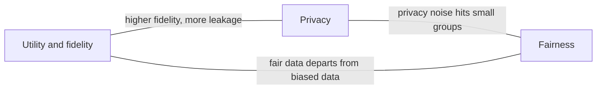

## Outline

1. Why data access is hard: law, institutions, companies
2. GDPR, EHDS and the AI Act on anonymous and synthetic data
3. What synthetic data is, and where it comes from
4. What synthetic data is used for
5. Is synthetic data anonymous?
6. Utility, privacy and fairness; energy use; course roadmap

Note:
The lecture has two halves. The first half is about access: why researchers cannot simply use real data, and what the law says. The second half asks whether synthetic data solves the problem, and introduces the three properties that structure the rest of the course. Energy use has no lecture of its own, so it is covered here.

---

## Three limits on data access

- **Legal:** data protection law decides whether personal data may be processed
- **Institutional:** ethical review, data access committees, data-sharing agreements
- **Commercial:** companies hold data as an asset and may not share it
- Synthetic data is often proposed as a way past all three
- Question for today: when does that proposal hold?

Note:
Ask the group which of the three limits applies to their own data. Keep the answers in mind for the project, which starts from the data-access problem behind your own data.

---

## GDPR: personal data and processing

- Article 4(1): personal data is "any information relating to an identified or identifiable natural person"
- Identifiable: "can be identified, directly or indirectly"
- A record without a name can still be personal data
- Article 4(2): processing is "any operation or set of operations which is performed on personal data"
- Training a generator on personal data is processing and needs a legal basis

Note:
The Article 29 Working Party treated anonymisation itself as "a further processing of personal data" in its 2014 opinion. By the same reading, the training run is processing even if the output turns out to be anonymous. Synthetic data does not remove the need for a legal basis for the training step.

---

## Pseudonymous is not anonymous

- Article 4(5): pseudonymised data "can no longer be attributed to a specific data subject without the use of additional information"
- The additional information "is kept separately"
- Recital 26: such data "should be considered to be information on an identifiable natural person"
- Replacing names with codes does not take data out of the GDPR

Note:
Do not call data with names removed "anonymised". Under the GDPR such data is pseudonymised, and still personal data. The Article 29 Working Party put it bluntly: "pseudonymisation is not a method of anonymisation".

---

## Recital 26: the test for anonymity {.dense}

- The GDPR does not apply to "anonymous information"
- Identifiability depends on "all the means reasonably likely to be used, such as singling out, either by the controller or by another person"
- Judged by "all objective factors": cost, time, "the available technology at the time of the processing and technological developments"
- Anonymity is a property of data in a context, not of a method
- The test looks forward: a new attack can change the verdict
- The word "synthetic" does not appear in the GDPR

Note:
Three consequences for synthetic data. One: the same synthetic dataset can be anonymous in one release and personal data in another. Two: an attack published after a release can change the assessment. Three: there is no special rule for synthetic data, so it faces the same test as any other dataset.

---

## Special categories and research

- Article 9(1) prohibits processing of special categories
- Among them: ethnic origin, genetic and biometric data, "data concerning health", "sex life or sexual orientation"
- Article 9(2)(j): exception for research "in accordance with Article 89(1)"
- Article 89(1): if research can be done with data that does not identify anyone, it "shall be fulfilled in that manner"
- Health data and protected attributes are among the most restricted; the law pushes towards non-identifying data

Note:
This is the gap that synthetic data is meant to fill. Note that the protected attributes we need for fairness research, such as ethnic origin, are special categories. That tension comes back with the AI Act.

---

## Is identifiability relative to the recipient?

- *EDPS v SRB*, Case C-413/23 P, judgment of 4 September 2025
- Pseudonymised data "must not be regarded as constituting, in all cases and for every person, personal data" (paragraph 86)
- If third parties may have means to re-identify, the data remain personal (paragraph 85)
- The case concerned pseudonymised data under Regulation (EU) 2018/1725
- Applying it to synthetic data is an interpretation, not a holding

Note:
Regulation 2018/1725 covers EU institutions. The passages of its Recital 16 quoted in the judgment match GDPR Recital 26. The judgment supports a recipient-relative reading of identifiability for pseudonymised data. Whether a synthetic dataset shared with one partner under contract is anonymous for that partner is an open question; do not present it as settled.

---

## Institutional limits

- Sweden: Lag (2003:460) om etikprövning av forskning som avser människor
- Covers research that processes sensitive personal data under GDPR Article 9(1) (section 3)
- Such research needs approval in an ethical review (section 6)
- Applications go to the Swedish Ethical Review Authority (section 24)
- Data holders add their own steps: proposals, committees, access "only for the requested variables"

Note:
The last bullet is from Raghunathan, Reiter and Rubin (2003), describing access to restricted survey microdata at statistical agencies. Amended versions of sections 6 and 24 of the Ethical Review Act take effect on 1 July 2027. Data-sharing agreements play a similar role between institutions.

---

## Health data: the European Health Data Space

- Regulation (EU) 2025/327 of 11 February 2025
- Aim: "facilitating access to electronic health data" for primary and secondary use
- Applies from 26 March 2027; secondary use from 26 March 2029 (Article 105)
- Article 66(2): provide data "in an anonymised format" where that serves the purpose
- Recital 92: residual re-identification risk, for example for rare diseases
- The Regulation does not mention synthetic data

Note:
Secondary-use purposes in Article 53(1) include scientific research and the training, testing and evaluation of algorithms. Pseudonymised data are provided only if the user shows that anonymised data cannot serve the purpose (Article 66(3)). Whether synthetic data counts as an anonymised format is open, and turns on the Recital 26 test.

---

## AI Act: data governance (Article 10) {.dense}

- Data of high-risk systems must undergo "examination in view of possible biases" (Article 10(2)(f))
- Followed by "appropriate measures to detect, prevent and mitigate possible biases" (Article 10(2)(g))
- Data "shall be relevant, sufficiently representative, and to the best extent possible, free of errors and complete" (Article 10(3))
- Bias detection usually needs the protected attribute
- The protected attribute is often a GDPR special category

Note:
Regulation (EU) 2024/1689. The full text of 10(2)(f) refers to biases likely to affect health and safety, have a negative impact on fundamental rights or lead to prohibited discrimination. The tension: to detect bias you need the sensitive attribute; the GDPR restricts processing it.

---

## The bias-detection exception

- Original Article 10(5): providers may "exceptionally process special categories of personal data" for bias detection
- First of six conditions: detection "cannot be effectively fulfilled by processing other data, including synthetic or anonymised data"
- Digital Omnibus on AI, Regulation (EU) 2026/1744: Article 10(5) deleted, provision moved to Article 4a, wording kept
- Article 4a(2) extends it to other AI systems and to deployers
- Open problem: how do you show synthetic data "cannot effectively" serve?

Note:
Regulation 2026/1744 of 8 July 2026 also moved the application of the high-risk requirements to 2 December 2027 for Annex III systems and 2 August 2028 for Annex I systems. Article 59(1)(b) uses similar wording for regulatory sandboxes. Article 50(2) uses "synthetic" in another sense: AI-generated audio, image, video or text content that must be marked. Synthetic data can support bias detection only if it keeps the joint distribution of protected attribute, label and features, including for small groups. Lecture 6 returns to this.

---

## What is synthetic data?

- Jordon et al. (2022): "data that has been generated using a purpose-built mathematical model or algorithm, with the aim of solving a (set of) data science task(s)"
- Real data $D = (x_1, \dots, x_n)$ from an unknown $P$
- Training: $P_{\hat\theta} = \mathcal{A}(D)$; release $S = (\tilde{x}_1, \dots, \tilde{x}_m) \sim P_{\hat\theta}$
- $S$ depends on $D$ only through $\hat\theta$
- Useful because $\hat\theta$ learnt about $P$; risky because it learnt about each $x_i$

Note:
This formalisation follows Stadler et al. (2022). The definition by Jordon et al. also covers simulators, such as Synthea. In this course the generator is trained on real data, so both utility and leakage flow through the learnt parameters.

---

## Fully synthetic data and its analysis {.dense}

Rubin (1993): "release no actual microdata but only synthetic microdata, constructed using multiple imputation". Raghunathan, Reiter and Rubin (2003) combine estimates $q^{(l)}, v^{(l)}$ from $M$ synthetic datasets:

$$
\bar{q}_M = \tfrac{1}{M}\textstyle\sum_l q^{(l)}, \quad
b_M = \tfrac{1}{M-1}\textstyle\sum_l \big(q^{(l)} - \bar{q}_M\big)^2, \quad
T_M = \big(1 + \tfrac{1}{M}\big) b_M - \bar{v}_M
$$

- $\bar{v}_M$ is the mean of the $v^{(l)}$; $T_M$ is the approximate variance
- The minus sign is intended, and $T_M$ can be negative
- One synthetic dataset analysed as if real understates uncertainty

Note:
Each synthetic sample is drawn from a synthetic population, so the between-dataset variance already contains the usual within-dataset variability. That is why the average within variance is subtracted. Jordon et al. (2022) warn that conclusions from synthetic data are necessarily weaker than conclusions from real data. Ask whether the papers you read account for this.

---

## Partially synthetic data

- Reiter (2003): keep "the units originally surveyed", replace some values "with multiple imputations"
- Example: the US Federal Reserve Board replaced monetary values in the Survey of Consumer Finances
- Record $x = (x_{\mathrm{q}}, x_{\mathrm{s}})$: keep $x_{\mathrm{q}}$, draw $x_{\mathrm{s}}$ from a model of $P(x_{\mathrm{s}} \mid x_{\mathrm{q}})$
- Easier to fit than the full joint distribution
- But "trivially vulnerable to membership inference attacks" (Jordon et al., 2022)

Note:
Little (1993) gave a likelihood theory for masked data, with masking methods that include imputation and the simulation of artificial records. Partially synthetic data trade privacy for utility: the kept values tie each record to a real person.

---

## What synthetic data is used for

| Use | Must preserve | Example |
|---|---|---|
| Private release | Statistics analysts estimate | Census commuting data (Machanavajjhala et al., 2008) |
| Model development | Ranking of methods | Partner selection (Jordon et al., 2022) |
| Augmentation | Class-conditional distribution | Liver lesion images (Frid-Adar et al., 2018) |
| Testing, simulation | Valid values and structure | Synthea (Walonoski et al., 2018) |
| Fairness | Task relations, minus biased ones | FairGAN, DECAF, Bt-GAN |

Note:
Each use asks the synthetic data to preserve a different property of the real data. For software testing, Jordon et al. note that synthetic data must be "semantically correct, but it need not necessarily be statistically correct". The fairness methods are Xu et al. (2018), van Breugel et al. (2021) and Ramachandranpillai et al. (2024).

---

## Two examples

- Frid-Adar et al. (2018): CT images of 182 liver lesions
- Classic augmentation: 78.6% sensitivity, 88.4% specificity
- Adding GAN-generated lesions: 85.7% sensitivity, 92.4% specificity
- Synthea simulates the lifespans of synthetic patients with models of disease progression and care
- Jordon et al. (2022): evaluate, and if necessary fine-tune, deployed models on real data

Note:
Augmentation and simulation are uses where privacy is not the main goal. For deployment, synthetic data does not replace real data: final models should be checked on real data.

---

## Is synthetic data anonymous?

- The argument: records are artificial, so no direct link to real records
- Many studies measured privacy by similarity between real and synthetic records
- Stadler et al. (2022): such studies underestimate the risk
- Jordon et al. (2022): "Synthetic data is not automatically private."

Note:
Ask the group to vote before the next slides: is a GAN-generated table of patient records anonymous? Return to the vote at the end of this part.

---

## Removing identifiers has failed before

- Narayanan and Shmatikov (2008): linked Netflix Prize ratings to public IMDb profiles
- Rocher et al. (2019): "99.98% of Americans would be correctly re-identified in any dataset using 15 demographic attributes"
- Article 29 Working Party (2014): three risks, singling out, linkability and inference
- "pseudonymisation is not a method of anonymisation"

Note:
These results concern de-identified real data, not synthetic data. They explain why the anonymity claim for synthetic data needs evidence. Stadler et al. build their privacy games on the linkability and inference risks of the Working Party opinion.

---

## Privacy gain (Stadler et al., 2022)

$$
\mathrm{PG}(r_t) = \mathrm{Adv}_{\mathcal{A}}(R, r_t) - \mathrm{Adv}_{\mathcal{A}}(S, r_t)
$$

- $R$: raw data; $S$: synthetic data; $r_t$: a target record
- Linkability: is $r_t$ in the training data? (membership inference)
- Inference: what is the value of an attribute of $r_t$?
- An anonymisation mechanism should give a high gain for every record

Note:
The gain is the drop in the adversary's advantage when the adversary sees synthetic instead of raw data. It is defined per record. An average over records hides the records that stay exposed; Stadler et al. found outliers to be the most exposed.

---

## What Stadler et al. find

- No explicit privacy protection: outlier records stay exposed to linkage
- Differential privacy protects them, at a cost in utility
- You cannot predict which properties of the data survive
- Two implementations of private generators violated their guarantees
- Synthetic data "does not provide a better tradeoff between privacy and utility than traditional anonymisation techniques"

Note:
Synthetic Data – Anonymisation Groundhog Day, USENIX Security 2022. The introduction reviews earlier failures of anonymisation; the paper asks whether synthetic data repeats them.

---

## Later attacks

- Annamalai, Gadotti and Rocher (2024): linear reconstruction attack, accurate on arbitrary records
- More synthetic records: higher utility, more effective attack
- Carlini et al. (2023): image diffusion models memorise training images
- They extract "over a thousand training examples"

Note:
Annamalai et al. evaluate probabilistic graphical models, GANs and differentially private mechanisms. Carlini et al. work on image models, not tabular ones, but show that a generator can reproduce its training data. Lecture 5 covers privacy attacks, and Lab 3 is the privacy evaluation lab.

---

## Law and evidence do not map onto each other

- Recital 26: means "reasonably likely to be used"
- Privacy research: adversary's advantage under a stated threat model
- No accepted rule turns a privacy gain or a value of $\varepsilon$ into a Recital 26 verdict
- In this course: anonymity is a claim to test against stated attacks, record by record

Note:
This is an open problem at the boundary of law and computer science. Lecture 5 introduces differential privacy, which bounds what any adversary can learn about one record, but the mapping from a privacy budget to legal anonymity is not settled.

---

## Utility, privacy and fairness



- Jordon et al. (2022): utility, fidelity and privacy
- This course: fidelity with utility (Lecture 4), plus fairness (Lecture 6)

Note:
Utility is usefulness for a task, often measured by training on synthetic and testing on real data. Fidelity is direct statistical similarity. Privacy is how much the synthetic data reveals about the real data. Fairness, throughout the course, means algorithmic fairness: whether models trained on the data treat groups defined by protected attributes differently.

---

## Tensions between the three

- "when fidelity increases, the privacy of synthetic data decreases" (Jordon et al., 2022)
- Ganev et al. (2022): differential privacy can shrink ("Robin Hood") or widen ("Matthew") subgroup gaps
- Either way, accuracy drops more for underrepresented subgroups
- A full statistical match is "even undesirable in the presence of biases"
- Open: fairness on synthetic data may not transfer to real data

Note:
Ganev et al. test PrivBayes, DP-WGAN and PATE-GAN. Jordon et al. name two open problems for fair synthetic data: a predictor fair on synthetic data may not be fair on real data because the feature distribution shifts, and there is no definition of fair synthetic data that does not depend on a given predictor.

---

## Why measure energy?

- Strubell et al. (2019): 626,155 lbs CO<sub>2</sub>e for a Transformer (big) with architecture search
- For comparison: 126,000 lbs for an average car over its lifetime, with fuel
- Patterson et al. (2021): search estimate 18.7 times too high (average organisation)
- And 88 times too high in emissions for an energy-efficient organisation
- Lesson: estimates rest on assumptions; measure during the run

Note:
Patterson et al. explain the gap: the original search used a small proxy task. They recommend that researchers measure energy and emissions themselves rather than leave others to estimate them afterwards. Lacoste et al. (2019) name the main factors: server location and grid, training time, hardware. Henderson et al. (2020) argue for systematic reporting. Luccioni et al. (2024) find that multi-purpose generative architectures are orders of magnitude more expensive at deployment than task-specific systems.

---

## How CodeCarbon estimates emissions

$$
\text{emissions} = E \times C, \qquad E = \sum_{k} P_k \, \Delta t \cdot \mathrm{PUE}
$$

- $P_k$: CPU, GPU and RAM power in interval $k$; $\Delta t$ = 15 s by default
- CPU: hardware counters (RAPL, Windows EMI) or TDP $\times (0.1 + 0.9\,u^3)$ at load $u$
- RAM: modelled from the number of memory modules; GPU: NVML
- $C$: set value, cloud region, Electricity Maps, region, country, or world average 475 gCO<sub>2</sub>eq/kWh

Note:
PUE defaults to 1.0. For a CPU model missing from its table, CodeCarbon assumes 4 watts per thread, or 85 watts if the model cannot be detected. Regional data include the Swedish bidding zones SE1 to SE4. Source: CodeCarbon documentation, methodology page.

---

## Where CodeCarbon can be wrong

- TDP fallback "deviated from RAPL by roughly −60% to +190%" on four profiled CPUs
- World-average carbon intensity can be wrong "by close to an order of magnitude"
- The output file does not record which method was used
- Advice: compare within one machine, not across machines

Note:
Source: CodeCarbon documentation, accuracy and validation page. The documentation is open about these limits. It notes that no external wattmeter validation has been done.

---

## Logging energy in the labs

```python
from codecarbon import OfflineEmissionsTracker

tracker = OfflineEmissionsTracker(country_iso_code="SWE",
                                  project_name="lab1-ctgan", output_dir="emissions")
tracker.start()
model.fit(train_data)          # the training run you measure
emissions_kg = tracker.stop()  # kg CO2eq; details in emissions/emissions.csv
```

- Report energy (kWh), emissions, duration and the CPU tracking method
- Compare models only on the same machine and set-up

Note:
The lab instructions give the exact set-up. A container on Windows or macOS runs inside a Linux virtual machine, so CodeCarbon may fall back to the TDP estimate; the start-up log names the CPU tracking method. Report energy next to emissions, since energy does not depend on the assumed grid.

---

## Course roadmap

| Session | Focus |
|---|---|
| Lectures 2 and 3 | Model families and their objectives (ILO1) |
| Paper seminar 1, Lab 1 | Failure modes of CTGAN, TimeGAN, TransFusion |
| Lecture 4 | Fidelity and utility (ILO2) |
| Lecture 5, Lab 2 | Differential privacy, attacks; utility and privacy lab (ILO2, ILO3) |
| Lecture 6, Lab 3 | Fairness; fairness lab (ILO2, ILO3) |
| Guest lecture | Synthetic data (ILO3) |
| Paper seminar 2 | Privacy and fairness papers |
| Project presentations | Your own domain (ILO4, ILO5) |

Note:
Lecture 2 covers VAEs and GANs, Lecture 3 diffusion models, transformers and basics of LLMs. The guest lecture on synthetic data comes after Lecture 6. Energy logging runs through all labs and the project.

---

## Summary

- Law restricts personal data; anonymous data falls outside the GDPR
- Anonymity depends on context and on attacks "reasonably likely" to be used
- The EHDS prefers anonymised data; the AI Act names synthetic or anonymised data as alternatives for bias detection
- Synthetic data is not anonymous by construction; test it per record
- Utility, privacy and fairness pull against each other
- Measure energy, and compare within one machine

Note:
Link back to the learning goals on the lecture page. Before the next lecture, read the Lecture 2 papers on VAEs and GANs.

---

## Discussion

- Who is the "other person" in Recital 26 for a synthetic release to one partner, and for a public release?
- How could a provider show that synthetic data "cannot effectively" serve bias detection?
- Why measure the privacy gain per record and not on average?
- Should a differentially private synthetic dataset count as "an anonymised format" under the EHDS?

Note:
Further questions and hints are on the lecture page. Ask participants to keep their pre-lecture note on what synthetic data can and cannot do; they return to it in the reflection report.

---

## References (1/2) {.refs}

- Annamalai, Gadotti, Rocher (2024). A Linear Reconstruction Approach for Attribute Inference Attacks against Synthetic Data. USENIX Security 24, 2351–2368.
- Article 29 Data Protection Working Party (2014). Opinion 05/2014 on Anonymisation Techniques (WP216).
- Carlini et al. (2023). Extracting Training Data from Diffusion Models. USENIX Security 23, 5253–5270.
- CodeCarbon (2026). Methodology; Accuracy and validation. Documentation, accessed 10 November 2026.
- Court of Justice of the EU (2025). Judgment of 4 September 2025, EDPS v SRB, C-413/23 P.
- Frid-Adar et al. (2018). GAN-based synthetic medical image augmentation for increased CNN performance in liver lesion classification. Neurocomputing 321, 321–331.
- Ganev, Oprisanu, De Cristofaro (2022). Robin Hood and Matthew Effects: Differential Privacy Has Disparate Impact on Synthetic Data. ICML, PMLR 162, 6944–6959.
- Henderson et al. (2020). Towards the Systematic Reporting of the Energy and Carbon Footprints of Machine Learning. JMLR 21(248), 1–43.
- Jordon et al. (2022). Synthetic Data – what, why and how? arXiv:2205.03257.
- Lacoste, Luccioni, Schmidt, Dandres (2019). Quantifying the Carbon Emissions of Machine Learning. arXiv:1910.09700.
- Lag (2003:460) om etikprövning av forskning som avser människor.
- Little (1993). Statistical Analysis of Masked Data. Journal of Official Statistics 9(2), 407–426.
- Luccioni, Jernite, Strubell (2024). Power Hungry Processing: Watts Driving the Cost of AI Deployment? FAccT '24, 85–99.
- Machanavajjhala et al. (2008). Privacy: Theory meets Practice on the Map. ICDE 2008, 277–286.
- Narayanan, Shmatikov (2008). Robust De-anonymization of Large Sparse Datasets. IEEE S&P 2008, 111–125.

---

## References (2/2) {.refs}

- Patterson et al. (2021). Carbon Emissions and Large Neural Network Training. arXiv:2104.10350.
- Raghunathan, Reiter, Rubin (2003). Multiple Imputation for Statistical Disclosure Limitation. Journal of Official Statistics 19(1), 1–16.
- Ramachandranpillai, Sikder, Bergström, Heintz (2024). Bt-GAN: Generating Fair Synthetic Healthdata via Bias-transforming Generative Adversarial Networks. JAIR 79, 1313–1341.
- Regulation (EU) 2016/679 (GDPR); Regulation (EU) 2024/1689 (AI Act); Regulation (EU) 2025/327 (EHDS); Regulation (EU) 2026/1744 (Digital Omnibus on AI).
- Reiter (2003). Inference for Partially Synthetic, Public Use Microdata Sets. Survey Methodology 29(2), 181–188.
- Rocher, Hendrickx, de Montjoye (2019). Estimating the success of re-identifications in incomplete datasets using generative models. Nature Communications 10, 3069.
- Rubin (1993). Discussion: Statistical Disclosure Limitation. Journal of Official Statistics 9(2), 461–468.
- Stadler, Oprisanu, Troncoso (2022). Synthetic Data – Anonymisation Groundhog Day. USENIX Security 22, 1451–1468.
- Strubell, Ganesh, McCallum (2019). Energy and Policy Considerations for Deep Learning in NLP. ACL 2019, 3645–3650.
- van Breugel, Kyono, Berrevoets, van der Schaar (2021). DECAF: Generating Fair Synthetic Data Using Causally-Aware Generative Networks. NeurIPS 34.
- Walonoski et al. (2018). Synthea: An approach, method, and software mechanism for generating synthetic patients and the synthetic electronic health care record. JAMIA 25(3), 230–238.
- Xu, Yuan, Zhang, Wu (2018). FairGAN: Fairness-aware Generative Adversarial Networks. IEEE Big Data 2018, 570–575.
