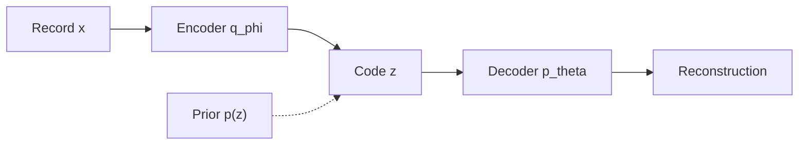
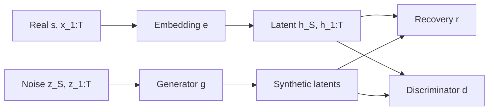

## Outline

- Latent variable models and maximum likelihood
- Variational autoencoders (VAEs)
- Generative adversarial networks (GANs) and their variants
- Tabular data: CTGAN and TVAE
- Time series: RCGAN and TimeGAN
- How the objective shapes the synthetic data

Note:
The thread through today is learning outcome LO1. A training objective decides which errors a model pays for and which it tolerates. Maximum likelihood pays heavily for missing any part of the data and little for implausible samples; the GAN objectives in common use tend to do the reverse. For synthetic data, this decides whether rare subgroups survive and how much the model copies. Keep that question in mind for every model we see.

---

## Latent variable models

$$
p_\theta(x) = \int p_\theta(x \mid z)\, p(z)\, dz
$$

- Draw $z \sim p(z)$, then $x \sim p_\theta(x \mid z)$ from a neural decoder
- No closed form: you cannot evaluate or differentiate $\log p_\theta(x)$
- The posterior $p_\theta(z \mid x)$ is intractable too, so expectation-maximisation is ruled out

Note:
This is the setting of Kingma and Welling, Section 2.1. The decoder is a neural network, so the integral over z has no closed form. The posterior is the likelihood times the prior divided by the marginal, so it inherits the same problem, and the expectation-maximisation algorithm cannot be used.

---

## Maximum likelihood is the forward KL

$$
\mathrm{KL}(p_{\text{data}} \Vert p_\theta) = \mathbb{E}_{p_{\text{data}}}[\log p_{\text{data}}(x)] - \mathbb{E}_{p_{\text{data}}}[\log p_\theta(x)]
$$

- The first term does not depend on $\theta$
- VAE: keep the likelihood and maximise a lower bound on it
- GAN: drop the likelihood and compare samples with real records

Note:
Maximising the expected log-likelihood is the same as minimising the KL divergence from the data to the model, the forward direction. Goodfellow's 2016 tutorial states this explicitly. Remember the direction; we come back to it at the end of the lecture.

---

## VAE: encoder and decoder

- Amortised inference: one encoder shared by all records
- Inference gap = approximation gap + amortisation gap (Cremer et al., 2018)

Note:
Classical variational inference fits separate variational parameters for each record. The VAE encoder shares one set of parameters across records. Cremer and colleagues split the gap between the log-likelihood and the bound into an approximation gap, from the restricted family, and an amortisation gap, from the encoder not finding the best member of that family for each record. On their datasets the amortisation gap was often the larger part.

---

## The evidence lower bound

$$
\begin{aligned}
\log p_\theta(x) &= \mathcal{L}(\theta, \phi; x) + \mathrm{KL}\big(q_\phi(z \mid x) \Vert p_\theta(z \mid x)\big) \\
\mathcal{L}(\theta, \phi; x) &= \mathbb{E}_{q_\phi(z \mid x)}[\log p_\theta(x \mid z)] - \mathrm{KL}\big(q_\phi(z \mid x) \Vert p(z)\big)
\end{aligned}
$$

- Reconstruction term and prior term
- The gap is the KL divergence to the true posterior, which is never negative
- Maximising over $\theta$ can also make the posterior easier to fit

Note:
These are equations 1 and 3 of Kingma and Welling. Maximising over phi tightens the bound. Maximising over theta raises the bound either by raising the likelihood or by shaping the model so that the true posterior is easier for the encoder to match. Cremer and colleagues found evidence that the decoder does accommodate the approximation.

---

## Deriving the bound {.dense}

$$
\begin{aligned}
\log p_\theta(x) &= \mathbb{E}_{q_\phi(z \mid x)}\left[\log \frac{p_\theta(x, z)}{p_\theta(z \mid x)}\right] \\
&= \mathbb{E}_{q_\phi(z \mid x)}\left[\log \frac{p_\theta(x, z)}{q_\phi(z \mid x)}\right] + \mathbb{E}_{q_\phi(z \mid x)}\left[\log \frac{q_\phi(z \mid x)}{p_\theta(z \mid x)}\right]
\end{aligned}
$$

- Line 1: $\log p_\theta(x)$ does not depend on $z$, and $p_\theta(x) = p_\theta(x, z)/p_\theta(z \mid x)$
- Line 2: multiply and divide by $q_\phi(z \mid x)$; the second term is a KL divergence
- Then write $p_\theta(x, z) = p_\theta(x \mid z)\, p(z)$

Note:
Work through this on the board. The derivation needs only Bayes' rule and the definition of the KL divergence. The point to stress is that the gap is exactly the KL divergence between the encoder and the true posterior, so a better encoder gives a tighter bound.

---

## The reparameterisation trick

$$
\begin{aligned}
z &= \mu_\phi(x) + \sigma_\phi(x) \odot \epsilon, \qquad \epsilon \sim \mathcal{N}(0, I) \\
-\mathrm{KL}\big(q_\phi(z \mid x) \Vert \mathcal{N}(0, I)\big) &= \tfrac{1}{2}\textstyle\sum_{j=1}^{J}\big(1 + \log \sigma_j^2 - \mu_j^2 - \sigma_j^2\big)
\end{aligned}
$$

- Gradients flow through $\mu_\phi$ and $\sigma_\phi$; the naive estimator's variance is too high to be practical
- Found independently by Rezende et al. (2014)
- Categorical variables need a relaxation: Gumbel-softmax (Jang et al., 2017)

Note:
The expectation now runs over noise that does not depend on phi, so you can differentiate inside it. The closed-form KL is equation 10 of Kingma and Welling. The trick needs a reparameterisable distribution; categorical variables are not, which is why CTGAN later uses the Gumbel-softmax relaxation for its discrete outputs.

---

## Gaussian decoders average

$$
\log p_\theta(x \mid z) = -\frac{\lVert x - \mu_\theta(z) \rVert^2}{2\sigma^2} + \text{const}
$$

- Squared error is minimised by the conditional mean: overlapping codes give averaged records (images: blur; tables: values between two modes)
- Disputed: Zhao et al. (2017) obtain sharp samples with a pixel-wise loss and blame unmet conditions on the objective
- Goodfellow (2016): GANs trained towards maximum likelihood stay sharp

Note:
With a fixed-variance Gaussian decoder, the reconstruction term is a scaled squared error, and squared error is minimised by the conditional mean. Multiplying the bound by two sigma squared shows that sigma squared also acts as a weight on the KL term. The averaging story is common but not settled; present both counterarguments and ask the students which evidence they find stronger.

---

## Posterior collapse

- $q_\phi(z \mid x) = p(z)$ for some dimensions: KL term zero, decoder ignores $z$
- Bowman et al. (2016): LSTM decoder; most straightforward runs collapsed
- Their remedies: KL annealing and word dropout
- Lucas et al. (2019): in linear VAEs the ELBO adds no spurious local maxima
- Their account: local maxima of the likelihood itself, affected by observation noise
- Open: how far this carries to deep decoders

Note:
Posterior collapse happens when the decoder is strong enough to model the data without the code. Bowman and colleagues observed it for sentences. Lucas and colleagues shift the blame from the ELBO to the likelihood surface, at least for linear models, and relate it to the observation noise. Whether this explains collapse in deep non-linear VAEs is still debated.

---

## β-VAE

$$
\mathcal{L}_\beta = \mathbb{E}_{q_\phi(z \mid x)}[\log p_\theta(x \mid z)] - \beta\, \mathrm{KL}\big(q_\phi(z \mid x) \Vert p(z)\big)
$$

- $\beta > 1$: more disentangled factors, worse reconstruction (Higgins et al., 2017)
- $\beta \ge 1$: still a lower bound on $\log p_\theta(x)$; $\beta < 1$: not guaranteed
- The variance of a Gaussian decoder acts as a similar KL weight

Note:
The bound claim follows from the KL divergence being non-negative. For synthetic data, beta changes how much information about each record the code can carry. Whether a larger beta reduces memorisation is a hypothesis, not a result; it is one of today's discussion questions.

---

## GAN: the game

$$
\min_G \max_D V(D, G) = \mathbb{E}_{x \sim p_{\text{data}}}[\log D(x)] + \mathbb{E}_{z \sim p_z}[\log(1 - D(G(z)))]
$$

- $G$ defines $p_g$ implicitly: you can sample from it but not evaluate it
- $D$ outputs the probability that its input is real
- Alternate $k$ discriminator steps with one generator step ($k = 1$ in the paper)

Note:
This is equation 1 of Goodfellow and colleagues. The generator never sees a real record directly; it learns only through the discriminator's gradients. Keep that fact in mind, because Xu and colleagues later use it as a privacy argument, and Lecture 5 tests it.

---

## Optimal discriminator and the JSD

$$
D^*_G(x) = \frac{p_{\text{data}}(x)}{p_{\text{data}}(x) + p_g(x)}, \qquad C(G) = -\log 4 + 2\,\mathrm{JSD}(p_{\text{data}} \Vert p_g)
$$

- Pointwise: $a \log y + b \log(1 - y)$ is maximal at $y = a/(a + b)$
- The minimum $-\log 4$ is reached only at $p_g = p_{\text{data}}$
- Proved in the space of densities; Goodfellow et al. note it does not apply to network parameters

Note:
Derive the optimal discriminator by writing the value function as an integral over x and maximising the integrand pointwise. Substituting back gives the Jensen-Shannon divergence plus a constant. Stress the caveat at the end of Section 4.2 of the paper: the proofs assume you optimise densities directly with an optimal discriminator.

---

## The non-saturating loss

$$
\mathbb{E}_{z}\big[-\nabla_\theta \log D^*(g_\theta(z))\big] = \nabla_\theta\big[\mathrm{KL}(p_{g_\theta} \Vert p_{\text{data}}) - 2\,\mathrm{JSD}(p_{g_\theta} \Vert p_{\text{data}})\big]
$$

- The generator maximises $\log D(G(z))$: same fixed point, stronger early gradients
- With an optimal $D$ it follows the reverse KL (Arjovsky and Bottou, 2017)
- Reverse KL: implausible samples are expensive, dropped modes are cheap

Note:
Goodfellow and colleagues introduced this loss because log of one minus D saturates early in training. Arjovsky and Bottou prove which quantity its gradient follows, with the discriminator optimal for the current parameters. The sign of the Jensen-Shannon term is negative, which they also flag as a problem.

---

## Training problems

- Mode collapse, the "Helvetica scenario" (Goodfellow et al., 2014); partial collapse is common
- Disjoint or misaligned supports: a discriminator with accuracy 1 exists and gradients vanish (Arjovsky and Bottou, 2017)
- Unregularised training can fail to converge (Mescheder et al., 2018)
- Lucic et al. (2018): with enough tuning, most variants reach similar scores
- No tested variant consistently beat the non-saturating GAN

Note:
The phrase Helvetica scenario is in the original paper. Mescheder and colleagues show that zero-centred gradient penalties restore local convergence. Lucic and colleagues conclude that improvements can come from computational budget and tuning rather than from algorithmic changes, which matters when you compare models in your project.

---

## Why do GANs collapse? Disputed

- Divergence view: the reverse-KL term drops modes (Arjovsky and Bottou, 2017)
- Optimisation view: GANs trained towards maximum likelihood also collapse (Goodfellow, 2016)
- GANs often use fewer modes than the JSD would prefer
- Simultaneous gradient descent can behave like the maximin game: every $z$ goes to the point $D$ rates most real

Note:
This is an open question. Ask the students what experiment could separate the two explanations. One answer: hold the divergence fixed and vary the optimisation, then the reverse, and count the categories of an imbalanced column that survive.

---

## f-GAN

$$
F(\theta, \omega) = \mathbb{E}_{x \sim P}[T_\omega(x)] - \mathbb{E}_{x \sim Q_\theta}\big[f^*(T_\omega(x))\big]
$$

- $D_f(P \Vert Q) = \int q(x)\, f\big(p(x)/q(x)\big)\, dx$, with $f^*$ the convex conjugate
- Choose $f$: forward KL, reverse KL, JSD; the GAN is $2\,\mathrm{JSD} - \log 4$
- On images, three divergences gave equally realistic samples (Nowozin et al., 2016)

Note:
The objective is a variational lower bound on the f-divergence. Nowozin and colleagues note that the learned distributions differ only when the generator is not rich enough. By their account, the choice of divergence matters most when the model family cannot represent the data.

---

## Wasserstein GAN

$$
W(P_r, P_g) = \inf_{\gamma \in \Pi(P_r, P_g)} \mathbb{E}_{(x, y) \sim \gamma}\big[\lVert x - y \rVert\big] = \sup_{\lVert f \rVert_L \le 1} \mathbb{E}_{P_r}[f(x)] - \mathbb{E}_{P_g}[f(x)]
$$

- Earth-Mover distance; the second form is the Kantorovich–Rubinstein duality
- Parallel lines $\theta$ apart: $W = \lvert\theta\rvert$, whereas the JSD is $\log 2$ for every $\theta \neq 0$
- The critic must be Lipschitz: the original WGAN clips its weights (Arjovsky et al., 2017)

Note:
Example 1 of the WGAN paper shows the point: the Wasserstein distance shrinks smoothly as the generated line moves towards the real one, while the Jensen-Shannon divergence stays constant and gives no gradient. Arjovsky and colleagues report no mode collapse in their experiments, which is an observation, not a guarantee.

---

## WGAN-GP

$$
L = \mathbb{E}_{\tilde{x} \sim P_g}[D(\tilde{x})] - \mathbb{E}_{x \sim P_r}[D(x)] + \lambda\, \mathbb{E}_{\hat{x}}\big[(\lVert \nabla_{\hat{x}} D(\hat{x}) \rVert_2 - 1)^2\big]
$$

- $\hat{x}$ uniform on lines between real and generated points; $\lambda = 10$
- No batch normalisation in the critic, since the penalty is per input
- Neither WGAN nor WGAN-GP always converges with finite critic steps (Mescheder et al., 2018)

Note:
Gulrajani and colleagues show that weight clipping can bias the critic towards overly simple functions and, without careful tuning, cause exploding or vanishing gradients. CTGAN uses this loss, so you will meet it again in Lab 1.

---

## Conditional GANs

$$
\min_G \max_D \; \mathbb{E}_{x}[\log D(x \mid y)] + \mathbb{E}_{z}[\log(1 - D(G(z \mid y)))]
$$

- Feed $y$ to both networks (Mirza and Osindero, 2014)
- Lets you request records with a given label or category
- CTGAN builds its training scheme on this idea

Note:
Conditioning is the simplest tool for controlling what a generator produces. In CTGAN the condition is a category of one discrete column, chosen afresh at every training step.

---

## Why tables are hard {.dense}

| Property | Finding in Xu et al. (2019) |
|---|---|
| Mixed types | Softmax and tanh outputs needed together |
| Multimodal continuous columns | 57 of 123 columns have more than one mode |
| Sparse one-hot vectors | A trivial discriminator can check sparsity |
| Imbalanced categories | 636 of 1048 columns: major category in over 90% of rows |
| Discrete outputs | GANs need gradients through generated values |

Note:
The counts come from the 8 real datasets in the CTGAN benchmark. Xu and colleagues also note that missing a minor category changes the distribution so little that the discriminator struggles to detect it. The last row is from the original GAN paper, which states that GANs cannot model discrete data directly.

---

## Mode-specific normalisation

$$
\rho_k = \mu_k\, \mathcal{N}(c_{i,j}; \eta_k, \phi_k), \qquad \alpha_{i,j} = \frac{c_{i,j} - \eta_k}{4\phi_k}
$$

- Fit a variational Gaussian mixture to each continuous column
- Sample a mode $k$ in proportion to $\rho_k$; encode a one-hot $\beta_{i,j}$ and the scalar $\alpha_{i,j}$
- Replacing it with min-max normalisation: −25.7% in the ablation

Note:
The variational Gaussian mixture estimates the number of modes as well as their weights, means and standard deviations; Bishop, Section 10.2, derives it. The ablation figure is the absolute change on the real classification datasets, excluding MNIST.

---

## Conditional generator and training-by-sampling

- Pick a discrete column uniformly, then a category with probability proportional to its log frequency
- Encode the condition as a one-hot vector $\mathit{cond}$; the generator gets $z$ and $\mathit{cond}$
- A cross-entropy term makes the generator output the requested category
- The critic sees real rows that have the requested category
- Ablation: −17.8% without training-by-sampling, −36.5% without both

Note:
Uniform sampling of rows under-represents minor categories; resampling the rows changes the distribution the generator learns. The log-frequency scheme flattens the category distribution during training, and the joint distribution is recovered by summing the conditionals weighted by the real category frequencies.

---

## CTGAN and TVAE

| | CTGAN | TVAE |
|---|---|---|
| Objective | WGAN-GP plus condition cross-entropy | ELBO |
| Discrete outputs | Gumbel-softmax, temperature 0.2 | Softmax |
| Diversity aid | PacGAN, 10 rows per critic decision (Lin et al., 2018) | None |
| Optimiser | Adam, learning rate $2 \times 10^{-4}$ | Adam, learning rate $10^{-3}$ |
| Average F1, real classification data | 0.469 | 0.519 |

Note:
Both models share the same preprocessing. Classifiers trained on the real training data reached 0.743 in the same table. Xu and colleagues write that TVAE outperforms CTGAN in several cases, yet argue for GANs because the generator never accesses real data, which in their view makes differential privacy easier. Ask the students to evaluate that argument; it is a discussion question.

---

## Time series: what must be preserved

- A record has static features $s$ and a sequence $x_{1:T}$
- Temporal dynamics: the conditionals $p(x_t \mid s, x_{1:t-1})$
- RCGAN: LSTM generator and discriminator, both conditioned (Esteban et al., 2017)
- RCGAN evaluates with train on synthetic, test on real (Lecture 4)

Note:
A generator can match the distribution of each time step and still get the transitions wrong. RCGAN does not feed the generator's previous output back as input. Esteban and colleagues also discuss privacy and train a differentially private RCGAN.

---

## TimeGAN: four networks

- The generator and discriminator work in the latent space (Yoon et al., 2019)

Note:
The embedding network maps features to latent codes and the recovery network maps them back. The generator produces latent sequences from Gaussian static noise and a Wiener process. The discriminator classifies latent sequences, not raw ones.

---

## TimeGAN: three losses {.dense}

$$
\begin{aligned}
\mathcal{L}_R &= \mathbb{E}\Big[\lVert s - \tilde{s} \rVert_2 + \textstyle\sum_t \lVert x_t - \tilde{x}_t \rVert_2\Big] \\
\mathcal{L}_U &= \mathbb{E}_{p}\Big[\log y_S + \textstyle\sum_t \log y_t\Big] + \mathbb{E}_{\hat{p}}\Big[\log(1 - \hat{y}_S) + \textstyle\sum_t \log(1 - \hat{y}_t)\Big] \\
\mathcal{L}_S &= \mathbb{E}\Big[\textstyle\sum_t \lVert h_t - g_X(h_S, h_{t-1}, z_t) \rVert_2\Big]
\end{aligned}
$$

- Embedding and recovery minimise $\lambda \mathcal{L}_S + \mathcal{L}_R$; the adversarial pair plays $\min_g(\eta \mathcal{L}_S + \max_d \mathcal{L}_U)$
- $\lambda = 1$, $\eta = 10$; the ablation shows the supervised loss matters most for strongly correlated data

Note:
The supervised loss gives the generator the real latent history and asks for the next real latent. It implements the local, stepwise objective, while the adversarial loss implements the global one. Yoon and colleagues report low sensitivity to lambda and eta. TimeGAN has no privacy guarantee; they name differential privacy as future work.

---

## Mode covering versus mode seeking

- Forward KL: uncovered data is expensive, mass between modes is cheap (zero-avoiding; Bishop, 2006)
- Reverse KL: mass without data is expensive, dropped modes are cheap (zero-forcing)
- Theis et al. (2016): a Gaussian fitted to a mixture; the KL fit covers, the JSD fit takes one mode
- Quality versus diversity: precision and recall (Sajjadi et al., 2018; Alaa et al., 2022), in Lecture 4
- These are tendencies under the assumptions of the theory; the optimiser matters too

Note:
Look at the integrand of each KL direction to see where the cost explodes. The terms zero-avoiding and zero-forcing come from Bishop. The disagreement about mode collapse shows that the divergence alone does not predict what a trained model does.

---

## Objective and consequences {.dense}

| Model | Minimises (in theory) | Per-record likelihood | Rare modes |
|---|---|---|---|
| VAE | Bound on maximum likelihood (forward KL) | Lower bound (ELBO) | Must keep mass on every record |
| GAN, minimax | $2\,\mathrm{JSD} - \log 4$ | None | Between the two KL directions |
| GAN, non-saturating | Reverse KL minus $2\,\mathrm{JSD}$ | None | Dropping a mode is cheap |
| WGAN, WGAN-GP | Wasserstein-1 distance | None | No collapse seen in the WGAN experiments |
| TimeGAN | Latent adversarial plus stepwise supervised loss | None | Inherits the adversarial behaviour |

Note:
This table summarises LO1 for the two families. Read each row as a prediction to test in Lab 1, not as a guarantee.

---

## Memorisation

- Theis et al. (2016): copy training data 99% of the time, lose at most $\log 100 \approx 4.61$ nats
- van den Burg and Williams (2021): change in log-likelihood when a record is left out
- They find memorisation in sparse regions, not only for outliers
- GANs give no likelihood, yet membership inference works (Hayes et al., 2019)
- Lecture 5: attacks and differential privacy

Note:
A high likelihood does not rule out copying. A likelihood does let you measure memorisation per record, which van den Burg and Williams do for VAEs. Goodfellow and colleagues suggested that the generator's indirect access to data may be a statistical advantage; Hayes and colleagues show it is not a privacy guarantee.

---

## Rare subgroups and fairness

- Mode seeking: a small subgroup can be dropped at little cost
- Minor categories are hard for the discriminator to see (Xu et al., 2019)
- Likelihood-based: the subgroup is kept, but sparse records may be memorised
- Training-by-sampling shows rare rows more often: a privacy cost? Test it in Lab 3
- Lecture 6: measuring the effect on downstream algorithmic fairness

Note:
Fairness here means algorithmic fairness. If a protected subgroup forms a small mode, the objective influences whether it disappears, is blurred into its neighbours, or is copied. The first two are fairness concerns; the third is a privacy concern.

---

## Summary

- VAE: a lower bound on the likelihood; averaging and posterior collapse
- GAN: the JSD in theory; the non-saturating loss follows the reverse KL
- WGAN-GP: Wasserstein distance with a gradient penalty
- CTGAN and TVAE: representation and sampling choices for tables
- TimeGAN: adversarial loss plus a stepwise supervised loss
- The objective predicts coverage, copying and the fate of rare subgroups

Note:
Next week, Lecture 3 covers diffusion and transformer-based models, and asks the same LO1 questions of them.

---

## Discussion

- Would a larger $\beta$ in a β-VAE reduce memorisation? How would you test it?
- Is CTGAN easier to make differentially private than TVAE? Which network touches real records?
- What does TimeGAN's supervised loss reward when the true next step is multimodal?

Note:
Model answers and hints for these and three further questions are on the lecture page.

---

## References (1) {.refs}

- Alaa, van Breugel, Saveliev, van der Schaar (2022). How Faithful is your Synthetic Data? Sample-level Metrics for Evaluating and Auditing Generative Models. ICML, PMLR 162.
- Arjovsky, Bottou (2017). Towards Principled Methods for Training Generative Adversarial Networks. ICLR.
- Arjovsky, Chintala, Bottou (2017). Wasserstein Generative Adversarial Networks. ICML, PMLR 70.
- Bishop (2006). Pattern Recognition and Machine Learning. Springer.
- Bowman, Vilnis, Vinyals, Dai, Jozefowicz, Bengio (2016). Generating Sentences from a Continuous Space. CoNLL.
- Cremer, Li, Duvenaud (2018). Inference Suboptimality in Variational Autoencoders. ICML, PMLR 80.
- Esteban, Hyland, Rätsch (2017). Real-valued (Medical) Time Series Generation with Recurrent Conditional GANs. arXiv:1706.02633.
- Goodfellow (2016). NIPS 2016 Tutorial: Generative Adversarial Networks. arXiv:1701.00160.
- Goodfellow, Pouget-Abadie, Mirza, Xu, Warde-Farley, Ozair, Courville, Bengio (2014). Generative Adversarial Nets. NeurIPS 27.
- Gulrajani, Ahmed, Arjovsky, Dumoulin, Courville (2017). Improved Training of Wasserstein GANs. NeurIPS 30.
- Hayes, Melis, Danezis, De Cristofaro (2019). LOGAN: Membership Inference Attacks Against Generative Models. PoPETs 2019(1).
- Higgins, Matthey, Pal, Burgess, Glorot, Botvinick, Mohamed, Lerchner (2017). beta-VAE: Learning Basic Visual Concepts with a Constrained Variational Framework. ICLR.
- Jang, Gu, Poole (2017). Categorical Reparameterization with Gumbel-Softmax. ICLR.
- Kingma, Welling (2014). Auto-Encoding Variational Bayes. ICLR.

---

## References (2) {.refs}

- Lin, Khetan, Fanti, Oh (2018). PacGAN: The power of two samples in generative adversarial networks. NeurIPS 31.
- Lucas, Tucker, Grosse, Norouzi (2019). Don't Blame the ELBO! A Linear VAE Perspective on Posterior Collapse. NeurIPS 32.
- Lucic, Kurach, Michalski, Gelly, Bousquet (2018). Are GANs Created Equal? A Large-Scale Study. NeurIPS 31.
- Mescheder, Geiger, Nowozin (2018). Which Training Methods for GANs do actually Converge? ICML, PMLR 80.
- Mirza, Osindero (2014). Conditional Generative Adversarial Nets. arXiv:1411.1784.
- Nowozin, Cseke, Tomioka (2016). f-GAN: Training Generative Neural Samplers using Variational Divergence Minimization. NeurIPS 29.
- Rezende, Mohamed, Wierstra (2014). Stochastic Backpropagation and Approximate Inference in Deep Generative Models. ICML, PMLR 32.
- Sajjadi, Bachem, Lucic, Bousquet, Gelly (2018). Assessing Generative Models via Precision and Recall. NeurIPS 31.
- Theis, van den Oord, Bethge (2016). A note on the evaluation of generative models. ICLR.
- van den Burg, Williams (2021). On Memorization in Probabilistic Deep Generative Models. NeurIPS 34.
- Xu, Skoularidou, Cuesta-Infante, Veeramachaneni (2019). Modeling Tabular data using Conditional GAN. NeurIPS 32.
- Yoon, Jarrett, van der Schaar (2019). Time-series Generative Adversarial Networks. NeurIPS 32.
- Zhao, Song, Ermon (2017). Towards Deeper Understanding of Variational Autoencoding Models. arXiv:1702.08658.

Note:
Full references with links are on the lecture page.
