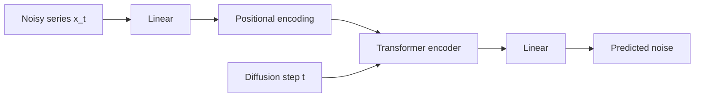

## Outline

- From one network pass to many: diffusion models
- The objective: variational bound and noise prediction
- Scores, SDEs and faster sampling
- Conditioning and guidance
- Diffusion for tables and time series, including TransFusion
- Transformers as generators; comparing the families

Note:
The guiding question is the one behind LO1: how does the training objective shape the synthetic data? We derive the diffusion objective, see what the common simplification gives up, and then look at how the models are adapted to tables and time series. The last part compares VAEs, GANs, diffusion models and autoregressive transformers.

---

## Where this lecture sits

- Lecture 2: a VAE or a GAN produces a sample in one network pass
- Diffusion model: fixed noising process, learned denoising over $T$ steps
- Idea from Sohl-Dickstein et al. (2015); made competitive by Ho et al. (2020)
- Autoregressive transformer: one token at a time
- Transformers also serve as denoisers, as in TransFusion

Note:
Sohl-Dickstein and colleagues proposed to destroy the structure of the data slowly with a forward diffusion process and to learn a reverse process that restores it. Ho and colleagues made this competitive on images with a reparameterised loss. A diffusion model keeps a variational bound, as the VAE does, but its encoder is fixed and has no parameters.

---

## The forward process

$$
q(x_t \mid x_{t-1}) = \mathcal{N}\big(x_t;\ \sqrt{1-\beta_t}\, x_{t-1},\ \beta_t I\big)
$$

- Variance schedule $\beta_1, \dots, \beta_T$; no learned parameters
- Notation: $\alpha_t = 1-\beta_t$ and $\bar{\alpha}_t = \prod_{s \le t} \alpha_s$
- Ho et al. (2020): $T = 1000$, linear schedule from $10^{-4}$ to $0.02$

Note:
Each step shrinks the signal slightly and adds a little Gaussian noise. After enough steps the data are indistinguishable from standard Gaussian noise. The schedule is a design choice, not a learned quantity.

---

## Closed form for $q(x_t \mid x_0)$

$$
x_t = \sqrt{\bar{\alpha}_t}\, x_0 + \sqrt{1-\bar{\alpha}_t}\, \epsilon, \qquad \epsilon \sim \mathcal{N}(0, I)
$$

- Two steps: the noise variances add to $1 - \alpha_t \alpha_{t-1}$; induction does the rest
- Training noises $x_0$ directly at a random $t$
- $\bar{\alpha}_T \approx 0$: $x_T$ is close to $\mathcal{N}(0, I)$ for any $x_0$

Note:
Write one step as the square root of alpha t times x t minus 1, plus the square root of 1 minus alpha t times fresh noise. Substitute the previous step. The two noise terms are independent zero-mean Gaussians, so their variances add: alpha t times 1 minus alpha t minus 1, plus 1 minus alpha t, which equals 1 minus alpha t alpha t minus 1. The consequence is that training never simulates the chain.

---

## Noise schedules

- Linear (Ho et al., 2020): $\beta_t$ from $10^{-4}$ to $0.02$ over 1000 steps
- Linear destroys information faster than necessary on 32×32 and 64×64 images
- Cosine (Nichol and Dhariwal, 2021): $\bar{\alpha}_t = f(t)/f(0)$, $f(t) = \cos^2\big(\tfrac{t/T + s}{1+s} \cdot \tfrac{\pi}{2}\big)$, $s = 0.008$
- TransFusion uses the cosine schedule
- For tables and time series: tune the schedule

Note:
Nichol and Dhariwal clip beta t at 0.999 to avoid a singularity at the end of the process. The schedule decides how much of the training effort goes to each noise level, so it shapes the synthetic data. The schedules in this lecture were designed on images.

---

## The reverse process and the bound {.dense}

$$
\mathbb{E}\big[-\log p_\theta(x_0)\big] \le \mathbb{E}_q\Big[ L_T + \sum_{t>1} L_{t-1} + L_0 \Big]
$$

- Learned steps $p_\theta(x_{t-1} \mid x_t) = \mathcal{N}\big(\mu_\theta(x_t, t), \Sigma_\theta(x_t, t)\big)$ from $p(x_T) = \mathcal{N}(0, I)$
- $L_T = D_\text{KL}\big(q(x_T \mid x_0) \,\|\, p(x_T)\big)$ has no parameters; $L_0 = -\log p_\theta(x_0 \mid x_1)$
- $L_{t-1} = D_\text{KL}\big(q(x_{t-1} \mid x_t, x_0) \,\|\, p_\theta(x_{t-1} \mid x_t)\big)$, tractable because the posterior is Gaussian

Note:
This is the same kind of bound as the evidence lower bound of Lecture 2. Luo (2022) derives it by treating the diffusion model as a Markovian hierarchical VAE with a fixed encoder. Conditioning on x 0 is what makes each KL term available in closed form.

---

## From means to noise {.dense}

$$
\tilde{\mu}_t = \frac{\sqrt{\bar{\alpha}_{t-1}}\, \beta_t}{1-\bar{\alpha}_t}\, x_0 + \frac{\sqrt{\alpha_t}\, (1-\bar{\alpha}_{t-1})}{1-\bar{\alpha}_t}\, x_t, \qquad \tilde{\beta}_t = \frac{1-\bar{\alpha}_{t-1}}{1-\bar{\alpha}_t}\, \beta_t
$$

- Fixed $\Sigma_\theta = \sigma_t^2 I$: $L_{t-1} = \mathbb{E}_q\big[\tfrac{1}{2\sigma_t^2} \| \tilde{\mu}_t - \mu_\theta \|^2\big] + C$
- Substitute $x_0$: $\tilde{\mu}_t = \tfrac{1}{\sqrt{\alpha_t}}\big(x_t - \tfrac{\beta_t}{\sqrt{1-\bar{\alpha}_t}}\, \epsilon\big)$
- Give $\mu_\theta$ the same form with a noise predictor $\epsilon_\theta(x_t, t)$

Note:
Ho and colleagues report similar results for sigma t squared equal to beta t and to beta tilde t. The substitution step is a short exercise: the coefficient of x t collapses to one over the square root of alpha t. The remaining term is the noise, scaled.

---

## Predict the noise

$$
L_\text{simple} = \mathbb{E}_{t, x_0, \epsilon}\Big[ \big\| \epsilon - \epsilon_\theta\big(\sqrt{\bar{\alpha}_t}\, x_0 + \sqrt{1-\bar{\alpha}_t}\, \epsilon,\ t\big) \big\|^2 \Big]
$$

- The bound weights each step by $\beta_t^2 / \big(2\sigma_t^2 \alpha_t (1-\bar{\alpha}_t)\big)$
- $L_\text{simple}$ drops the weight; small $t$ loses weight
- A regression loss: no discriminator and no minimax game

Note:
With sigma t squared equal to beta t and the linear schedule, the weight is about 0.5 at t equal to 1 and about 0.01 at large t. Dropping it shifts effort to large t, the harder denoising tasks. Each step is now a supervised problem with a known target.

---

## What the simplification costs

| Objective, CIFAR-10 | FID | Bound (bits/dim) |
|---|---|---|
| True bound, fixed variance | 13.51 | ≤ 3.70 |
| $L_\text{simple}$ | 3.17 | ≤ 3.75 |

- Better samples, slightly worse bound (Ho et al., 2020)
- Learned variance and $L_\text{hybrid} = L_\text{simple} + 0.001\, L_\text{vlb}$: 2.94 bits/dim (Nichol and Dhariwal, 2021)

Note:
Ho and colleagues state that their log-likelihoods are not competitive with other likelihood-based models. Nichol and Dhariwal recover competitive likelihoods by learning the variance and adding the bound with a small weight. The lesson for synthetic data: the objective decides whether you optimise sample quality or likelihood.

---

## Sampling

$$
x_{t-1} = \frac{1}{\sqrt{\alpha_t}}\Big( x_t - \frac{1-\alpha_t}{\sqrt{1-\bar{\alpha}_t}}\, \epsilon_\theta(x_t, t) \Big) + \sigma_t z
$$

- Start from $x_T \sim \mathcal{N}(0, I)$; $z = 0$ at the last step
- One sample costs $T$ network evaluations, 1000 in Ho et al.
- A VAE decoder or a GAN generator needs one

Note:
This is the cost that matters on a laptop CPU in the labs. Record the number of sampling steps with every result, together with the schedule and the loss.

---

## Noise prediction is score estimation

$$
\nabla_{x_t} \log q(x_t \mid x_0) = -\frac{\epsilon}{\sqrt{1-\bar{\alpha}_t}} \quad\Rightarrow\quad s_\theta(x_t, t) = -\frac{\epsilon_\theta(x_t, t)}{\sqrt{1-\bar{\alpha}_t}}
$$

- Score matching avoids the normalising constant (Hyvärinen, 2005)
- Denoising score matching (Vincent, 2011)
- Annealed Langevin dynamics over noise levels (Song and Ermon, 2019)

Note:
Vincent showed that regressing onto the score of a Gaussian corruption kernel is equivalent to score matching on the corrupted density. So the noise predictor, rescaled, is a score model. Ho and colleagues make this link explicit in their paper.

---

## The SDE view {.dense}

$$
dx = f(x, t)\, dt + g(t)\, dw \qquad\qquad dx = \big[ f(x, t) - g(t)^2\, \nabla_x \log p_t(x) \big]\, dt + g(t)\, d\bar{w}
$$

- Forward SDE and its time reversal (Song et al., 2021)
- DDPM is the variance-preserving SDE $dx = -\tfrac{1}{2}\beta(t)\, x\, dt + \sqrt{\beta(t)}\, dw$
- The score model is trained by weighted denoising score matching

Note:
Taking T to infinity turns the chain into a stochastic differential equation. The reverse-time SDE needs only the score of the noised data at each time. The score-based model of Song and Ermon corresponds to a variance-exploding SDE.

---

## Probability flow ODE

$$
dx = \big[ f(x, t) - \tfrac{1}{2} g(t)^2\, \nabla_x \log p_t(x) \big]\, dt
$$

- Same marginals $p_t$ as the SDE, with deterministic paths
- Exact likelihood: 2.99 bits/dim on CIFAR-10 (Song et al., 2021)
- A deterministic map between noise and data

Note:
The likelihood comes from the instantaneous change of variables formula. Three consequences: training and sampling separate, so one score model can be sampled with different solvers; diffusion models do give likelihoods, at the cost of an ODE solve; and a real record can be encoded into noise and decoded again.

---

## DDIM: fewer steps, same training {.dense}

$$
x_{t-1} = \sqrt{\bar{\alpha}_{t-1}}\, \hat{x}_0 + \sqrt{1-\bar{\alpha}_{t-1}-\sigma_t^2}\, \epsilon_\theta(x_t, t) + \sigma_t z, \qquad \hat{x}_0 = \frac{x_t - \sqrt{1-\bar{\alpha}_t}\, \epsilon_\theta(x_t, t)}{\sqrt{\bar{\alpha}_t}}
$$

- Same marginals and objective: reuse a trained DDPM (Song, Meng and Ermon, 2021)
- $\eta = 1$ gives DDPM, $\eta = 0$ is deterministic; sample on a subsequence of steps
- 10 to 50 times faster in wall-clock time

Note:
A notation warning: the DDIM paper writes alpha t for the cumulative product that Ho and colleagues call alpha bar t. Check the convention of every paper and code base before you compare equations.

---

## Other ways to cut sampling cost

- Progressive distillation: halve the steps repeatedly, down to 4 (Salimans and Ho, 2022)
- Denoising diffusion GANs: a conditional GAN models large steps (Xiao et al., 2022)
- Why: the Gaussian reverse step holds only for small steps
- The trilemma: quality, mode coverage and fast sampling (Xiao et al., 2022)
- Evaluated on images; TabSyn reports fewer than 20 evaluations for tables

Note:
Xiao and colleagues describe a trilemma: GANs sample fast with high quality but poor mode coverage, VAEs cover modes but often have low sample quality, and diffusion models have quality and coverage but sample slowly. We return to this in the comparison.

---

## Classifier guidance

$$
\nabla_{x_t} \log p(x_t \mid c) = \nabla_{x_t} \log p(x_t) + \nabla_{x_t} \log p(c \mid x_t)
$$

- Train a classifier on noisy $x_t$; scale its gradient by $s$
- Scales above 1 trade recall for precision (Dhariwal and Nichol, 2021)
- Cost: a separate classifier for noisy inputs

Note:
The condition c can be a class label, a sensitive attribute or a set of observed values. Recall is a measure of diversity and precision a measure of fidelity. Lecture 4 defines both.

---

## Classifier-free guidance

$$
\tilde{\epsilon}_\theta(x_t, c) = (1 + w)\, \epsilon_\theta(x_t, c) - w\, \epsilon_\theta(x_t)
$$

- One network; drop $c$ with probability 0.1 or 0.2 (Ho and Salimans, 2022)
- The difference of the two outputs acts as an implicit classifier
- Larger $w$: less varied samples; two evaluations per step

Note:
In their ImageNet experiments the best FID came from small weights, 0.1 or 0.3, and the best Inception score from weights of 4 or more. For a table, guidance on a small subgroup trades diversity for fidelity on exactly the rows you have least of. Lecture 6 returns to this as an open question.

---

## Tables: categorical columns

$$
q(x_t \mid x_0) = \mathcal{C}\big(x_t \mid \bar{\alpha}_t\, x_0 + (1-\bar{\alpha}_t) / K\big)
$$

- Multinomial diffusion on one-hot vectors (Hoogeboom et al., 2021)
- Each step keeps the category or resamples it uniformly
- The network predicts $\hat{x}_0$, plugged into the closed-form posterior

Note:
Gaussian diffusion assumes continuous coordinates, so categorical columns need a discrete process. Here K is the number of categories, and the process ends close to the uniform distribution over categories.

---

## TabDDPM {.dense}

- Gaussian diffusion on quantile-transformed numerical columns
- One multinomial diffusion per categorical column; MLP denoiser
- Loss: $L_\text{simple}$ plus the multinomial KL terms, divided by the number of categorical columns
- Class-conditional for classification; regression target as one more numerical column
- DCR: more private than SMOTE, less private than the GAN and VAE baselines
- The authors: DCR is not an ultimate privacy measure (Kotelnikov et al., 2023)

Note:
DCR is the distance to the closest real record. Kotelnikov and colleagues attribute part of the gap to the GAN and VAE baselines to the lower utility of those baselines. Lecture 5 treats privacy measures properly.

---

## TabSyn: diffusion in a latent space {.dense}

- A VAE with a column-wise tokeniser and transformer layers embeds each row
- Score-based diffusion in the latent space, noise level $\sigma(t) = t$
- Best results with fewer than 20 network evaluations
- 86% and 67% lower error for column-wise distributions and pair-wise correlations, against the strongest baselines (Zhang et al., 2024)
- Unconditional generation only
- Tabular diffusion memorises more with more epochs (Fang et al., 2025)

Note:
The design follows latent diffusion for images. The numbers are those reported by the TabSyn authors on six datasets. Fang and colleagues propose TabCutMix, which swaps feature segments between training rows of the same class, to reduce memorisation.

---

## Time series: CSDI and Diffusion-TS {.dense}

- CSDI imputes with $\epsilon_\theta(x_t^\text{ta}, t \mid x_0^\text{co})$; masked observed values are targets (Tashiro et al., 2021)
- Temporal and feature transformers; $T = 50$
- 40–65% better than existing probabilistic imputation, on healthcare and environmental data
- Diffusion-TS: encoder-decoder transformer with trend and Fourier seasonality (Yuan and Qiao, 2024)
- Predicts $x_0$, not the noise, with a Fourier loss term; lengths 24 to 256

Note:
CSDI is trained like masked language modelling: hide some observed values and learn to recover them. Diffusion-TS handles forecasting and imputation with reconstruction-based guidance at sampling time, without retraining. Both papers note the cost of sampling.

---

## TransFusion

- DDPM training and sampling with the cosine schedule (Sikder et al., 2025)
- Lengths 100 and 384; four datasets; eight baselines

Note:
The motivation is long sequences: the authors argue that recurrent and convolutional GANs fail to capture long-range dependencies and suffer from mode collapse. The transformer encoder replaces the denoising network; attention lets every time step see every other. The datasets are Sine, Stock, Energy with 28 features, and Air Quality.

---

## TransFusion: paper and code {.dense}

- Paper: hidden size 256, 8 heads, 6 layers, Adam with learning rate $10^{-4}$, 5000 epochs
- Paper: noise-prediction loss $L_\text{simple}$
- Code: the diffusion step is prepended as an extra token
- Code: $T = 1000$, cosine schedule; target `pred_noise`, `pred_x0` or `pred_v`, default `pred_v`
- $v = \alpha_t \epsilon - \sigma_t x$ for $z_t = \alpha_t x + \sigma_t \epsilon$ (Salimans and Ho, 2022)
- Ablation: a transformer GAN and a GRU-denoiser diffusion model both do worse

Note:
In Lab 1, check which prediction target you train, since the released default differs from the loss written in the paper. The ablation supports the claim that both the diffusion process and the transformer matter. Training took 5 hours against nearly 28 hours for GT-GAN on an A100 GPU.

---

## Two scores for long sequences {.dense}

- LDS: a transformer classifier separates real from synthetic; $\text{LDS} = |0.5 - \text{accuracy}|$ on held-out data
- LPS: train a transformer predictor on synthetic data, test on real; mean absolute error
- Both adapt the scores of TimeGAN (Yoon et al., 2019); lower is better
- A weak classifier gives a low LDS for any data
- A generator that copies training sequences also gets LDS near 0
- Pair LDS with a memorisation test (Lecture 5)

Note:
TimeGAN used recurrent networks for its discriminative and predictive scores; TransFusion replaces them with transformers so that the scores work on long sequences. The two limits on this slide are properties of any classifier-based score, not of TransFusion in particular.

---

## Attention

$$
\text{Attention}(Q, K, V) = \text{softmax}\Big( \frac{Q K^\top}{\sqrt{d_k}} \Big) V
$$

- Multi-head attention runs $h$ heads in parallel (Vaswani et al., 2017)
- Any two positions are connected in one step
- Cost per layer $O(n^2 \cdot d)$: this limits sequence length

Note:
Positional encodings add order information. The quadratic cost in sequence length is why TransFusion stops at 384 on its hardware; the authors expect longer sequences to be feasible with more GPU memory.

---

## Autoregressive transformers and tables as text {.dense}

- $p_\theta(x) = \prod_{i} p_\theta(x_i \mid x_{<i})$; causal mask; exact likelihood
- Sampling: $n$ sequential network passes
- GReaT: "Occupation is doctor, Gender is female, Age is 34" (Borisov et al., 2023)
- Random feature order; fine-tuned GPT-2; condition on any known values
- Costs: numbers as text, invalid outputs discarded, hours of fine-tuning

Note:
Because each row is seen under many feature orders, the model need not assign a row the same probability under two orders. Borisov and colleagues report invalid-sample rates below 11 percent. A denoising transformer, by contrast, has no causal mask and iterates over noise levels, not positions.

---

## Comparing the families {.dense}

| | VAE | GAN | Diffusion | AR transformer |
|---|---|---|---|---|
| Objective | ELBO | Minimax game | Bound; $L_\text{simple}$ | Next-token likelihood |
| Likelihood | Lower bound | None | Bound; exact via ODE | Exact, per order |
| Quality and coverage | Coverage, lower quality | Quality, poor coverage | Both, slow sampling | Not in the trilemma |
| Passes per sample | 1 | 1 | $T$; fewer with DDIM | 1 per token |
| Memorisation | Occurs | Less than diffusion | Images extracted | Text extracted |

Note:
Sources: Kingma and Welling (2014) and Goodfellow et al. (2014) for the objectives; Song et al. (2021) for the ODE likelihood; Xiao et al. (2022) for quality and coverage; van den Burg and Williams (2021) for VAE memorisation; Carlini et al. (2023) for diffusion models and the comparison with GANs; Carlini et al. (2021) for GPT-2. Theis et al. (2016) show that likelihood and sample quality are largely independent, so neither row alone ranks the families.

---

## Memorisation

- Over a thousand training images extracted from Stable Diffusion and Imagen (Carlini et al., 2023)
- Duplicated training images are far more likely to be memorised
- Membership inference on CIFAR-10: over 70% true positives at 1% false positives
- The exact score of the empirical mixture returns training points (Gu et al., 2025)
- Smaller datasets memorise more readily: a release risk for small tables

Note:
With n training points the noised training distribution is a mixture of n Gaussians. A model that learned its exact score would invert the forward process back to the training points. Generalisation therefore depends on the network not reaching the optimum of its own objective. Carlini and colleagues also report that differentially private training diverged in their CIFAR-10 setup. Lecture 5 covers attacks and defences.

---

## Energy and cost

- Image generation: mean 2.9 kWh per 1,000 inferences; text classification 0.002 kWh (Luccioni et al., 2024)
- Diffusion sampling cost grows with network evaluations per sample
- TransFusion trained in 5 hours, GT-GAN in nearly 28, on an A100 (Sikder et al., 2025)
- In the labs: log training and sampling energy separately with CodeCarbon

Note:
Training a diffusion model can be cheaper than training a GAN, while each sample is more expensive. Separate logs show which phase dominates for your use case.

---

## Open problems

- When does a diffusion model trained on a few thousand rows generalise?
- Mixed types: separate processes or a learned latent space?
- How few sampling steps do tables and time series tolerate?
- Sequences longer than 384 under quadratic attention
- How to report LDS and LPS so that scores are comparable

Note:
The comparisons between TabDDPM and TabSyn cited here come from the authors of the methods. Most step-reduction methods in this lecture were evaluated on images.

---

## Summary

- Diffusion: fixed noising, learned denoising; $L_\text{simple}$ trades the bound for sample quality
- Noise prediction is score estimation; SDE and ODE views give samplers and likelihoods
- DDIM and guidance trade steps, diversity and fidelity
- Tables: multinomial or latent diffusion; series: CSDI, Diffusion-TS, TransFusion
- Main release concerns: memorisation and sampling cost

Note:
Next week: Paper seminar 1 on the generative model families, and Lab 1, where you train CTGAN, TimeGAN and TransFusion and compare their output.

---

## Discussion

- Which noise levels gain weight under $L_\text{simple}$, and does it matter for a downstream classifier?
- Why does the exact empirical score return training points? What follows for 2,000 patient records?
- Three generators reach a low LDS: which would you release?
- Which family would you start with for your project, on a laptop CPU?

Note:
Model answers and hints for these questions are on the lecture page.

---

## References (1/2) {.refs}

- Borisov, V., et al. (2023). Language Models are Realistic Tabular Data Generators. ICLR.
- Carlini, N., et al. (2023). Extracting Training Data from Diffusion Models. USENIX Security, 5253–5270.
- Carlini, N., et al. (2021). Extracting Training Data from Large Language Models. USENIX Security, 2633–2650.
- Dhariwal, P., & Nichol, A. (2021). Diffusion Models Beat GANs on Image Synthesis. NeurIPS 34, 8780–8794.
- Fang, Z., et al. (2025). Understanding and Mitigating Memorization in Diffusion Models for Tabular Data. ICML, PMLR 267, 15976–16005.
- Goodfellow, I. J., et al. (2014). Generative Adversarial Nets. NeurIPS 27.
- Gu, X., et al. (2025). On Memorization in Diffusion Models. TMLR.
- Ho, J., Jain, A., & Abbeel, P. (2020). Denoising Diffusion Probabilistic Models. NeurIPS 33, 6840–6851.
- Ho, J., & Salimans, T. (2022). Classifier-Free Diffusion Guidance. arXiv:2207.12598.
- Hoogeboom, E., et al. (2021). Argmax Flows and Multinomial Diffusion: Learning Categorical Distributions. NeurIPS 34, 12454–12465.
- Hyvärinen, A. (2005). Estimation of Non-Normalized Statistical Models by Score Matching. JMLR 6, 695–709.
- Kingma, D. P., & Welling, M. (2014). Auto-Encoding Variational Bayes. ICLR.
- Kotelnikov, A., et al. (2023). TabDDPM: Modelling Tabular Data with Diffusion Models. ICML, PMLR 202, 17564–17579.
- Luccioni, S., Jernite, Y., & Strubell, E. (2024). Power Hungry Processing: Watts Driving the Cost of AI Deployment? ACM FAccT, 85–99.
- Luo, C. (2022). Understanding Diffusion Models: A Unified Perspective. arXiv:2208.11970.

Note:
Full references with links are on the lecture page.

---

## References (2/2) {.refs}

- Nichol, A. Q., & Dhariwal, P. (2021). Improved Denoising Diffusion Probabilistic Models. ICML, PMLR 139, 8162–8171.
- Salimans, T., & Ho, J. (2022). Progressive Distillation for Fast Sampling of Diffusion Models. ICLR.
- Sikder, M. F., Ramachandranpillai, R., & Heintz, F. (2025). TransFusion: Generating long, high fidelity time series using diffusion models with transformers. Machine Learning with Applications, 20, 100652.
- Sohl-Dickstein, J., et al. (2015). Deep Unsupervised Learning using Nonequilibrium Thermodynamics. ICML, PMLR 37, 2256–2265.
- Song, J., Meng, C., & Ermon, S. (2021). Denoising Diffusion Implicit Models. ICLR.
- Song, Y., & Ermon, S. (2019). Generative Modeling by Estimating Gradients of the Data Distribution. NeurIPS 32.
- Song, Y., et al. (2021). Score-Based Generative Modeling through Stochastic Differential Equations. ICLR.
- Tashiro, Y., et al. (2021). CSDI: Conditional Score-based Diffusion Models for Probabilistic Time Series Imputation. NeurIPS 34, 24804–24816.
- Theis, L., van den Oord, A., & Bethge, M. (2016). A note on the evaluation of generative models. ICLR.
- van den Burg, G. J. J., & Williams, C. K. I. (2021). On Memorization in Probabilistic Deep Generative Models. NeurIPS 34, 27916–27928.
- Vaswani, A., et al. (2017). Attention is All you Need. NeurIPS 30.
- Vincent, P. (2011). A Connection Between Score Matching and Denoising Autoencoders. Neural Computation, 23(7), 1661–1674.
- Xiao, Z., Kreis, K., & Vahdat, A. (2022). Tackling the Generative Learning Trilemma with Denoising Diffusion GANs. ICLR.
- Yoon, J., Jarrett, D., & van der Schaar, M. (2019). Time-series Generative Adversarial Networks. NeurIPS 32.
- Yuan, X., & Qiao, Y. (2024). Diffusion-TS: Interpretable Diffusion for General Time Series Generation. ICLR.
- Zhang, H., et al. (2024). Mixed-Type Tabular Data Synthesis with Score-based Diffusion in Latent Space. ICLR.

Note:
Full references with links are on the lecture page.
