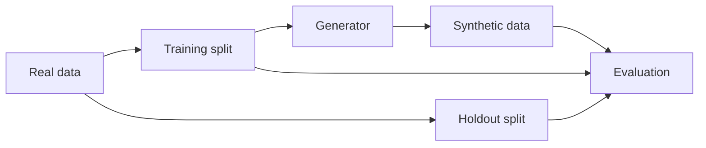

## Outline

1. What to evaluate, and why one number is not enough
2. Fidelity: single columns, pairs of columns, whole distributions
3. Sample-level metrics: precision, recall, density, coverage, α-precision, β-recall, authenticity
4. Fréchet distances for images and time series
5. Utility: TSTR, TRTS and ranking agreement
6. Tools, pitfalls and a reporting checklist

Note:
This lecture serves learning outcome LO2. Lab 2 in week 7 uses the sample-level metrics of Alaa et al. and FairX, so the second half of the lecture prepares you for it. Privacy metrics come in Lecture 5 and fairness metrics in Lecture 6.

---

## Three questions about a synthetic dataset

- **Fidelity**: does it follow the distribution of the real data?
- **Utility**: does it support the task you need it for?
- **Privacy** and **fairness**: Lectures 5 and 6
- Alaa et al. (2022) split fidelity into fidelity, diversity and generalisation
- Log-likelihood, Parzen estimates and sample quality are largely independent in high dimensions (Theis et al., 2016)

Note:
Theis et al. conclude that you must evaluate a generative model for the application it is meant for. So the first step of any evaluation is to decide what the synthetic data are for. Diversity asks whether the synthetic data cover the variability of the real data. Generalisation asks whether the model creates new records instead of copying training records.

---

## Notation and protocol

- Training split: $n$ records; synthetic data: $m$ records; $P_r$ real, $P_g$ generator
- The holdout never reaches the generator, not even through hyperparameter search

Note:
The holdout plays two roles. It is the test set for utility, and the distance between holdout and training data is the reference value for every fidelity metric. Authenticity, in contrast, needs the training split itself.

---

## Univariate fidelity: KS and TVD

$$
D_{\text{KS}} = \sup_x \lvert \hat F_r(x) - \hat F_g(x) \rvert
\qquad
\delta(R, S) = \frac{1}{2} \sum_{\omega \in \Omega} \lvert R_\omega - S_\omega \rvert
$$

- KS for numerical columns, total variation distance for categorical columns
- Both lie in $[0, 1]$; SDMetrics reports $1 - D_{\text{KS}}$ (KSComplement) and $1 - \delta$ (TVComplement)
- KS records how much mass is misplaced, not how far it moves

Note:
The TVD equals the largest difference in probability that the two distributions give to any set of categories. With large samples, a KS test detects differences too small to matter, so report the statistic as an effect size and not only the p-value.

---

## Wasserstein distance

$$
W_1(P, Q) = \inf_{\gamma \in \Gamma(P, Q)} \mathbb{E}_{(X, Y) \sim \gamma} \lvert X - Y \rvert = \int_{-\infty}^{\infty} \lvert F_P(x) - F_Q(x) \rvert \, dx
$$

- Move a mass $\epsilon$ far into a tail: KS changes by at most $\epsilon$, $W_1$ grows with the distance
- $W_1$ is in the units of the column: standardise before you average over columns
- In $d \ge 3$ dimensions, empirical $W_p$ converges at rate $n^{-1/d}$ (Ramdas et al., 2015)

Note:
The integral form holds for one-dimensional distributions; it is the form that SciPy's wasserstein_distance documents. The slow convergence in high dimensions is one reason not to apply the multivariate Wasserstein distance naively to a wide table with a few hundred rows.

---

## What marginal metrics cannot see

- Shuffle each column of the real training data independently
- Every marginal is preserved exactly: KS, TVD and $W_1$ are all zero
- Every relation between columns is destroyed
- Use this column-shuffle table as a baseline that a useful generator must beat
- Never release it: every value in it is real

Note:
This is a thought experiment you can also run in the lab. If your generator does not beat the shuffled table on the pairwise and multivariate metrics, it has not learned the dependence structure.

---

## Pairwise structure {.dense}

$$
\text{CorrSim}_{A,B} = 1 - \frac{\lvert S_{A,B} - R_{A,B} \rvert}{2}
\qquad
\text{ContSim}_{A,B} = 1 - \frac{1}{2} \sum_{a} \sum_{b} \lvert S_{a,b} - R_{a,b} \rvert
$$

- Correlation similarity for two numerical columns (Pearson or Spearman)
- Contingency similarity for categorical pairs; numerical columns are binned (10 bins by default)
- Pairs miss three-way and higher interactions; Platzer and Reutterer (2021) average TVD over all $k$-way tables up to $k = 3$

Note:
Both formulas are the SDMetrics versions. From SDMetrics 0.27.0, the Quality Report drops pairs with weak association in the real data: a Pearson correlation between minus 0.5 and 0.5, or a Cramér association of at most 0.3. Scores from versions before and after 0.27.0 are therefore not comparable. On a dataset with 15 attributes, $k = 1, 2, 3$ give 15, 105 and 455 tables.

---

## Maximum mean discrepancy

$$
\mathrm{MMD}^2[\mathcal{F}, p, q] = \mathbb{E}_{x, x'}[k(x, x')] - 2\, \mathbb{E}_{x, y}[k(x, y)] + \mathbb{E}_{y, y'}[k(y, y')]
$$

- With a characteristic kernel (Gaussian, Laplace), MMD is zero only if $p = q$
- The unbiased estimator costs $O((m + n)^2)$ and can be negative
- KS and $W_1$ are integral probability metrics too, with other function classes (Gretton et al., 2012)

Note:
The general definition is the supremum over a function class of the difference in expectations. The unit ball of a reproducing kernel Hilbert space gives this closed form. Functions of bounded variation 1 give the Kolmogorov distance, and 1-Lipschitz functions give the Wasserstein distance. The kernel and bandwidth decide which differences the MMD sees, so report them.

---

## Classifier two-sample tests

$$
\hat t = \frac{1}{n_{\text{te}}} \sum_{(z_i, l_i) \in \mathcal{D}_{\text{te}}} \mathbb{I}\left[ \mathbb{I}\left( f(z_i) > \tfrac{1}{2} \right) = l_i \right]
$$

- Under $H_0\colon P = Q$, approximately $\hat t \sim \mathcal{N}\left(\tfrac{1}{2}, \tfrac{1}{4 n_{\text{te}}}\right)$
- The classifier's scores show which records and features give the data away
- On raw pixels, all tests separated DCGAN samples almost perfectly, through checkerboard artefacts (Lopez-Paz & Oquab, 2017)

Note:
Label real records 0 and synthetic records 1, split the pooled data, train on one part and report accuracy on the other. The test is only as good as the classifier, and it reacts to any systematic artefact, relevant or not. SDMetrics implements this idea as LogisticDetection and SVCDetection.

---

## Propensity score MSE

$$
\text{pMSE} = \frac{1}{N} \sum_{i=1}^{N} (\hat p_i - c)^2, \qquad c = \frac{n_2}{N}, \qquad N = n_1 + n_2
$$

- Logistic propensity model with $k$ parameters, correct synthesis: $\mathbb{E}[\text{pMSE}] = (k - 1)(1 - c)^2 c / N$
- pMSE ratio: observed over null expectation, about 1 under correct synthesis
- For CART propensity models, estimate the null by permutation (Snoke et al., 2018)

Note:
Here $n_1$ is the number of real and $n_2$ the number of synthetic records, and $\hat p_i$ is the estimated probability that record $i$ is synthetic. With equal sizes the null expectation is $(k-1)/(8N)$. Snoke et al. prefer the ratio to the standardised pMSE, which they find over-sensitive to small differences. The measure is implemented in the R package synthpop.

---

## Precision and recall for distributions

$$
P = \beta \mu + (1 - \beta) \nu_P, \qquad Q = \alpha \mu + (1 - \alpha) \nu_Q
$$

- $Q$ has precision $\alpha$ at recall $\beta$ with respect to $P$ (Sajjadi et al., 2018)
- Computed on 20 $k$-means clusters of Inception features; $F_8$ summarises recall, $F_{1/8}$ precision
- On Fashion-MNIST, VAEs showed lower precision, higher recall, or both, compared with GANs

Note:
Here $\mu$ is the shared part, $\nu_P$ the part of the real distribution that the model misses, and $\nu_Q$ the part of the model that does not resemble the real data. Careful: $\alpha$ and $\beta$ mean something different in Alaa et al. The VAE and GAN result links back to the training objectives of Lecture 2.

---

## k-NN precision and recall

$$
f(\phi, \Phi) = 1 \iff \exists\, \phi' \in \Phi : \lVert \phi - \phi' \rVert_2 \le \lVert \phi' - \mathrm{NN}_k(\phi', \Phi) \rVert_2
$$

- Precision: mean of $f(\phi_g, \Phi_r)$ over synthetic features; recall: mean of $f(\phi_r, \Phi_g)$ over real features
- Kynkäänniemi et al. (2019): VGG-16 features, $k = 3$, 50,000 samples
- One real outlier enlarges the real manifold, and fake samples near it raise precision

Note:
$\mathrm{NN}_k(\phi', \Phi)$ is the $k$-th nearest neighbour of $\phi'$ in $\Phi$. Each sample gets a ball whose radius reaches its $k$-th neighbour, and the union of balls estimates the manifold. Naeem et al. also show that these estimates do not reach 1 when the two distributions are identical.

---

## Density and coverage {.dense}

$$
\begin{aligned}
\text{density} &= \frac{1}{kM} \sum_{j=1}^{M} \sum_{i=1}^{N} \mathbb{1}\left[ Y_j \in B(X_i, \mathrm{NND}_k(X_i)) \right] \\
\text{coverage} &= \frac{1}{N} \sum_{i=1}^{N} \mathbb{1}\left[ \exists\, j : Y_j \in B(X_i, \mathrm{NND}_k(X_i)) \right]
\end{aligned}
$$

- Both use balls around the $N$ real samples only
- Identical distributions: $\mathbb{E}[\text{density}] = 1$, and density can exceed 1
- $k = 5$ and $N = M = 10{,}000$ give $\mathbb{E}[\text{coverage}] \approx 0.969$ (Naeem et al., 2020)

Note:
Density counts how many real neighbourhoods contain each synthetic sample, so it rewards samples in dense real regions and is less sensitive to real outliers. Coverage is the fraction of real neighbourhoods that contain at least one synthetic sample. Its expectation under identical distributions does not depend on the data distribution, which is how Naeem et al. choose $k$, $N$ and $M$.

---

## α-precision and β-recall

$$
\mathcal{S}^{\alpha} = \arg\min_{s \subseteq \mathcal{S}} V(s) \ \text{s.t.} \ \mathbb{P}(s) = \alpha,
\qquad
P_\alpha = \mathbb{P}(\widetilde{X}_g \in \mathcal{S}_r^{\alpha}),
\qquad
R_\beta = \mathbb{P}(\widetilde{X}_r \in \mathcal{S}_g^{\beta})
$$

- The $\alpha$-support holds the densest probability mass $\alpha$: the typical samples
- $P_1$ and $R_1$ are standard precision and recall
- $P_\alpha = \alpha$ and $R_\beta = \beta$ for all $\alpha, \beta$ if and only if $P_g = P_r$

Note:
$V$ is volume, and the tilde marks embedded samples. Sweeping $\alpha$ and $\beta$ from 0 to 1 gives curves instead of single points. Theorem 1 of Alaa et al. is the last bullet: matching supports is not enough, the densities must match.

---

## Integrated scores and curve shapes

$$
\Delta P_\alpha = \int_0^1 \lvert P_\alpha - \alpha \rvert \, d\alpha, \qquad IP_\alpha = 1 - 2\, \Delta P_\alpha
$$

- $IR_\beta = 1 - 2\, \Delta R_\beta$ likewise; both lie in $[0, 1]$, and $IP_\alpha = IR_\beta = 1$ only if $P_g = P_r$
- Mode collapse: $P_1 = 1$, but a concave $P_\alpha$ curve
- Mode invention, oversampling rare samples: $P_1 = R_1 = 1$, but poor curves

Note:
These examples come from Figure 3 of Alaa et al. Standard precision and recall would rank the mode-inventing model above a model that is slightly shifted but realises both modes. The curves reverse that ranking.

---

## Authenticity

$$
P_g = A \cdot P_g' + (1 - A) \cdot \delta_{g, \epsilon}
$$

- With probability $1 - A$, the model copies a training record and adds small noise
- Sample $j$ is unauthentic if it is closer to its nearest training record $i^*$ than any other training record is to $i^*$
- Needs the training data, not the holdout; it is a copying check, not a privacy guarantee

Note:
$A$ is the authenticity score, the fraction of synthetic samples judged authentic. Alaa et al. use the same original data for training the generative models and for evaluating all metrics. Lecture 5 covers distance-based privacy metrics and membership inference.

---

## Estimating the metrics in practice

- One-class embedding trained on real data; $\hat{\mathcal{S}}_r^{\alpha} = B(c_r, \hat r_\alpha)$ with $\hat r_\alpha$ the $\alpha$-quantile of distances to $c_r$
- $\beta$-recall: a $k$-NN check around each real sample
- Scores depend on the embedding, on $k$ and on the grid of $\alpha$ values
- FairX adapts the synthcity code: 30 values of $\alpha$, real and synthetic sets of equal size

Note:
The embedding is a Deep SVDD-style network that squeezes real data into a hypersphere around a centre. FairX truncates the larger of the two datasets so that both have the same size, so check how many records were actually compared. Read the implementation you use; details differ from the paper.

---

## Fréchet Inception Distance

$$
d^2 = \lVert m - m_w \rVert_2^2 + \mathrm{Tr}\left( C + C_w - 2 (C C_w)^{1/2} \right)
$$

- $(m, C)$ and $(m_w, C_w)$: mean and covariance of Inception-v3 pooling features, generated and real
- Assumes Gaussian features and compares only two moments
- Heusel et al. (2017) used 50,000 generated images

Note:
This is the Fréchet, or Wasserstein-2, distance between two Gaussians. It mixes fidelity and diversity in one number, which is why precision and recall were proposed next to it.

---

## FID caveats

- The estimator is biased: strong bias for $n$ up to 10,000 on CIFAR-10 (Bińkowski et al., 2018)
- KID: squared MMD with a cubic polynomial kernel on the same features, unbiased
- The bias depends on the generator, so a fixed $n$ does not make comparisons fair (Chong & Forsyth, 2020)
- No metric tested correlates strongly with human judgements of realism; over-reliance on Inception-v3 is one cause (Stein et al., 2023)

Note:
Chong and Forsyth extrapolate FID to an infinite sample size. Stein et al. ran a large human study and propose other feature extractors, in particular DINOv2. The general lesson: a Fréchet distance is only as good as its features.

---

## Context-FID for time series

- Jeha et al. (2022): replace Inception-v3 with the encoder of Franceschi et al. (2019), trained per dataset
- Encode real and synthetic windows from the same time range, then compute FID on the embeddings
- Correlation with forecasting NRMSE, averaged over datasets: Pearson 0.71, Spearman 0.67
- Values are comparable only under the same encoder

Note:
Context-FID was introduced with PSA-GAN. The encoder is trained separately for each dataset, so check which encoder and training run a paper used before you compare numbers. For tabular data there is no agreed pre-trained embedding.

---

## Train on synthetic, test on real

| Protocol | Train on | Test on |
|---|---|---|
| TRTR, real baseline | real training split | real holdout |
| TSTR | synthetic data | real holdout |
| TRTS | real training split | synthetic data |

- Mode collapse does not degrade TRTS, so TSTR is more informative (Esteban et al., 2017)
- Report the gap to TRTR, with several downstream models

Note:
TSTR and TRTS come from Esteban et al. TRTR is our label for the real baseline. Use the same model class and hyperparameters for TRTR and TSTR. A synthetic test set confined to a few modes can still be classified correctly, which is why TRTS misses mode collapse.

---

## Synthetic ranking agreement

$$
\text{SRA}(G) = \frac{1}{k(k - 1)} \sum_{i=1}^{k} \sum_{j \ne i} \mathbb{I}\left[ (R_i - R_j)(S_i - S_j) > 0 \right]
$$

- $R_i$: algorithm $i$ trained and tested on real data; $S_i$: trained and tested on synthetic data
- The probability that a comparison on synthetic data matches the comparison on real data (Jordon et al., 2018)
- Depends on the set of algorithms; Jordon et al. use 12

Note:
Ranking agreement matters when synthetic data are used to compare methods, for example in a data challenge. Including many variants of one method biases the score. SRA can be high even when the synthetic distribution differs from the real one.

---

## Time-series scores of Yoon et al. (2019)

- Discriminative score: a post-hoc RNN separates real from synthetic sequences
- Predictive score: a next-step predictor trained on synthetic data, MAE on real data
- Paper: 2-layer LSTMs, discriminative score described as classification error
- Public code: GRUs, $\lvert \text{accuracy} - 0.5 \rvert$, and the last feature predicted one step ahead
- State which version you used

Note:
The predictive score is TSTR for forecasting. The first author's public implementation differs from the paper text in the points listed, so numbers computed in the two ways are not directly comparable.

---

## Tools: SDMetrics {.dense}

- Quality Report: Column Shapes (KSComplement, TVComplement) and Column Pair Trends (CorrelationSimilarity, ContingencySimilarity)
- Detection (beta): LogisticDetection and SVCDetection, score $1 - (2 \max(\text{AUC}, 0.5) - 1)$
- ML efficacy (beta): train on synthetic, test on real; F1 score for binary classification
- The documentation warns that a detection score of 1 can also mean copied rows
- Statistical quality and task value "may or may not correlate"

Note:
SDMetrics is maintained by DataCebo as part of the Synthetic Data Vault project. A detection score of 1 means the classifier cannot tell the data apart; in synthcity, a detection score of 0 means the same. Check the direction of every score.

---

## Tools: synthcity and FairX {.dense}

- synthcity statistical metrics: KS, chi-squared, MMD, Jensen-Shannon, Wasserstein, PRDC, α-precision, FID and others
- synthcity utility and detection: `performance.xgb`, `performance.linear`, `performance.mlp`, `detection_xgb` and others
- FairX `SyntheticEvaluation`: α-precision, β-recall, authenticity
- FairX `DataUtilsMetrics`: XGBoost; accuracy, AUROC, F1, precision, recall on the test split you pass
- For TSTR in FairX, pass synthetic training data and a real test split

Note:
PRDC stands for precision, recall, density and coverage. FairX also has fairness metrics, which we use in Lecture 6, and t-SNE and PCA plots. DataUtilsMetrics is protocol-agnostic: whatever you put in the training part is what the classifier learns from.

---

## Pitfall: metrics disagree

- Model chosen by $P_1$: downstream AUC-ROC 0.55; model chosen by $IP_\alpha$: 0.79 (Alaa et al., 2022)
- Global distances hide where the data fail; sample-level metrics depend on an embedding
- Choose metrics for the use of the data, then report all of them, including the bad ones

Note:
The AUC-ROC example comes from the COVID-19 experiment of Alaa et al., where the ground-truth ranking of generators was their TSTR performance. A metric that ranks generators differently from the use you care about is the wrong metric for that use.

---

## Pitfalls: tuning, sample size and leakage

- Tuning and reporting on the same metric measures the tuning
- Esteban et al. (2017) chose among synthetic datasets by TSTR on 3 of 7 tasks, and reported all 7
- Small samples: FID bias, C2ST variance $1/(4 n_{\text{te}})$, $k$-NN metrics that depend on $N$, $M$ and $k$
- Leakage: preprocessing fitted on all data, or a test set that the generator saw

Note:
Repeat over several generator seeds and evaluation resamples, and report the spread. Fit scalers, encoders and bins on the training split only. If the test set reached the generator, copying looks like utility.

---

## The holdout as a reference

$$
\text{ratio}_k = \frac{F_k(T, S)}{F_k(T, H)}
$$

- $F_k$: mean TVD over all $k$-way marginals; $T$ training, $S$ synthetic, $H$ holdout (Platzer & Reutterer, 2021)
- Near 1: $S$ is as close to $T$ as fresh real data
- Below 1: $S$ is closer to $T$ than fresh real data, a sign of memorisation

Note:
Without a reference, you cannot tell whether a given TVD is good or bad. Lopez-Paz and Oquab make the same point for two-sample tests: a generator that does not overfit gives similar statistics against the training and the test set.

---

## Reporting checklist {.dense}

- Data: source, $n$ and $m$, splits, where preprocessing was fitted
- Fidelity: marginal, pairwise, distribution-level and sample-level metrics, with $k$, kernel, bins and embedding
- Utility: TRTR baseline, TSTR (and TRTS), several downstream models, ranking agreement if relevant
- References: holdout against training, and the column-shuffle baseline
- Uncertainty: several seeds and resamples, with mean and spread
- Software versions and code; energy use (CodeCarbon); privacy and fairness from Lectures 5 and 6

Note:
Use this checklist for your project report. The lecture page has a longer version.

---

## Summary

- Fidelity, diversity, generalisation and utility are different properties
- Marginal metrics miss dependence; global distances hide where the data fail
- Sample-level metrics separate fidelity from diversity but depend on an embedding
- Utility needs a real holdout and a real baseline
- Report several metrics, with reference values and uncertainty

Note:
In Lab 2 you apply these metrics to synthetic data from an existing generative model.

---

## Discussion

- Near-perfect marginal scores, TSTR close to TRTR, yet a classifier separates real from synthetic well above chance. What could explain this?
- Is authenticity a fidelity metric or a privacy metric?
- When can TSTR exceed TRTR, and what would that tell you?
- Which metrics transfer to your own project data, and which embedding would you need to validate?

Note:
The lecture page has hints and model answers for these questions.

---

## References (1/2) {.refs}

- Alaa, A., van Breugel, B., Saveliev, E. S., & van der Schaar, M. (2022). How Faithful is your Synthetic Data? Sample-level Metrics for Evaluating and Auditing Generative Models. ICML, PMLR 162, 290–306.
- Bińkowski, M., Sutherland, D. J., Arbel, M., & Gretton, A. (2018). Demystifying MMD GANs. ICLR.
- Chong, M. J., & Forsyth, D. (2020). Effectively Unbiased FID and Inception Score and Where to Find Them. CVPR, 6070–6079.
- DataCebo. SDMetrics documentation. docs.sdv.dev/sdmetrics
- Esteban, C., Hyland, S. L., & Rätsch, G. (2017). Real-valued (Medical) Time Series Generation with Recurrent Conditional GANs. arXiv:1706.02633.
- Franceschi, J.-Y., Dieuleveut, A., & Jaggi, M. (2019). Unsupervised Scalable Representation Learning for Multivariate Time Series. NeurIPS 32.
- Gretton, A., Borgwardt, K. M., Rasch, M. J., Schölkopf, B., & Smola, A. (2012). A Kernel Two-Sample Test. JMLR, 13, 723–773.
- Heusel, M., Ramsauer, H., Unterthiner, T., Nessler, B., & Hochreiter, S. (2017). GANs Trained by a Two Time-Scale Update Rule Converge to a Local Nash Equilibrium. NeurIPS 30.
- Jeha, P., et al. (2022). PSA-GAN: Progressive Self Attention GANs for Synthetic Time Series. ICLR.
- Jordon, J., Yoon, J., & van der Schaar, M. (2018). Measuring the quality of Synthetic data for use in competitions. arXiv:1806.11345.
- Kynkäänniemi, T., Karras, T., Laine, S., Lehtinen, J., & Aila, T. (2019). Improved Precision and Recall Metric for Assessing Generative Models. NeurIPS 32.

---

## References (2/2) {.refs}

- Lopez-Paz, D., & Oquab, M. (2017). Revisiting Classifier Two-Sample Tests. ICLR.
- Naeem, M. F., Oh, S. J., Uh, Y., Choi, Y., & Yoo, J. (2020). Reliable Fidelity and Diversity Metrics for Generative Models. ICML, PMLR 119, 7176–7185.
- Platzer, M., & Reutterer, T. (2021). Holdout-Based Empirical Assessment of Mixed-Type Synthetic Data. Frontiers in Big Data, 4, 679939.
- Qian, Z., Cebere, B.-C., & van der Schaar, M. (2023). Synthcity: facilitating innovative use cases of synthetic data in different data modalities. arXiv:2301.07573.
- Ramdas, A., García Trillos, N., & Cuturi, M. (2015). On Wasserstein Two Sample Testing and Related Families of Nonparametric Tests. arXiv:1509.02237.
- Sajjadi, M. S. M., Bachem, O., Lucic, M., Bousquet, O., & Gelly, S. (2018). Assessing Generative Models via Precision and Recall. NeurIPS 31.
- Sikder, M. F., Ramachandranpillai, R., de Leng, D., & Heintz, F. (2024). FairX: A comprehensive benchmarking tool for model analysis using fairness, utility, and explainability. AEQUITAS workshop at ECAI 2024, CEUR-WS Vol-3808.
- Snoke, J., Raab, G. M., Nowok, B., Dibben, C., & Slavković, A. (2018). General and specific utility measures for synthetic data. JRSS Series A, 181(3), 663–688.
- Stein, G., et al. (2023). Exposing flaws of generative model evaluation metrics and their unfair treatment of diffusion models. NeurIPS 36.
- Theis, L., van den Oord, A., & Bethge, M. (2016). A note on the evaluation of generative models. ICLR.
- Yoon, J., Jarrett, D., & van der Schaar, M. (2019). Time-series Generative Adversarial Networks. NeurIPS 32.

Note:
Full references with links are on the lecture page.
