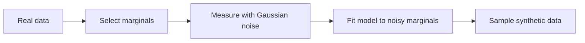
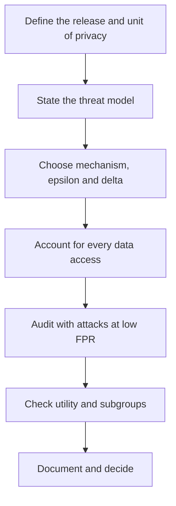

## Outline

1. Why de-identification fails
2. Differential privacy: definition, mechanisms, composition
3. DP-SGD and differentially private generative models
4. Attacks on generative models and on synthetic data
5. Similarity metrics, auditing and release risk

Note:
This lecture serves LO2 (evaluate synthetic data for privacy) and LO3 (assess the risk of a release). The first half gives you upper bounds on leakage: differential privacy. The second half gives you lower bounds: attacks. A release decision needs both, plus an explicit threat model. Lab 3 later this week puts both into practice.

---

## De-identification fails {.dense}

- 87% of the US population was likely unique on ZIP code, gender and date of birth (Sweeney, 2002)
- Linking hospital data to a voter list singled out the state governor's record (Sweeney, 2002)
- 8 Netflix ratings, dates within 14 days: 99% of records identified (Narayanan and Shmatikov, 2008)
- 15 demographic attributes: 99.98% of Americans re-identified (Rocher et al., 2019)
- Privacy depends on the attacker's auxiliary knowledge, which you cannot list in advance

Note:
Sweeney's 87% figure comes from her earlier study of 1990 census data, which she reports in the 2002 k-anonymity paper. The Massachusetts Group Insurance Commission released hospital data on about 135,000 state employees and their families; the Cambridge voter list cost twenty dollars. k-anonymity was the response, and the same paper shows how linking several k-anonymous releases breaks it. Narayanan and Shmatikov show that sparse, high-dimensional data are even easier to link. The Netflix numbers allow 2 of the 8 ratings to be wrong. Rocher et al. estimate re-identification with a copula model.

---

## Synthetic records are not automatically private

- A synthetic record matches no real person, but the generator was fitted to real people
- Without formal guarantees, outliers stay exposed to linkage attacks (Stadler et al., 2022)
- One hospital outlier under CTGAN: privacy gain below 0.005, where 1 means full protection
- Randomly chosen records: privacy gain close to 1
- We need a property of the generating *process*, not of the output

Note:
Stadler, Oprisanu and Troncoso define privacy gain as one minus the attacker's advantage on the synthetic data, relative to an attacker who sees the raw data. The disparity between outliers and typical records is the main point: average-case metrics hide the records most at risk. Differential privacy is a property of the process that produced the data, and it holds for every record.

---

## Neighbouring datasets and the unit of privacy

- $D \simeq D'$: add or remove one record; Dwork and Roth write $\lVert x - y \rVert_1 \le 1$
- Replace-one is also common; for pure DP it costs a factor of 2 in $\varepsilon$ (group privacy)
- The record must be the entity you protect: a patient, not a visit
- A group of $k$ records: $\varepsilon$-DP gives $k\varepsilon$-DP (Dwork and Roth, Theorem 2.2)
- Compare $\varepsilon$ values only under the same relation and unit

Note:
Dwork and Roth represent databases as histograms over the data universe, so the l1 distance between histograms counts added or removed records. Replace-one equals one removal plus one addition, so group privacy with k equal to 2 converts between the two. Section 2.3.3 of Dwork and Roth discusses granularity with graph and recommender examples. For longitudinal health records, visit-level DP can leave a patient with many visits poorly protected.

---

## Differential privacy

$$
\Pr[M(D) \in S] \le e^{\varepsilon} \Pr[M(D') \in S] + \delta
$$

- For all neighbouring $D, D'$ and all events $S$; probability over the coins of $M$ only (Dwork and Roth, Definition 2.4)
- $\delta = 0$ gives pure $\varepsilon$-DP; choose $\delta \ll 1/n$
- Holds for every attacker, whatever their auxiliary information

Note:
The definition is due to Dwork, McSherry, Nissim and Smith (2006). Dwork and Roth warn that delta of order one over n permits publishing the complete records of a few participants, which is why delta must be much smaller than one over n. The quantification over all neighbouring pairs is what makes the guarantee independent of auxiliary information: it already covers the attacker who knows every other record.

---

## Reading epsilon as a hypothesis test

$$
P_{\mathrm{FA}} + e^{\varepsilon} P_{\mathrm{MD}} \ge 1 - \delta, \qquad e^{\varepsilon} P_{\mathrm{FA}} + P_{\mathrm{MD}} \ge 1 - \delta
$$

- Any test of "is the target in $D$?" must obey both (Kairouz et al., 2015, Theorem 2.1)
- With $\mathrm{FPR} = P_{\mathrm{FA}}$ and $\mathrm{TPR} = 1 - P_{\mathrm{MD}}$: $\mathrm{TPR} \le e^{\varepsilon}\,\mathrm{FPR} + \delta$
- Bayesian reading: posterior odds are at most $e^{\varepsilon}$ times the prior odds

Note:
Kairouz, Oh and Viswanath show that the two inequalities are equivalent to (epsilon, delta)-DP. Rejecting the null hypothesis means claiming that the target is a member. The Bayesian reading follows from Bayes' rule for pure DP: the likelihood ratio of any output is at most e to the epsilon. Both readings assume the strongest attacker, who knows everything except the target's membership.

---

## What a given epsilon allows

| $\varepsilon$ | $e^{\varepsilon}$ | Max posterior from 0.5 | Max $\mathrm{TPR} - \mathrm{FPR}$ | TPR bound at FPR 0.001 |
|---|---|---|---|---|
| 0.1 | 1.11 | 0.525 | 0.050 | 0.0011 |
| 1 | 2.72 | 0.731 | 0.462 | 0.0027 |
| 3 | 20.1 | 0.953 | 0.905 | 0.020 |
| 8 | 2981 | 0.9997 | 0.9993 | none (above 1) |

- Computed from the test inequalities with $\delta = 0$
- Max $\mathrm{TPR} - \mathrm{FPR}$ is $(e^{\varepsilon} - 1)/(e^{\varepsilon} + 1)$

Note:
These are worst-case bounds, not predictions of what real attacks achieve. At epsilon equal to 8, the bound does not constrain an attacker at a false positive rate of 0.1 per cent. Dwork and Roth write that "a large epsilon is large after its own fashion": failing to be DP at a large epsilon can mean anything from a meaningless breach to full disclosure. Deriving the advantage formula is a discussion question on the lecture page.

---

## What DP does not promise

- No protection from population-level inferences (Dwork and Roth, Section 2.3.2)
- If the data show that an attribute predicts a disease, applying that to you is not a violation
- $\delta$ near $1/n$ allows publishing a few complete records
- The guarantee covers the mechanism as analysed, not a faulty implementation
- Floating-point arithmetic can break real-valued mechanisms (Dwork and Roth, Remark 2.1)

Note:
DP protects against learning what you contributed, not against learning facts about the population that also apply to you. This matters for attribute inference later in the lecture. Implementation faults are a recurring theme: we will see data-dependent preprocessing and accountant bugs in published DP generators.

---

## Sensitivity and the Laplace mechanism

$$
\begin{aligned}
\Delta_1 f &= \max_{D \simeq D'} \lVert f(D) - f(D') \rVert_1 \\
M(D) &= f(D) + (Y_1, \dots, Y_k), \quad Y_i \sim \mathrm{Lap}(\Delta_1 f / \varepsilon)
\end{aligned}
$$

- The Laplace mechanism is $\varepsilon$-DP (Dwork and Roth, Theorem 3.6)
- A count has $\Delta_1 f = 1$: at $\varepsilon = 0.5$ the noise scale is 2 (standard deviation 2.83)
- Noise depends on sensitivity and $\varepsilon$, not on $n$

Note:
Sensitivity is a worst case over all neighbouring pairs, not over the dataset you hold. Because the noise does not grow with n, relative error falls as the dataset grows, which is why DP suits large datasets. The Laplace distribution with scale b has standard deviation the square root of 2 times b.

---

## Gaussian mechanism

$$
M(D) = f(D) + \mathcal{N}(0, \sigma^2 I), \qquad \sigma \ge c\, \Delta_2 f / \varepsilon, \quad c^2 > 2 \ln(1.25/\delta)
$$

- $(\varepsilon, \delta)$-DP for $\varepsilon \in (0, 1)$ (Dwork and Roth, Theorem A.1)
- Scales with $\ell_2$ sensitivity, which suits high-dimensional outputs such as gradients
- $\Delta_2 f = 1$, $\varepsilon = 0.5$, $\delta = 10^{-5}$: $\sigma > 9.69$

Note:
The l2 sensitivity of a vector-valued function can be much smaller than its l1 sensitivity, by up to the square root of the dimension. Dwork and Roth discuss the trade-offs in Section 3.5.3: Gaussian and Laplace noise give the same cumulative loss under composition, and sums of Gaussians stay Gaussian. The theorem as stated needs epsilon below 1; Rényi DP gives a cleaner analysis for repeated Gaussian noise, as the next slides show.

---

## Post-processing and composition {.dense}

- Post-processing: any $g(M(D))$ keeps the guarantee (Dwork and Roth, Proposition 2.1)
- Basic composition: $k$ mechanisms give $(\sum_i \varepsilon_i, \sum_i \delta_i)$ (Theorem 3.16)
- Advanced composition (Theorem 3.20): $\varepsilon' = \sqrt{2k \ln(1/\delta')}\,\varepsilon + k\varepsilon(e^{\varepsilon} - 1)$, with $\delta$ total $k\delta + \delta'$
- $k = 1000$, $\varepsilon = 0.01$, $\delta' = 10^{-5}$: basic gives 10, advanced gives 1.62

Note:
Post-processing is why a DP generator yields DP synthetic data of any size: sampling is a function of the private model. It does not cover steps that read the real data again. Advanced composition is due to Dwork, Rothblum and Vadhan; Dwork and Roth present it as Theorem 3.20. The square-root growth in k is what makes iterative training feasible.

---

## Rényi differential privacy (Mironov, 2017)

$$
D_\alpha(P \,\|\, Q) = \frac{1}{\alpha - 1} \log \mathbb{E}_{x \sim Q}\left[ \left( \frac{P(x)}{Q(x)} \right)^{\alpha} \right] \le \varepsilon
$$

- Gaussian with sensitivity 1 is $(\alpha, \alpha / 2\sigma^2)$-RDP; composition adds $\varepsilon$ at each $\alpha$
- $(\alpha, \varepsilon)$-RDP gives $(\varepsilon + \log(1/\delta)/(\alpha - 1), \delta)$-DP
- 100 Gaussian steps, $\sigma = 10$, $\delta = 10^{-5}$: $\varepsilon \approx 5.3$ at $\alpha \approx 5.8$

Note:
The definition requires the bound for every pair of neighbouring datasets, with P and Q the output distributions on D and D prime. The Gaussian result is Corollary 3 in Mironov, composition is Proposition 1 and the conversion is Proposition 3. In the example, composition gives RDP epsilon of alpha over 2; adding log of 1 over delta divided by alpha minus 1 and minimising over alpha gives about 5.3. MST and AIM use Rényi DP or the closely related zCDP for their accounting.

---

## DP-SGD (Abadi et al., 2016) {.dense}

$$
\begin{aligned}
\bar g(x_i) &= \frac{g(x_i)}{\max\left(1, \lVert g(x_i) \rVert_2 / C\right)} \\
\tilde g &= \frac{1}{L} \Big( \sum_{i \in \text{lot}} \bar g(x_i) + \mathcal{N}(0, \sigma^2 C^2 I) \Big)
\end{aligned}
$$

- Each example joins a lot with probability $q = L/N$; clipping bounds each example's influence
- Moments accountant: $q = 0.01$, $\sigma = 4$, $T = 10^4$, $\delta = 10^{-5}$ gives $\varepsilon \approx 1.26$
- The same run gives $\varepsilon \approx 9.34$ under the strong composition theorem

Note:
The two numbers are the example that Abadi et al. give in Section 3.1. Clipping turns each step into a Gaussian mechanism with l2 sensitivity C, and subsampling amplifies privacy. Theorem 1 of the paper gives the asymptotic condition: sigma of order q times the square root of T log 1 over delta, divided by epsilon. The guarantee covers every intermediate model, so the final model and anything sampled from it are covered by post-processing.

---

## Opacus in practice {.dense}

```python
from opacus import PrivacyEngine

engine = PrivacyEngine(accountant="prv")  # default; "rdp" and "gdp" also exist
model, optimizer, loader = engine.make_private_with_epsilon(
    module=model, optimizer=optimizer, data_loader=loader,
    target_epsilon=3.0, target_delta=1e-5, epochs=20, max_grad_norm=1.0)
# ... train as usual ...
print(engine.get_epsilon(delta=1e-5))
```

- Computes per-sample gradients in batches (Yousefpour et al., 2021)
- Poisson sampling is on by default, and the accountant assumes it
- Tuning and preprocessing on the same data are not covered

Note:
Argument names follow the current Opacus API documentation for PrivacyEngine. The value of target_epsilon here is an example, not a recommendation. If you set poisson_sampling to False, the documentation warns that the data loader no longer matches the accountant's assumptions. For a GAN, only the discriminator reads real data, so you make the discriminator's optimiser private; the generator is then private by post-processing.

---

## Three routes to a DP generator

| Route | Example | Where noise enters |
|---|---|---|
| Noisy training | DPGAN (Xie et al., 2018) | Discriminator gradients |
| Teacher ensemble | PATE-GAN (Jordon et al., 2019) | Teacher votes |
| Marginals | PrivBayes, MST, AIM | Low-dimensional marginals |

- In all three, the generator and its samples are private by post-processing

Note:
DPGAN trains a Wasserstein GAN, adds Gaussian noise to the discriminator's gradients and bounds them through weight clipping; the generator is private by post-processing. Xie et al. evaluate on MNIST and MIMIC-III. PATE comes from Papernot et al. (2017), where teachers trained on disjoint data label public data through a noisy arg max over vote counts, with Laplace noise.

---

## PATE-GAN (Jordon et al., 2019)

- Split the real data into $k$ disjoint parts; train one teacher discriminator per part
- Teachers label generated samples as real or fake; votes are aggregated with Laplace noise
- A student discriminator sees only generated samples and their noisy labels
- The generator trains against the student, so it is private by post-processing
- An accountant tracks the budget and stops training when it is spent

Note:
PATE-GAN needs no public data: the student learns from generated samples only. Jordon et al. also propose judging synthetic data by whether models rank in the same order on synthetic and real data. Ganev, Annamalai and De Cristofaro (2025) audited six public implementations: none reproduced the original utility, and all leaked more than intended. Read their summary after the original paper.

---

## Select, measure, generate



- Any marginal has $\ell_2$ sensitivity 1 under add or remove (McKenna et al., 2021)
- PrivBayes: Bayesian network; MST: spanning tree of pairs; AIM: adaptive and workload-aware

Note:
PrivBayes (Zhang et al., 2017) learns a Bayesian network privately and adds noise to its low-dimensional marginals. MST (McKenna, Miklau and Sheldon, 2021) measures all one-way marginals, picks pairs that form a maximum spanning tree with a private version of Kruskal's algorithm, measures them with the Gaussian mechanism and fits Private-PGM. AIM (McKenna et al., 2022) selects marginals iteratively with the exponential mechanism, weighted by the workload, and anneals the budget.

---

## Evidence on tabular benchmarks {.dense}

- MST ranked best overall, average rank 1.56 (Tao et al., 2021)
- GAN-based methods often missed one-way marginals; their classifiers rarely beat a majority-class baseline
- AIM: error 1.6 times lower than the next best mechanism on average, up to 5.7 times (McKenna et al., 2022)
- Caveats: tabular data, marginal-type metrics, and the MST and AIM authors are among the benchmark authors
- Marginal methods assume a finite, discrete domain

Note:
Tao et al. compared MST, MWEM-PGM, PrivBayes, DPGAN, DP-CTGAN, PATE-GAN, PATE-CTGAN and others on one-way and two-way marginals, correlations and classification. They also found that the discretisation of numerical attributes matters, with PrivTree binning beating equal-width bins. An independent replication would strengthen the conclusion. For images and long time series, the marginal recipe does not apply directly.

---

## Implementations break guarantees

- Public PrivBayes and PATE-GAN code derived ranges and categories from the raw data (Stadler et al., 2022)
- At $\varepsilon = 0.1$, two of five outliers had privacy gain below 0.1; the DP bound implies at least 0.89
- Six PATE-GAN implementations: 19 privacy violations and 5 other bugs (Ganev et al., 2025)
- Every data access counts, including preprocessing and tuning

Note:
Stadler et al. patched the implementations so that metadata came from public sources or a disjoint sample; the privacy gain then respected the bound for most targets. The bound they use is the one by Yeom et al., advantage at most e to the epsilon minus 1. Ganev et al. found teachers that saw the wrong partitions, accountant errors in both directions, and data bounds extracted from the data in a non-private way.

---

## Threat models for synthetic data

| Dimension | Options (Houssiau et al., 2022) |
|---|---|
| Knowledge of data | Auxiliary population sample; exact knowledge of all other records |
| Knowledge of generator | No-box; black-box; white-box; uncertain-box |
| Goal | Membership inference; attribute inference |

- Exact knowledge with a black-box generator is the setting DP protects against

Note:
TAPAS is an open-source toolbox that implements this framework. Black-box here means the attacker knows the generation algorithm and can run it on any dataset, which matches good security practice. White-box adds the trained weights. State your threat model before you run any attack, since attack results mean nothing without it.

---

## Membership inference

- Game: the target comes from the training set or the population; advantage $= \mathrm{TPR} - \mathrm{FPR}$ (Yeom et al., 2018)
- $\varepsilon$-DP bounds the advantage by $e^{\varepsilon} - 1$ (Yeom et al., 2018, Theorem 1)
- Shadow models teach an attack model what members look like (Shokri et al., 2017)
- Report TPR at a low FPR, for example 0.1% (Carlini et al., 2022)

Note:
Yeom's bound is loose: at epsilon equal to 1 it exceeds 1. The hypothesis-testing bound on the earlier slide is tighter. Shokri et al. train shadow models on data like the target's, with known membership, and learn to tell members from non-members from the outputs. Carlini et al. argue that average accuracy or AUC hides attacks that are confident on a few records, and report that their LiRA attack is 10 times stronger than earlier attacks at low false positive rates.

---

## Attacks on generative models

- LOGAN: the target GAN's discriminator scores members higher; a black-box variant trains a local GAN (Hayes et al., 2019)
- Monte Carlo attack: count generated samples close to the target (Hilprecht et al., 2019)
- GAN-Leaks: settings from full black-box to accessible discriminator; calibrated reconstruction distance (Chen et al., 2020)
- Attacks weaken as the training set grows (Chen et al., 2020)

Note:
These attacks assume access to the model or unlimited samples from it. Hilprecht et al. also give a reconstruction attack for VAEs. Chen et al. calibrate the reconstruction distance with a reference model trained on other data, which removes the effect of records that are easy or hard to reconstruct for any generator.

---

## Attacks on released synthetic data

$$
\text{DOMIAS score}(x) = \frac{p_G(x)}{p_R(x)}
$$

- The attacker holds the synthetic data and a reference sample from the population (van Breugel et al., 2023)
- A high ratio marks local overfitting; uncommon records are the most exposed
- More synthetic records make the attack stronger; a failed attack does not certify privacy

Note:
p G is a density estimate fitted to the synthetic data and p R one fitted to the reference data. Stadler et al. use shadow modelling on features of the synthetic data instead. Both attacks need only the released data, which is the realistic setting when the model stays private. Van Breugel et al. warn that DOMIAS must not be used as a certificate of privacy.

---

## Attribute inference

- The attacker knows part of a target record and infers a sensitive attribute
- Base-rate problem: population correlations let a guess succeed without any leakage (Houssiau et al., 2022)
- Linear reconstruction attacks reach all records, not only outliers (Annamalai et al., 2024a)
- DP limits what is learned about your contribution, not population correlations

Note:
TAPAS randomises the target's sensitive attribute when it trains the attack classifier, to separate leakage from correlation. Whether inference from correlations counts as a privacy violation is contested. Annamalai, Gadotti and Rocher find that current generators cannot consistently prevent their attack while keeping reasonable utility, and that releasing more synthetic records makes the attack more effective.

---

## Distance to closest record is not a guarantee

- DCR test passes if the fifth percentile of training-to-synthetic distances is at least that of training-to-holdout
- No guarantee, arbitrary threshold, privacy treated as binary, no worst case (Ganev and De Cristofaro, 2025)
- The metric reads the training data, so it leaks: ReconSyn recovers 78–100% of outliers
- Filtering synthetic records by DCR after DP training breaks end-to-end DP

Note:
Ganev and De Cristofaro study three metrics used in industry: identical match share, distance to closest records and nearest neighbour distance ratio. ReconSyn needs only black-box access to one fitted model and the metric results. TAPAS makes a related point: a nearby synthetic record is evidence of leakage only if it is more likely to appear when the target was in the training data.

---

## Auditing: lower bounds on epsilon

$$
\varepsilon \ge \ln \frac{\mathrm{TPR} - \delta}{\mathrm{FPR}}
$$

- Run a distinguishing game; estimate TPR and FPR with confidence intervals
- Worst-case attacks match the DP-SGD bound; realistic ones are much weaker (Nasr et al., 2021)
- Six DP synthetic data implementations: known violations found in 4, a new one in a DPWGAN implementation (Annamalai et al., 2024b)

Note:
The inequality rearranges the hypothesis-testing bound. If the empirical lower bound exceeds the claimed epsilon, the implementation violates its guarantee. Annamalai, Ganev and De Cristofaro needed white-box attacks and worst-case datasets to get tight estimates; black-box membership attacks gave loose ones.

---

## Release risk assessment



Note:
This is the workflow for LO3 and for your project report. Defining the release includes whether you publish the model or only the data, and how many records. Utility checks come from Lecture 4; subgroup checks lead into Lecture 6.

---

## Choosing and reporting epsilon {.dense}

- Tier 1: $\varepsilon \le 1$, strong formal guarantee (Ponomareva et al., 2023)
- Tier 2: $\varepsilon \le 10$, a widely used but undocumented convention
- Tier 3: $\varepsilon > 10$, needs further evidence such as auditing
- Report the DP setting, unit, data accesses covered, released output, accountant and its assumptions, and code
- Publish only the synthetic data, and no more records than the task needs

Note:
Ponomareva et al. write the tiers for machine learning models with user-level or example-level DP. They recommend reporting a guarantee without amplification when the training pipeline does not match the sampling the accountant assumed. The last bullet follows from DOMIAS and from Annamalai et al. (2024a): more synthetic records and access to the model both help the attacker.

---

## Open problems

- No principled map from $\varepsilon$ to harm or to legal anonymisation
- Large gap between worst-case bounds and realistic attacks
- DP deep generators trail marginal methods on tabular benchmarks
- Correct implementations: preprocessing, sampling, floating point
- DP noise affects small groups more: see Lecture 6 (Ganev et al., 2022)

Note:
Each of these is a possible project direction. Lecture 1 covered the regulatory side; how a value of epsilon relates to legal notions of anonymisation is a question for discussion, not something this lecture settles. Ganev, Oprisanu and De Cristofaro show that DP synthetic data can shrink or inflate minority subgroups and lower accuracy on them; Lecture 6 takes this up.

---

## Summary

- De-identification fails against linkage, and synthetic data alone does not fix it
- DP bounds every attacker; read $\varepsilon$ through TPR and FPR
- DP-SGD, PATE-GAN and marginal methods make generators private; marginal methods lead on tabular benchmarks
- Attacks give lower bounds: audit at low FPR and on outliers
- Similarity metrics are diagnostics, not guarantees

---

## Discussion

- A vendor's synthetic data passes DCR, IMS and NNDR tests. What would you ask before calling it anonymous?
- You normalise columns with the training minimum and maximum, then train with DP-SGD. Is the output DP?
- Which unit of privacy fits longitudinal health records, and what does it cost?
- Under which conditions would you accept $\varepsilon = 8$?

Note:
Model answers for related questions are on the lecture page, in the discussion section.

---

## References (1/3) {.refs}

- Abadi, M., et al. (2016). Deep Learning with Differential Privacy. ACM CCS.
- Annamalai, M. S. M. S., Gadotti, A., & Rocher, L. (2024a). A Linear Reconstruction Approach for Attribute Inference Attacks against Synthetic Data. USENIX Security.
- Annamalai, M. S. M. S., Ganev, G., & De Cristofaro, E. (2024b). "What do you want from theory alone?" Experimenting with Tight Auditing of Differentially Private Synthetic Data Generation. USENIX Security.
- Carlini, N., et al. (2022). Membership Inference Attacks From First Principles. IEEE S&P.
- Chen, D., Yu, N., Zhang, Y., & Fritz, M. (2020). GAN-Leaks: A Taxonomy of Membership Inference Attacks against Generative Models. ACM CCS.
- Dwork, C., McSherry, F., Nissim, K., & Smith, A. (2006). Calibrating Noise to Sensitivity in Private Data Analysis. TCC.
- Dwork, C., & Roth, A. (2014). The Algorithmic Foundations of Differential Privacy. Foundations and Trends in Theoretical Computer Science.
- Ganev, G., & De Cristofaro, E. (2025). The Inadequacy of Similarity-based Privacy Metrics: Privacy Attacks against "Truly Anonymous" Synthetic Datasets. IEEE S&P.
- Ganev, G., Annamalai, M. S. M. S., & De Cristofaro, E. (2025). The Elusive Pursuit of Reproducing PATE-GAN: Benchmarking, Auditing, Debugging. TMLR.
- Ganev, G., Oprisanu, B., & De Cristofaro, E. (2022). Robin Hood and Matthew Effects: Differential Privacy Has Disparate Impact on Synthetic Data. ICML.
- Hayes, J., Melis, L., Danezis, G., & De Cristofaro, E. (2019). LOGAN: Membership Inference Attacks Against Generative Models. PoPETs.

---

## References (2/3) {.refs}

- Hilprecht, B., Härterich, M., & Bernau, D. (2019). Monte Carlo and Reconstruction Membership Inference Attacks against Generative Models. PoPETs.
- Houssiau, F., et al. (2022). TAPAS: a Toolbox for Adversarial Privacy Auditing of Synthetic Data. NeurIPS SyntheticData4ML workshop.
- Jordon, J., Yoon, J., & van der Schaar, M. (2019). PATE-GAN: Generating Synthetic Data with Differential Privacy Guarantees. ICLR.
- Kairouz, P., Oh, S., & Viswanath, P. (2015). The Composition Theorem for Differential Privacy. ICML.
- McKenna, R., Miklau, G., & Sheldon, D. (2021). Winning the NIST Contest: A scalable and general approach to differentially private synthetic data. Journal of Privacy and Confidentiality.
- McKenna, R., Mullins, B., Sheldon, D., & Miklau, G. (2022). AIM: An Adaptive and Iterative Mechanism for Differentially Private Synthetic Data. PVLDB.
- Mironov, I. (2017). Rényi Differential Privacy. IEEE CSF.
- Narayanan, A., & Shmatikov, V. (2008). Robust De-anonymization of Large Sparse Datasets. IEEE S&P.
- Nasr, M., Song, S., Thakurta, A., Papernot, N., & Carlini, N. (2021). Adversary Instantiation: Lower Bounds for Differentially Private Machine Learning. IEEE S&P.
- Papernot, N., Abadi, M., Erlingsson, Ú., Goodfellow, I., & Talwar, K. (2017). Semi-supervised Knowledge Transfer for Deep Learning from Private Training Data. ICLR.
- Ponomareva, N., et al. (2023). How to DP-fy ML: A Practical Guide to Machine Learning with Differential Privacy. JAIR.

---

## References (3/3) {.refs}

- Rocher, L., Hendrickx, J. M., & de Montjoye, Y.-A. (2019). Estimating the success of re-identifications in incomplete datasets using generative models. Nature Communications.
- Shokri, R., Stronati, M., Song, C., & Shmatikov, V. (2017). Membership Inference Attacks Against Machine Learning Models. IEEE S&P.
- Stadler, T., Oprisanu, B., & Troncoso, C. (2022). Synthetic Data – Anonymisation Groundhog Day. USENIX Security.
- Sweeney, L. (2002). k-anonymity: a model for protecting privacy. International Journal of Uncertainty, Fuzziness and Knowledge-Based Systems.
- Tao, Y., McKenna, R., Hay, M., Machanavajjhala, A., & Miklau, G. (2021). Benchmarking Differentially Private Synthetic Data Generation Algorithms. arXiv:2112.09238.
- van Breugel, B., Sun, H., Qian, Z., & van der Schaar, M. (2023). Membership Inference Attacks against Synthetic Data through Overfitting Detection. AISTATS.
- Xie, L., Lin, K., Wang, S., Wang, F., & Zhou, J. (2018). Differentially Private Generative Adversarial Network. arXiv:1802.06739.
- Yeom, S., Giacomelli, I., Fredrikson, M., & Jha, S. (2018). Privacy Risk in Machine Learning: Analyzing the Connection to Overfitting. IEEE CSF.
- Yousefpour, A., et al. (2021). Opacus: User-Friendly Differential Privacy Library in PyTorch. arXiv:2109.12298.
- Zhang, J., Cormode, G., Procopiuc, C. M., Srivastava, D., & Xiao, X. (2017). PrivBayes: Private Data Release via Bayesian Networks. ACM TODS.
